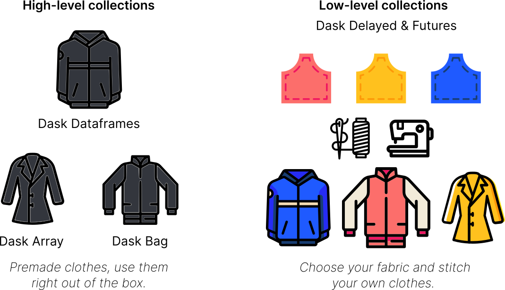
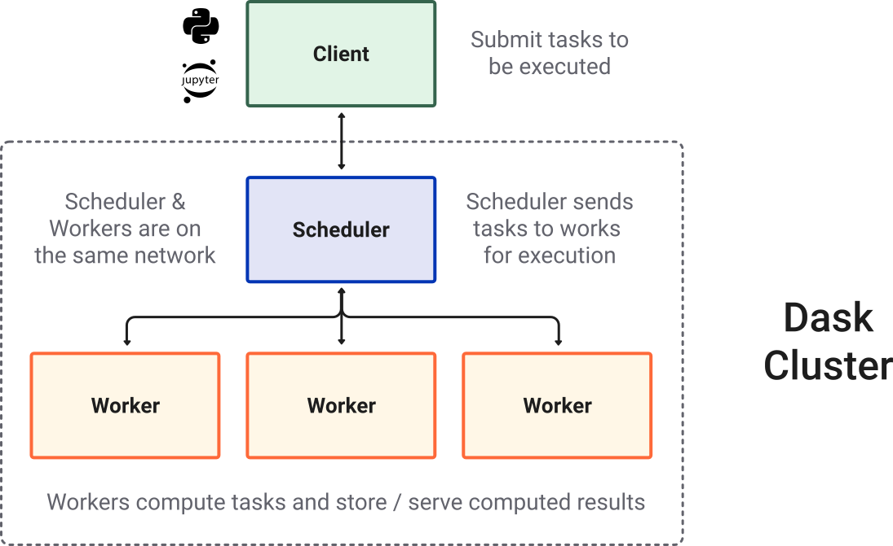
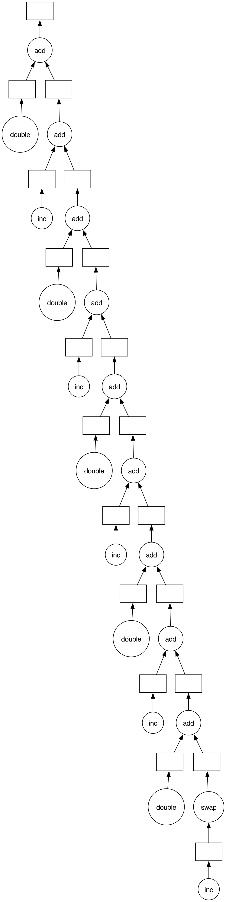
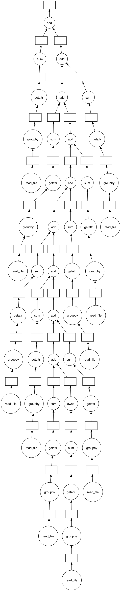

## Intro
{height=250}

- Dask is a parallel and distributed computing library that scales the existing Python and PyData ecosystem.
- Dask can scale up to your full laptop capacity and out to a cloud cluster.

## Installation
:::{.callout-note}
## With uv
```bash
uv add "dask[complete]"
uv add s3fs
uv add pyarrow
```
:::

## Data for this lecture
:::{.callout-important icon=false}
## Download and set `DATA_DIR`

Download `dask_data.zip` and unzip it anywhere. It contains the NYC flights CSVs (1990--1999), a 200k-row extract of the 2015 NYC taxi data, and `prep.py`, which generates the remaining datasets.

Every code cell below reads its data through one variable. Set it to the folder you unzipped into:

```{python}
import os

# Folder where you unzipped dask_data.zip -- change this to your own path
DATA_DIR = "_data/dask"
```
:::

```{python}
#| include: false
# Render only: use an absolute path and work inside the data folder,
# so that files written by .visualize() (mydask.png) stay out of the repo
DATA_DIR = os.path.abspath(DATA_DIR)
os.chdir(DATA_DIR)
```


## An example Dask computation {.font8 .scrollable}

:::{.callout-note icon=false}
## Example
In the following lines of code, we're reading the NYC taxi cab data from 2015 and finding the mean tip amount. 

1. Import
```{python}
import dask.dataframe as dd
from dask.distributed import Client
```

2. Create client.
```{python}
client = Client()
client
```

3. Read data.
```{python}
ddf = dd.read_parquet(
    os.path.join(DATA_DIR, "taxi.parquet"),  # 200k-row extract of the 2015 data
    columns=["passenger_count", "tip_amount"],
)
```

4. Groupby and mean
```{python}
result = ddf.groupby("passenger_count").tip_amount.mean().compute()
result
```

```{python}
#| include: false
client.close()
```

:::

## What is [Dask]("https://www.dask.org/")?

:::{.callout-tip icon=false}
## Many parts
There are many parts to the "Dask" the project:

* Collections/API also known as "core-library".
* Distributed -- to create clusters
* Integrations and broader ecosystem
:::

## Dask Collections {.font8}

:::{.callout-warning icon=false}
## Overview
Dask provides **multi-core** and **distributed+parallel** execution on **larger-than-memory** datasets

{height=350}

*  **High-level collections:**  Dask provides high-level Array, Bag, and DataFrame
   collections that mimic NumPy, lists, and pandas but can operate in parallel on
   datasets that don't fit into memory.
* **Low-level collections:**  Dask also provides low-level Delayed and Futures
   collections that give you finer control to build custom parallel and distributed computations.

:::

## Dask Cluster

:::{.callout-important icon=false}
## Cluster
Most of the times when you are using Dask, you will be using a distributed scheduler, which exists in the context of a Dask cluster. The Dask cluster is structured as:
:::


## Dask Ecosystem

:::{.callout-tip icon=false}
## Libraries
In addition to the core Dask library and its distributed scheduler, the Dask ecosystem connects several additional initiatives, including:

- Dask-ML (parallel scikit-learn-style API)
- Dask-image
- Dask-cuDF
- Dask-sql
- Dask-snowflake
- Dask-mongo
- Dask-bigquery
:::

## Dask Ecosystem {.font8 .scrollable}

:::{.callout-tip icon=false}
## Community ibraries
Community libraries that have built-in dask integrations like:

- Xarray
- XGBoost
- Prefect
- Airflow

Dask deployment libraries

- Dask-kubernetes
- Dask-YARN
- Dask-gateway
- Dask-cloudprovider
- jobqueue
:::

## Dask Use Cases

:::{.callout-tip icon=false}
## Use cases
Dask is used in multiple fields such as:

* Geospatial
* Finance
* Astrophysics
* Microbiology
* Environmental science

Check out the Dask [use cases](https://stories.dask.org/en/latest/) page that provides a number of sample workflows.
:::

# Dataframe

## Dask DataFrame - parallelized pandas

:::{.callout-tip icon=false}
## Description

Looks and feels like the pandas API, but for parallel and distributed workflows. 

- At its core, the `dask.dataframe` module implements a "blocked parallel" `DataFrame` object that looks and feels like the pandas API, but for parallel and distributed workflows.

- One Dask `DataFrame` is comprised of many in-memory pandas `DataFrame`s separated along the index.

- One operation on a Dask `DataFrame` triggers many pandas operations on the constituent pandas `DataFrame`s in a way that is mindful of potential parallelism and memory constraints.
:::

## Dask DataFrame


## Dask DataFrame
:::{.callout-important icon=false}
## Related Documentation

* [DataFrame documentation](https://docs.dask.org/en/latest/dataframe.html)
* [DataFrame screencast](https://youtu.be/AT2XtFehFSQ)
* [DataFrame API](https://docs.dask.org/en/latest/dataframe-api.html)
* [DataFrame examples](https://examples.dask.org/dataframe.html)
* [pandas documentation](https://pandas.pydata.org/pandas-docs/stable/)
:::

## DataFrame
:::{.callout-note icon=false}
## When to use `dask.dataframe`

pandas is great for tabular datasets that fit in memory. A general rule of thumb for pandas is:

> "Have 5 to 10 times as much RAM as the size of your dataset"

> ~ Wes McKinney (2017) in [10 things I hate about pandas](https://wesmckinney.com/blog/apache-arrow-pandas-internals/)

Here "size of dataset" means dataset size on _the disk_.

Dask becomes useful when the datasets exceed the above rule.

In this notebook, you will be working with the New York City Airline data. This dataset is only ~200MB, so that you can download it in a reasonable time, but `dask.dataframe` will scale to  datasets **much** larger than memory.
:::

## DataFrame {.scrollable}
:::{.callout-important icon=false}
## Create datasets

Create the datasets you will be using in this notebook:

```{python}
%run {DATA_DIR}/prep.py -d flights
```
:::

:::{.callout-tip icon=false}
## Set up your local cluster

Create a local Dask cluster and connect it to the client. 

```{python}
from dask.distributed import Client

client = Client(n_workers=4)
client
```
:::


## DataFrame
:::{.callout-tip icon=false}
## Dask Diagnostic Dashboard

Dask Distributed provides a useful Dashboard to visualize the state of your cluster and computations.

Click on the dashboard link displayed in the Client details above: <http://127.0.0.1:8787/status>. It will open a new browser tab with the Dashboard.
:::

## DataFrame {.scrollable}
:::{.callout-tip icon=false}
## Reading and working with datasets

Let's read an extract of flights in the USA across several years. This data is specific to flights out of the three airports in the New York City area.

```{python}
import os
import dask
```

By convention, we import the module `dask.dataframe` as `dd`, and call the corresponding `DataFrame` object `ddf`.
:::

:::{.callout-note}
The term "Dask DataFrame" is slightly overloaded. Depending on the context, it can refer to the module or the DataFrame object. To avoid confusion:

- `dask.dataframe` (note the all lowercase) refers to the API, and
- `DataFrame` (note the CamelCase) refers to the object.
:::

## DataFrame {.scrollable}
:::{.callout-tip icon=false}
## Reading and working with datasets
The following filename includes a glob pattern `*`, so all files in the path matching that pattern will be read into the same `DataFrame`.

```{python}
import dask.dataframe as dd
import pandas as pd

# pandas 3 removed parse_dates={"Date": [0, 1, 2]}; build the same Date column per partition
def add_date(df):
    date = pd.to_datetime(
        df[["Year", "Month", "DayofMonth"]].rename(columns={"DayofMonth": "Day"}),
        errors="coerce",
    )
    return df.drop(columns=["Year", "Month", "DayofMonth"]).assign(Date=date)


ddf = dd.read_csv(os.path.join(DATA_DIR, "nycflights", "*.csv"))
ddf = ddf.map_partitions(add_date)
ddf
```
:::

## DataFrame
:::{.callout-tip icon=false}
## What happened?

Dask has not loaded the data yet, it has:

- investigated the input path and found that there are ten matching files
- intelligently created a set of jobs for each chunk -- one per original CSV file in this case
:::

:::{.callout-note}
Notice that the representation of the `DataFrame` object contains no data - Dask has just done enough to read the start of the first file, and infer the column names and `dtype`s.
:::

## DataFrame {.scrollable}
:::{.callout-tip icon=false}
## Lazy Evaluation

Most Dask Collections, including Dask `DataFrame` are evaluated lazily, which means Dask constructs the logic (called task graph) of your computation immediately but "evaluates" them  only when necessary.

You can view this task graph using `.visualize()`.


```{python}
ddf.visualize()
```

Note that we need to call `.compute()` to trigger actual computations.
:::

## DataFrame {.scrollable}
:::{.callout-tip icon=false}
## Lazy Evaluation

Some functions like `len` and `head` also trigger a computation. Specifically, calling `len` will:

- load actual data, (that is, load each file into a pandas DataFrame)
- then apply the corresponding functions to each pandas DataFrame (also known as a partition)
- combine the subtotals to give you the final grand total

```python
# load and count number of rows
len(ddf)
```
:::

:::{.callout-note}
Not run here: with current pandas (3.x), reading every file already hits the dtype problem shown for `ddf.tail()` on the next slides. `len(ddf)` is run after the fix.
:::

## DataFrame {.scrollable}
:::{.callout-tip icon=false}
## Lazy Evaluation
You can view the start and end of the data as you would in pandas:

```{python}
ddf.head()
```

```{python}
#| error: true
ddf.tail()

# ValueError: Mismatched dtypes found in `pd.read_csv`/`pd.read_table`.

# +----------------+---------+----------+
# | Column         | Found   | Expected |
# +----------------+---------+----------+
# | CRSElapsedTime | float64 | int64    |
# | TailNum        | object  | float64  |
# +----------------+---------+----------+

# The following columns also raised exceptions on conversion:

# - TailNum
#   ValueError("could not convert string to float: 'N54711'")

# Usually this is due to dask's dtype inference failing, and
# *may* be fixed by specifying dtypes manually by adding:

# dtype={'CRSElapsedTime': 'float64',
#        'TailNum': 'object'}

# to the call to `read_csv`/`read_table`.

```
:::

## DataFrame {.scrollable}
:::{.callout-tip icon=false}
## Handling conflicting types

Unlike `pandas.read_csv` which reads in the entire file before inferring datatypes, `dask.dataframe.read_csv` only reads in a sample from the beginning of the file (or first file if using a glob). These inferred datatypes are then enforced when reading all partitions.

In this case, the datatypes inferred in the sample are incorrect. The first `n` rows have no value for `CRSElapsedTime` (which pandas infers as a `float`), and later on turn out to be strings (`object` dtype). When this happens you have a few options:

- Specify dtypes directly using the `dtype` keyword. This is the recommended solution, as it's the least error prone (better to be explicit than implicit) and also the most performant.
- Increase the size of the `sample` keyword (in bytes)
- Use `assume_missing` to make `dask` assume that columns inferred to be `int` (which don't allow missing values) are actually `floats` (which do allow missing values). In our particular case this doesn't apply.
:::

## DataFrame {.scrollable}
:::{.callout-tip icon=false}
## Handling conflicting types

In our case we'll use the first option and directly specify the `dtypes` of the offending columns. 

```{python}
ddf = dd.read_csv(
    os.path.join(DATA_DIR, "nycflights", "*.csv"),
    dtype={"TailNum": str, "CRSElapsedTime": float, "Cancelled": bool},
)
ddf = ddf.map_partitions(add_date)
```

```{python}
ddf.tail()  # now works
```

```{python}
len(ddf)  # and so does counting the rows
```
:::

## DataFrame {.scrollable}
:::{.callout-tip icon=false}
## Reading from remote storage

If you're thinking about distributed computing, your data is probably stored remotely on services (like Amazon's S3 or Google's cloud storage) and is in a friendlier format (like Parquet). Dask can read data in various formats directly from these remote locations **lazily** and **in parallel**.

Here's how you can read the NYC taxi cab data from Amazon S3:

```python
ddf = dd.read_parquet(
    "s3://nyc-tlc/trip data/yellow_tripdata_2012-*.parquet",
)
```

Not executed here: the `nyc-tlc` bucket is no longer publicly readable (it now returns *Access Denied*).

You can also leverage Parquet-specific optimizations like column selection and metadata handling, learn more in [the Dask documentation on working with Parquet files](https://docs.dask.org/en/stable/dataframe-parquet.html).
:::

## DataFrame {.scrollable}
:::{.callout-tip icon=false}
## Computations with `dask.dataframe`

Let's compute the maximum of the flight delay.

With just pandas, we would loop over each file to find the individual maximums, then find the final maximum over all the individual maximums.

```{python}
import pandas as pd

files = os.listdir(os.path.join(DATA_DIR, 'nycflights'))

maxes = []

for file in files:
    df = pd.read_csv(os.path.join(DATA_DIR, 'nycflights', file))
    maxes.append(df.DepDelay.max())
    
final_max = max(maxes)
```
:::

## DataFrame {.scrollable}
:::{.callout-tip icon=false}
## Computations with `dask.dataframe`
`dask.dataframe` lets us write pandas-like code, that operates on larger-than-memory datasets in parallel.

```{python}
%%time
result = ddf.DepDelay.max()
result.compute()
```

This creates the lazy computation for us and then runs it.  
:::

## DataFrame {.scrollable}
:::{.callout-note}
## Computations with `dask.dataframe`

Dask will delete intermediate results (like the full pandas DataFrame for each file) as soon as possible. This means you can handle datasets that are larger than memory but, repeated computations will have to load all of the data in each time. (Run the code above again, is it faster or slower than you would expect?)

You can view the underlying task graph using `.visualize()`:

```{python}
# notice the parallelism
result.visualize()
```
:::

## DataFrame {.scrollable}
:::{.callout-tip icon=false}
## Exercises

1. How many rows are in our dataset?

```{python}
# Your code here
```

<!-- ```python -->
<!-- #| jupyter: {source_hidden: true} -->
<!-- #| tags: [] -->
<!-- len(ddf) -->
<!-- ``` -->

2. In total, how many non-canceled flights were taken?

_Hint_: use [boolean indexing](https://pandas.pydata.org/pandas-docs/stable/indexing.html#boolean-indexing).

```{python}
# Your code here
```

<!-- ```python -->
<!-- #| jupyter: {source_hidden: true} -->
<!-- #| tags: [] -->
<!-- len(ddf[~ddf.Cancelled]) -->
<!-- ``` -->
:::

## DataFrame {.scrollable}
:::{.callout-tip icon=false}
## Exercises
3. In total, how many non-canceled flights were taken from each airport?

*Hint*: use [groupby](https://pandas.pydata.org/pandas-docs/stable/groupby.html).

```{python}
# Your code here
```

<!-- ```python -->
<!-- #| jupyter: {source_hidden: true} -->
<!-- #| tags: [] -->
<!-- ddf[~ddf.Cancelled].groupby("Origin").Origin.count().compute() -->
<!-- ``` -->

4. What was the average departure delay from each airport?

```{python}
# Your code here
```

<!-- ```python -->
<!-- #| jupyter: {source_hidden: true} -->
<!-- #| tags: [] -->
<!-- ddf.groupby("Origin").DepDelay.mean().compute() -->
<!-- ``` -->
:::

## DataFrame {.scrollable}
:::{.callout-tip icon=false}
## Exercises

5. What day of the week has the worst average departure delay?

```{python}
# Your code here
```

<!-- ```python -->
<!-- #| jupyter: {source_hidden: true} -->
<!-- #| tags: [] -->
<!-- ddf.groupby("DayOfWeek").DepDelay.mean().idxmax().compute() -->
<!-- ``` -->

6. Let's say the distance column is erroneous and you need to add 1 to all values, how would you do this?

```{python}
# Your code here
```

<!-- ```python -->
<!-- #| jupyter: {source_hidden: true} -->
<!-- #| tags: [] -->
<!-- ddf["Distance"].apply( -->
<!--     lambda x: x + 1 -->
<!-- ).compute()  # don't worry about the warning, we'll discuss in the next sections -->

<!-- # OR -->

<!-- (ddf["Distance"] + 1).compute() -->
<!-- ``` -->
:::

## DataFrame {.scrollable}
:::{.callout-tip icon=false}
## Sharing Intermediate Results

When computing all of the above, we sometimes did the same operation more than once. For most operations, `dask.dataframe` stores the arguments, allowing duplicate computations to be shared and only computed once.

For example, let's compute the mean and standard deviation for departure delay of all non-canceled flights. 

If you compute them with two calls to compute, there is no sharing of intermediate computations.

```{python}
non_canceled = ddf[~ddf.Cancelled]
mean_delay = non_canceled.DepDelay.mean()
std_delay = non_canceled.DepDelay.std()
```

```{python}
%%time

mean_delay_res = mean_delay.compute()
std_delay_res = std_delay.compute()
```
:::

## DataFrame {.scrollable}
:::{.callout-tip icon=false}
## `dask.compute`

But let's try by passing both to a single `compute` call.

```{python}
%%time

mean_delay_res, std_delay_res = dask.compute(mean_delay, std_delay)
```

Using `dask.compute` takes roughly 1/2 the time. This is because the task graphs for both results are merged when calling `dask.compute`, allowing shared operations to only be done once instead of twice. In particular, using `dask.compute` only does the following once:

- the calls to `read_csv`
- the filter (`df[~df.Cancelled]`)
- some of the necessary reductions (`sum`, `count`)
:::

## DataFrame {.scrollable}
:::{.callout-tip icon=false}
## Visualization

- To see what the merged task graphs between multiple results look like (and what's shared), you can use the `dask.visualize` function
- you might want to use `filename='graph.pdf'` to save the graph to disk so that you can zoom in more easily

```python
dask.visualize(mean_delay, std_delay, engine="cytoscape")
```
:::

:::{.callout-warning}
Not executed here: with current Dask (2026.x), `dask.visualize` on **several** DataFrame collections raises `NotImplementedError`. A single one still works, e.g. `mean_delay.visualize()`.
:::

## DataFrame {.scrollable}
:::{.callout-tip icon=false}
## `.persist()`

While using a distributed scheduler (you will learn more about schedulers in the upcoming notebooks), you can keep some _data that you want to use often_ in the _distributed memory_. 

`persist` generates "Futures" (more on this later as well) and stores them in the same structure as your output. You can use `persist` with any data or computation that fits in memory.

If you want to analyze data only for non-canceled flights departing from JFK airport, you can either have two compute calls like in the previous section:

```{python}
non_cancelled = ddf[~ddf.Cancelled]
ddf_jfk = non_cancelled[non_cancelled.Origin == "JFK"]
```

```{python}
%%time
ddf_jfk.DepDelay.mean().compute()
ddf_jfk.DepDelay.sum().compute()
```
:::

## DataFrame {.scrollable}
:::{.callout-tip icon=false}
## `.persist()`
Or, consider persisting that subset of data in memory.

See the "Graph" dashboard plot, the red squares indicate persisted data stored as Futures in memory. You will also notice an increase in Worker Memory (another dashboard plot) consumption.

```{python}
ddf_jfk = ddf_jfk.persist()  # returns back control immediately
```

```{python}
%%time
ddf_jfk.DepDelay.mean().compute()
ddf_jfk.DepDelay.std().compute()
```

Analyses on this persisted data is faster because we are not repeating the loading and selecting (non-canceled, JFK departure) operations.
:::

## DataFrame
:::{.callout-warning icon=false}
## Custom code with Dask DataFrame

`dask.dataframe` only covers a small but well-used portion of the pandas API.

This limitation is for two reasons:

1.  The Pandas API is *huge*
2.  Some operations are genuinely hard to do in parallel, e.g, sorting.

Additionally, some important operations like `set_index` work, but are slower than in pandas because they include substantial shuffling of data, and may write out to disk.
:::

## DataFrame
:::{.callout-tip icon=false}
## Solutions
In case it's a custom function or tricky to implement, `dask.dataframe` provides a few methods to make applying custom functions to Dask DataFrames easier:

- [`map_partitions`](https://docs.dask.org/en/latest/generated/dask.dataframe.DataFrame.map_partitions.html): to run a function on each partition (each pandas DataFrame) of the Dask DataFrame
- [`map_overlap`](https://docs.dask.org/en/latest/generated/dask.dataframe.rolling.map_overlap.html): to run a function on each partition (each pandas DataFrame) of the Dask DataFrame, with some rows shared between neighboring partitions
- [`reduction`](https://docs.dask.org/en/latest/generated/dask.dataframe.Series.reduction.html): for custom row-wise reduction operations.
:::

## DataFrame {.scrollable}
:::{.callout-tip icon=false}
## `map_partitions`
Let's take a quick look at the `map_partitions()` function:

```{python}
help(ddf.map_partitions)
```

The "Distance" column in `ddf` is currently in miles. Let's say we want to convert the units to kilometers and we have a general helper function as shown below. In this case, we can use `map_partitions` to apply this function across each of the internal pandas `DataFrame`s in parallel. 

```{python}
def my_custom_converter(df, multiplier=1):
    return df * multiplier


meta = pd.Series(name="Distance", dtype="float64")

distance_km = ddf.Distance.map_partitions(
    my_custom_converter, multiplier=0.6, meta=meta
)
```

```{python}
distance_km.visualize()
```

```{python}
distance_km.head()
```
:::

## DataFrame
:::{.callout-tip icon=false}
## What is `meta`?

Since Dask operates lazily, it doesn't always have enough information to infer the output structure (which includes datatypes) of certain operations.

`meta` is a _suggestion_ to Dask about the output of your computation. Importantly, `meta` _never infers with the output structure_. Dask uses this `meta` until it can determine the actual output structure.

Even though there are many ways to define `meta`, we suggest using a small pandas Series or DataFrame that matches the structure of your final output.
:::

## Close you local Dask Cluster {.scrollable}

:::{.callout-important}
It's good practice to always close any Dask cluster you create:

```{python}
client.shutdown()
```
:::

# Dask Arrays

## Dask Arrays
:::{.callout-note icon=false}
## Dask Arrays - parallelized numpy
Parallel, larger-than-memory, n-dimensional array using blocked algorithms. 

*  **Parallel**: Uses all of the cores on your computer
*  **Larger-than-memory**:  Lets you work on datasets that are larger than your available memory by breaking up your array into many small pieces, operating on those pieces in an order that minimizes the memory footprint of your computation, and effectively streaming data from disk.
*  **Blocked Algorithms**:  Perform large computations by performing many smaller computations.
:::

## Dask Arrays
:::{.callout-note icon=false}
## Dask Arrays - parallelized numpy


:::

## Dask Arrays
:::{.callout-note icon=false}
## Related Documentation

* [Array documentation](https://docs.dask.org/en/latest/array.html)
* [Array screencast](https://youtu.be/9h_61hXCDuI)
* [Array API](https://docs.dask.org/en/latest/array-api.html)
* [Array examples](https://examples.dask.org/array.html)
:::


## Dask Arrays {.scrollable}
:::{.callout-note icon=false}
## Create datasets

Create the datasets you will be using in this notebook:

```{python}
%run {DATA_DIR}/prep.py -d random
```
:::

## Dask Arrays {.scrollable}
:::{.callout-note icon=false}
## Start the Client

```{python}
from dask.distributed import Client

client = Client(n_workers=4)
client
```
:::

## Dask Arrays {.scrollable}
:::{.callout-note icon=false}
## Blocked Algorithms in a nutshell

Let's do side by side the sum of the elements of an array using a NumPy array and a Dask array. 

```{python}
import numpy as np
import dask.array as da
```

```{python}
# NumPy array
a_np = np.ones(10)
a_np
```
:::

## Dask Arrays {.scrollable}
:::{.callout-note icon=false}
## Blocked Algorithms in a nutshell
We know that we can use `sum()` to compute the sum of the elements of our array, but to show what a blocksized operation would look like, let's do:

```{python}
a_np_sum = a_np[:5].sum() + a_np[5:].sum()
a_np_sum
```

Now notice that each sum in the computation above is completely independent so they could be done in parallel. 
To do this with Dask array, we need to define our "slices", we do this by defining the amount of elements we want per block using the variable `chunks`. 

```{python}
a_da = da.ones(10, chunks=5)
a_da
```
:::

## Dask Arrays {.scrollable}
:::{.callout-important}

Note here that to get two blocks, we specify `chunks=5`, in other words, we have 5 elements per block. 

```{python}
a_da_sum = a_da.sum()
a_da_sum
```
:::

## Dask Arrays {.scrollable}
:::{.callout-note icon=false}
## Task Graphs

```{python}
# visualize the low level Dask graph using cytoscape
a_da_sum.visualize(engine="cytoscape")
```

And then compute:
```{python}
a_da_sum.compute()
```
:::

## Dask Arrays {.scrollable}
:::{.callout-note icon=false}
## Performance comparison

Let's try a more interesting example. We will create a 20_000 x 20_000 array with normally distributed values, and take the mean along one of its axis.

#### Numpy version 

```python
%%time
xn = np.random.normal(10, 0.1, size=(30_000, 30_000))
yn = xn.mean(axis=0)
yn
```

#### Dask array version

```{python}
xd = da.random.normal(10, 0.1, size=(30_000, 30_000), chunks=(3000, 3000))
xd
```

```{python}
xd.nbytes / 1e9  # Gigabytes of the input processed lazily
```

```{python}
yd = xd.mean(axis=0)
yd
```
:::

## Dask Arrays
:::{.callout-note icon=false}
## Performance comparison

```python
%%time
xd = da.random.normal(10, 0.1, size=(30_000, 30_000), chunks=(3000, 3000))
yd = xd.mean(axis=0)
yd.compute()
```
:::

## Dask Arrays {.scrollable}
:::{.callout-note icon=false}
## Exercise

* What happens if the Dask chunks=(10000,10000)?
* What happens if the Dask chunks=(30,30)?
* For Dask arrays, compute the mean along `axis=1` of the sum of the x array and its transpose. 

```{python}
# Your code here
```

<!-- **Solution** -->

<!-- ```python -->
<!-- #| jupyter: {source_hidden: true} -->
<!-- #| tags: [] -->
<!-- x_sum = xd + xd.T -->
<!-- res = x_sum.mean(axis=1) -->
<!-- res.compute() -->
<!-- ``` -->
:::

## Dask Arrays {.scrollable}
:::{.callout-note icon=false}
## Choosing good chunk sizes

We can think of Dask arrays as a big structure composed by chunks of a smaller size, where these chunks are typically an a single `numpy` array, and they are all arranged to form a larger Dask array. 

If you have a Dask array and want to know more information about chunks and their size, you can use the `chunksize` and `chunks` attributes to access this information. If you are in a jupyter notebook
you can also visualize the Dask array via its HTML representation. 

```{python}
darr = da.random.random((1000, 1000, 1000))
darr
```
:::

## Dask Arrays {.scrollable}
:::{.callout-note icon=false}
## Choosing good chunk sizes
Notice that when we created the Dask array, we did not specify the `chunks`. Dask has set by default `chunks='auto'` which accommodates ideal chunk  sizes. To learn more on how auto-chunking works you can go to this documentation [here](https://docs.dask.org/en/stable/array-chunks.html#automatic-chunking).

- `darr.chunksize` shows the largest chunk size.
- But if your array have irregular chunks, `darr.chunks` will show you the explicit sizes of all the chunks along all the dimensions of your dask array.

```{python}
darr.chunksize
```

```{python}
darr.chunks
```
:::

## Dask Arrays {.scrollable}
:::{.callout-note icon=false}
## Choosing good chunk sizes
Let's modify our example to see explore chunking a bit more. We can rechunk our array:

```{python}
darr = darr.rechunk({0: -1, 1: 100, 2: "auto"})
```

```{python}
darr
```

```{python}
darr.chunksize
```

```{python}
darr.chunks
```
:::

## Dask Arrays
:::{.callout-note icon=false}
## Exercise

- What does -1 do when specify as the chunk on a certain axis?
:::

## Dask Arrays
:::{.callout-warning icon=false}
## Too small is a problem

- If your chunks are too small, the amount of actual work done by every task is very tiny, and the overhead of coordinating all these tasks results in a very inefficient process. 

- In general, the dask scheduler takes approximately one millisecond to coordinate a single task. That means we want the computation time to be comparatively large, i.e in the order of seconds. 
:::

## Dask Arrays {.scrollable}
:::{.callout-important icon=false}
## Too big is a problem

- If your chunks are too big, this is also a problem because you will likely run out of memory.
- You will start seeing in the dashboard that data is being spill to disk and this will lead to performance decrements. 

- If we load to much data into memory, Dask workers will start to spill data to disk to avoid crashing.
- To watch out for this you can look at the worker memory plot on the dashboard.
- Orange bars are a warning you are close to the limit, and gray means data is being spilled to disk. 

:::

## Dask Arrays {.scrollable}
:::{.callout-note icon=false}
## Rules of thumb

- Users have reported that chunk sizes smaller than 1MB tend to be bad. In general, a chunk size between **100MB and 1GB is good**, while going over 1 or 2GB means you have a really big dataset and/or a lot of memory available per worker.
- Upper bound: Avoid very large task graphs. More than 10,000 or 100,000 chunks may start to perform poorly.
- Lower bound: To get the advantage of parallelization, you need the number of chunks to at least equal the number of worker cores available (or better, the number of worker cores times 2). Otherwise, some workers will stay idle.
- The time taken to compute each task should be much larger than the time needed to schedule the task. The Dask scheduler takes roughly 1 millisecond to coordinate a single task, so a good task computation time would be in the order of seconds (not milliseconds).
- Chunks should be aligned with array storage on disk. Modern NDArray storage formats (HDF5, NetCDF, TIFF, Zarr) allow arrays to be stored in chunks so that the blocks of data can be pulled efficiently. However, data stores often chunk more finely than is ideal for Dask array, so it is common to choose a chunking that is a multiple of your storage chunk size, otherwise you might incur high overhead. For example,  if you are loading data that is chunked in blocks of (100, 100), the  you might might choose a chunking strategy more like (1000, 2000) that is larger but still divisible by (100, 100). 

For more more advice on chunking see <https://docs.dask.org/en/stable/array-chunks.html>
:::

## Dask Arrays {.scrollable}
:::{.callout-note icon=false}
## Example of chunked data with Zarr

Zarr is a format for the storage of chunked, compressed, N-dimensional arrays. Zarr provides classes and functions for working with N-dimensional arrays that behave like NumPy arrays (Dask array behave like Numpy arrays) but whose data is divided into chunks and each chunk is compressed. If you are already familiar with HDF5 then Zarr arrays provide similar functionality, but with some additional flexibility.

For extra material check the [Zarr tutorial](https://zarr.readthedocs.io/en/stable/tutorial.html)

**Let's read an array from zarr:**

```{python}
import zarr
```

```{python}
a = da.from_zarr(os.path.join(DATA_DIR, "random.zarr"))
```

```{python}
a
```
:::

## Dask Arrays {.scrollable}
:::{.callout-note icon=false}
## Example of chunked data with Zarr
Notice that the array is already chunked, and we didn't specify anything when loading it. Now notice that the chunks have a nice chunk size, let's compute the mean and see how long it takes to run

```{python}
%%time
a.mean().compute()
```

Let's load a separate example where the `chunksize` is much smaller, and see what happen

```{python}
b = da.from_zarr(os.path.join(DATA_DIR, "random_sc.zarr"))
b
```

```python
%%time
b.mean().compute()
```
:::

## Dask Arrays {.scrollable}
:::{.callout-note icon=false}
## Exercise

Provide a `chunksize` when reading `b` that will improve the time of computation of the mean. Try multiple `chunks` values and see what happens.

```{python}
# Your code here
```

<!-- ```python -->
<!-- #| jupyter: {source_hidden: true} -->
<!-- #| tags: [] -->
<!-- # 1 possible Solution (imitate original). chunks will vary if you are in binder -->
<!-- c = da.from_zarr(os.path.join(DATA_DIR, "random_sc.zarr"), chunks=(6250000,)) -->
<!-- c -->
<!-- ``` -->

```{python}
#| include: false
c = da.from_zarr(os.path.join(DATA_DIR, "random_sc.zarr"), chunks=(6250000,))
```

```{python}
%%time
c.mean().compute()
```
:::


## Dask Arrays {.scrollable}
:::{.callout-note icon=false}
## Xarray  

In some applications we have multidimensional data, and sometimes working with all this dimensions can be confusing. Xarray is an open source project and Python package that makes working with labeled multi-dimensional arrays easier. 

Let's learn how to use xarray and Dask together:

```{python}
import xarray as xr
```

```{python}
ds = xr.tutorial.open_dataset(
    "air_temperature",
    chunks={  # this tells xarray to open the dataset as a dask array
        "lat": 25,
        "lon": 25,
        "time": -1,
    },
)
ds
```

```{python}
ds.air
```

```{python}
ds.air.chunks
```

```{python}
mean = ds.air.mean("time")  # no activity on dashboard
mean  # contains a dask array
```

```{python}
# we will see dashboard activity
mean.load()
```
:::

## Dask Arrays {.scrollable}
:::{.callout-note icon=false}
## Standard Xarray Operations

Let's grab the air variable and do some operations. Operations using xarray objects are identical, regardless if the underlying data is stored as a Dask array or a NumPy array.

```{python}
dair = ds.air
```

```{python}
dair2 = dair.groupby("time.month").mean("time")
dair_new = dair - dair2
dair_new
```

Call `.compute()` or `.load()` when you want your result as a `xarray.DataArray` with data stored as NumPy arrays.

```{python}
# things happen in the dashboard
dair_new.load()
```
:::

## Dask Arrays {.scrollable}
:::{.callout-note icon=false}
## Time Series Operations with xarray

Because we have a datetime index time-series operations work efficiently, for example we can do a resample and then plot the result.

```{python}
dair_resample = dair.resample(time="1w").mean("time").std("time")
```

```{python}
dair_resample.load().plot(figsize=(12, 8))
```
:::

## Dask Arrays
:::{.callout-note icon=false}
## Learn More 

Both xarray and zarr have their own tutorials that go into greater depth:

* [Zarr tutorial](https://zarr.readthedocs.io/en/stable/tutorial.html)
* [Xarray tutorial](https://tutorial.xarray.dev/intro.html)
:::

## Dask Arrays {.scrollable}
:::{.callout-note icon=false}
## Close your cluster

It's good practice to close any Dask cluster you create:

```{python}
client.shutdown()
```
:::

# Dask Delayed

## Dask Delayed {.scrollable}
:::{.callout-tip icon=false}
## `dask.delayed` - parallelize any code

What if you don't have an array or dataframe? Instead of having blocks where the function is applied to each block, you can decorate functions with `@delayed` and _have the functions themselves be lazy_.

This is a simple way to use `dask` to parallelize existing codebases or build [complex systems](https://blog.dask.org/2018/02/09/credit-models-with-dask).
:::

:::{.callout-important icon=false}
## Related Documentation

* [Delayed documentation](https://docs.dask.org/en/latest/delayed.html)
* [Delayed screencast](https://www.youtube.com/watch?v=SHqFmynRxVU)
* [Delayed API](https://docs.dask.org/en/latest/delayed-api.html)
* [Delayed examples](https://examples.dask.org/delayed.html)
* [Delayed best practices](https://docs.dask.org/en/latest/delayed-best-practices.html)
:::

## Dask Delayed {.scrollable}
:::{.callout-tip icon=false}
## Start the Client

Dask has several ways of executing code in parallel. We'll use the distributed scheduler by creating a `dask.distributed.Client`. For now, this will provide us with some nice diagnostics.

```{python}
from dask.distributed import Client

client = Client(n_workers=4)
client
```
:::

## Dask Delayed {.scrollable}
:::{.callout-tip icon=false}
## A Typical Workflow

Typically if a workflow contains a for-loop it can benefit from delayed. The following example outlines a read-transform-write:

```python
import dask
    
@dask.delayed
def process_file(filename):
    data = read_a_file(filename)
    data = do_a_transformation(data)
    destination = f"results/{filename}"
    write_out_data(data, destination)
    return destination

results = []
for filename in filenames:
    results.append(process_file(filename))
    
dask.compute(results)
```
:::

## Dask Delayed {.scrollable}
:::{.callout-tip icon=false}
## Basics

First let's make some toy functions, `inc` and `add`, that sleep for a while to simulate work. We'll then time running these functions normally.

```{python}
from time import sleep


def inc(x):
    sleep(1)
    return x + 1


def add(x, y):
    sleep(1)
    return x + y
```

We time the execution of this normal code using the `%%time` magic, which is a special function of the Jupyter Notebook.

```{python}
%%time
# This takes three seconds to run because we call each
# function sequentially, one after the other

x = inc(1)
y = inc(2)
z = add(x, y)
```
:::

## Dask Delayed {.scrollable}
:::{.callout-tip icon=false}
## Parallelize with the `dask.delayed` decorator

Those two increment calls *could* be called in parallel, because they are totally independent of one-another.

We'll make the `inc` and `add` functions lazy using the `dask.delayed` decorator. When we call the delayed version by passing the arguments, exactly as before, the original function isn't actually called yet - which is why the cell execution finishes very quickly.

Instead, a *delayed object* is made, which keeps track of the function to call and the arguments to pass to it.

```{python}
import dask


@dask.delayed
def inc(x):
    sleep(1)
    return x + 1


@dask.delayed
def add(x, y):
    sleep(1)
    return x + y
```
:::

## Dask Delayed {.scrollable}
:::{.callout-tip icon=false}
## Building the graph vs. computing it

```{python}
%%time
# This runs immediately, all it does is build a graph

x = inc(1)
y = inc(2)
z = add(x, y)
```

This ran immediately, since nothing has really happened yet.

To get the result, call `compute`. Notice that this runs faster than the original code.

```{python}
%%time
# This actually runs our computation using a local thread pool

z.compute()
```
:::

:::{.callout-note}
Building the graph takes milliseconds; `z.compute()` returns `5` after about **2 s** instead of 3 s.
:::

## Dask Delayed {.scrollable}
:::{.callout-tip icon=false}
## What just happened?

The `z` object is a lazy `Delayed` object. This object holds everything we need to compute the final result, including references to all of the functions that are required and their inputs and relationship to one-another. We can evaluate the result with `.compute()` as above or we can visualize the task graph for this value with `.visualize()`.

```{python}
z
```

```{python}
#| output: false   # the rendered graph is shown as an image below
# Look at the task graph for `z`
z.visualize()
```

Notice that this includes the names of the functions from before, and the logical flow of the outputs of the `inc` functions to the inputs of `add`.
:::

{height=400}

## Dask Delayed
:::{.callout-note icon=false}
## Exercise

-  Why did we go from 3s to 2s? Why weren't we able to parallelize down to 1s?
-  What would have happened if the inc and add functions didn't include the `sleep(1)`? Would Dask still be able to speed up this code?
-  What if we have multiple outputs or also want to get access to x or y?
:::

## Dask Delayed {.scrollable}
:::{.callout-tip icon=false}
## Exercise: Parallelize a for loop

`for` loops are one of the most common things that we want to parallelize. Use `dask.delayed` on `inc` and `sum` to parallelize the computation below:

```{python}
data = [1, 2, 3, 4, 5, 6, 7, 8]
```

```python
%%time
# Sequential code


def inc(x):
    sleep(1)
    return x + 1


results = []
for x in data:
    y = inc(x)
    results.append(y)

total = sum(results)
```

```{python}
#| include: false
# same result as the sequential loop above, without the sleeps
total = sum(x + 1 for x in data)
```

```{python}
total
```

```{python}
%%time
# Your parallel code here...
```

```{python}
#| include: false
@dask.delayed
def inc(x):
    sleep(1)
    return x + 1


results = []
for x in data:
    y = inc(x)
    results.append(y)

total = sum(results)
```


<!-- ```python -->
<!-- @dask.delayed -->
<!-- def inc(x): -->
<!--     sleep(1) -->
<!--     return x + 1 -->


<!-- results = [] -->
<!-- for x in data: -->
<!--     y = inc(x) -->
<!--     results.append(y) -->

<!-- total = sum(results) -->
<!-- print("Before computing:", total)  # Let's see what type of thing total is -->
<!-- result = total.compute() -->
<!-- print("After computing :", result)  # After it's computed -->
<!-- ``` -->
:::

## Dask Delayed {.scrollable}
:::{.callout-note icon=false}
## Delayed `sum`, or plain `sum`?

How do the graph visualizations compare with the given solution, compared to a version with the `sum` function used directly rather than wrapped with `delayed`? Can you explain the latter version? You might find the result of the following expression illuminating:

```{python}
inc(1) + inc(2)
```
:::

:::{.callout-tip}
Arithmetic on `Delayed` objects is itself delayed: `inc(1) + inc(2)` is another `Delayed`, not a number. So the built-in `sum` over a list of `Delayed` objects builds a chain of delayed `add` tasks.
:::

## Dask Delayed {.scrollable}
:::{.callout-tip icon=false}
## Exercise: Parallelize a for-loop code with control flow

Often we want to delay only *some* functions, running a few of them immediately. This is especially helpful when those functions are fast and help us to determine what other slower functions we should call. This decision, to delay or not to delay, is usually where we need to be thoughtful when using `dask.delayed`.

In the example below we iterate through a list of inputs. If that input is even then we want to call `inc`. If the input is odd then we want to call `double`. This `is_even` decision to call `inc` or `double` has to be made immediately (not lazily) in order for our graph-building Python code to proceed.

```{python}
def double(x):
    sleep(1)
    return 2 * x


def is_even(x):
    return not x % 2


data = [1, 2, 3, 4, 5, 6, 7, 8, 9, 10]
```
:::

## Dask Delayed {.scrollable}
:::{.callout-tip icon=false}
## Exercise: Parallelize a for-loop code with control flow

```python
%%time
# Sequential code

results = []
for x in data:
    if is_even(x):
        y = double(x)
    else:
        y = inc(x)
    results.append(y)

total = sum(results)
print(total)
```

```{python}
%%time
# Your parallel code here...
# TODO: parallelize the sequential code above using dask.delayed
# You will need to delay some functions, but not all
```

```{python}
#| include: false
@dask.delayed
def double(x):
    sleep(1)
    return 2 * x


results = []
for x in data:
    if is_even(x):  # even
        y = double(x)
    else:  # odd
        y = inc(x)
    results.append(y)

total = sum(results)
```


<!-- ```python -->
<!-- @dask.delayed -->
<!-- def double(x): -->
<!--     sleep(1) -->
<!--     return 2 * x -->


<!-- results = [] -->
<!-- for x in data: -->
<!--     if is_even(x):  # even -->
<!--         y = double(x) -->
<!--     else:  # odd -->
<!--         y = inc(x) -->
<!--     results.append(y) -->

<!-- total = sum(results) -->
<!-- ``` -->

```{python}
%time total.compute()
```

```{python}
#| output: false   # the rendered graph is shown as an image below
total.visualize()
```
:::

## Dask Delayed {.scrollable}

{width=1200}

## Dask Delayed
:::{.callout-note icon=false}
## Exercise

-  What are other examples of control flow where we can't use delayed?
-  What would have happened if we had delayed the evaluation of `is_even(x)` in the example above?
-  What are your thoughts on delaying `sum`? This function is both computational but also fast to run.
:::

## Dask Delayed {.scrollable}
:::{.callout-tip icon=false}
## Exercise: Parallelize a Pandas Groupby Reduction

In this exercise we read several CSV files and perform a groupby operation in parallel. We are given sequential code to do this and parallelize it with `dask.delayed`.

The computation we will parallelize is to compute the mean departure delay per airport from some historical flight data. We will do this by using `dask.delayed` together with `pandas`. In the DataFrame section we did this same exercise with `dask.dataframe`.
:::

:::{.callout-important icon=false}
## Create data

This downloads and extracts some historical flight data for flights out of NYC between 1990 and 2000. 

```{python}
%run {DATA_DIR}/prep.py -d flights
```
:::

## Dask Delayed {.scrollable}
:::{.callout-tip icon=false}
## Inspect data

```{python}
import os

sorted(os.listdir(os.path.join(DATA_DIR, "nycflights")))
```
:::

:::{.callout-tip icon=false}
## Read one file with `pandas.read_csv` and compute mean departure delay

```{python}
import pandas as pd

df = pd.read_csv(os.path.join(DATA_DIR, "nycflights", "1990.csv"))
df.head()
```

```{python}
# What is the schema?
df.dtypes
```

```{python}
# What originating airports are in the data?
df.Origin.unique()
```

```{python}
# Mean departure delay per-airport for one year
df.groupby("Origin").DepDelay.mean()
```
:::

## Dask Delayed {.scrollable}
:::{.callout-tip icon=false}
## Sequential code: Mean Departure Delay Per Airport

The above cell computes the mean departure delay per-airport for one year. Here we expand that to all years using a sequential for loop.

```{python}
from glob import glob

filenames = sorted(glob(os.path.join(DATA_DIR, "nycflights", "*.csv")))
```

```{python}
%%time

sums = []
counts = []
for fn in filenames:
    # Read in file
    df = pd.read_csv(fn)

    # Groupby origin airport
    by_origin = df.groupby("Origin")

    # Sum of all departure delays by origin
    total = by_origin.DepDelay.sum()

    # Number of flights by origin
    count = by_origin.DepDelay.count()

    # Save the intermediates
    sums.append(total)
    counts.append(count)

# Combine intermediates to get total mean-delay-per-origin
total_delays = sum(sums)
n_flights = sum(counts)
mean = total_delays / n_flights
```

```{python}
mean
```
:::

## Dask Delayed {.scrollable}
:::{.callout-tip icon=false}
## Exercise

Use `dask.delayed` to parallelize the code above. Some extra things you will need to know.

1.  Methods and attribute access on delayed objects work automatically, so if you have a delayed object you can perform normal arithmetic, slicing, and method calls on it and it will produce the correct delayed calls.
    
2.  Calling the `.compute()` method works well when you have a single output. When you have multiple outputs you might want to use the `dask.compute` function. This way Dask can share the intermediate values.
    
So your goal is to parallelize the code above using `dask.delayed`. You may also want to visualize a bit of the computation to see if you're doing it correctly.

```{python}
%%time
# your code here
```
:::

<!-- ```python -->
<!-- %%time -->

<!-- # This is just one possible solution, there are -->
<!-- # several ways to do this using `dask.delayed` -->


<!-- @dask.delayed -->
<!-- def read_file(filename): -->
<!--     # Read in file -->
<!--     return pd.read_csv(filename) -->


<!-- sums = [] -->
<!-- counts = [] -->
<!-- for fn in filenames: -->
<!--     # Delayed read in file -->
<!--     df = read_file(fn) -->

<!--     # Groupby origin airport -->
<!--     by_origin = df.groupby("Origin") -->

<!--     # Sum of all departure delays by origin -->
<!--     total = by_origin.DepDelay.sum() -->

<!--     # Number of flights by origin -->
<!--     count = by_origin.DepDelay.count() -->

<!--     # Save the intermediates -->
<!--     sums.append(total) -->
<!--     counts.append(count) -->

<!-- # Combine intermediates to get total mean-delay-per-origin -->
<!-- total_delays = sum(sums) -->
<!-- n_flights = sum(counts) -->
<!-- mean, *_ = dask.compute(total_delays / n_flights) -->
<!-- ``` -->

<!-- ```python -->
<!-- (sum(sums)).visualize() -->
<!-- ``` -->

<!-- ```python -->
<!-- # ensure the results still match -->
<!-- mean -->
<!-- ``` -->

## Dask Delayed {.scrollable}

{width=350}

## Dask Delayed
:::{.callout-note icon=false}
## Exercise

- How much speedup did you get? Is this how much speedup you'd expect?
- Experiment with where to call `compute`. What happens when you call it on `sums` and `counts`? What happens if you wait and call it on `mean`?
- Experiment with delaying the call to `sum`. What does the graph look like if `sum` is delayed? What does the graph look like if it isn't?
- Can you think of any reason why you'd want to do the reduction one way over the other?
:::

## Dask Delayed {.scrollable}
:::{.callout-important icon=false}
## Learn More

Visit the [Delayed documentation](https://docs.dask.org/en/latest/delayed.html). In particular, this [delayed screencast](https://www.youtube.com/watch?v=SHqFmynRxVU) will reinforce the concepts you learned here and the [delayed best practices](https://docs.dask.org/en/latest/delayed-best-practices.html) document collects advice on using `dask.delayed` well.
:::

:::{.callout-note icon=false}
## Close the Client

Before moving on to the next exercise, make sure to close your client or stop this kernel.

```{python}
client.close()
```
:::

# Futures

## Futures {.scrollable}
:::{.callout-tip icon=false}
## Futures - non-blocking distributed calculations

Submit arbitrary functions for computation in a parallelized, eager, and non-blocking way.

- provides fine-grained real-time execution for custom situations
- we can submit individual functions for evaluation with one set of inputs, or evaluated over a sequence of inputs with `submit()` and `map()`
- the call returns immediately, giving one or more *futures*, whose status begins as "pending" and later becomes "finished"
- there is no blocking of the local Python session.
:::

## Futures {.scrollable}
:::{.callout-important icon=false}
## Lazy vs. eager

Both can be used to support arbitrary task scheduling, however:

- delayed is **lazy** (it just constructs a graph)
- futures are **eager.**

With futures, as soon as the inputs are available and there is compute available, the computation starts.
:::

## Futures {.scrollable}
:::{.callout-important icon=false}
## Related Documentation

* [Futures documentation](https://docs.dask.org/en/latest/futures.html)
* [Futures screencast](https://www.youtube.com/watch?v=07EiCpdhtDE)
* [Futures examples](https://examples.dask.org/futures.html)
:::

:::{.callout-tip icon=false}
## Start the Client

Futures need the distributed scheduler: they live on a cluster.

```{python}
from dask.distributed import Client

client = Client(n_workers=4)
client
```
:::

## Futures {.scrollable}
:::{.callout-tip icon=false}
## A Typical Workflow

This is the same workflow that we saw in the delayed section. It is for-loopy and the data is not necessarily an array or a dataframe. The following example outlines a read-transform-write:

```python
def process_file(filename):
    data = read_a_file(filename)
    data = do_a_transformation(data)
    destination = f"results/{filename}"
    write_out_data(data, destination)
    return destination

futures = []
for filename in filenames:
    future = client.submit(process_file, filename)
    futures.append(future)
    
futures
```
:::

:::{.callout-note}
Compare with the delayed version: no decorator, and no `dask.compute` at the end. Each `client.submit` starts work immediately.
:::

## Futures {.scrollable}
:::{.callout-tip icon=false}
## Basics

Just like we did in the delayed section, let's make some toy functions, `inc` and `add`, that sleep for a while to simulate work.

```{python}
from time import sleep


def inc(x):
    sleep(1)
    return x + 1


def double(x):
    sleep(2)
    return 2 * x


def add(x, y):
    sleep(1)
    return x + y
```

We can run these locally

```{python}
inc(1)
```
:::

## Futures {.scrollable}
:::{.callout-tip icon=false}
## Submitting a function

Or we can submit them to run remotely with Dask. This immediately returns a future that points to the ongoing computation, and eventually to the stored result.

```{python}
future = client.submit(inc, 1)  # returns immediately with pending future
future
```

If you wait a second, and then check on the future again, you'll see that it has finished.

```{python}
#| include: false
sleep(1.5)  # let the submitted task finish
```

```{python}
future
```

You can block on the computation and gather the result with the `.result()` method.

```{python}
future.result()
```
:::

## Futures {.scrollable}
:::{.callout-tip icon=false}
## Other ways to wait for a future

```python
from dask.distributed import wait, progress
progress(future)
```

shows a progress bar in *this* notebook, rather than having to go to the dashboard. This progress bar is also asynchronous, and doesn't block the execution of other code in the meanwhile.

```python
wait(future)
```

blocks and forces the notebook to wait until the computation pointed to by `future` is done. However, note that if the result of `inc()` is sitting in the cluster, it would take **no time** to execute the computation now, because Dask notices that we are asking for the result of a computation it already knows about.
:::

:::{.callout-note icon=false}
## Other ways to gather results

```python
client.gather(futures)
```

gathers results from more than one future.
:::

## Futures {.scrollable}
:::{.callout-tip icon=false}
## `client.compute`

Generally, any Dask operation that is executed using `.compute()` or `dask.compute()` can be submitted for asynchronous execution using `client.compute()` instead.

Here is an example from the delayed section:

```{python}
import dask


@dask.delayed
def inc(x):
    sleep(1)
    return x + 1


@dask.delayed
def add(x, y):
    sleep(1)
    return x + y


x = inc(1)
y = inc(2)
z = add(x, y)
```
:::

## Futures {.scrollable}
:::{.callout-tip icon=false}
## `client.compute`

So far we have a regular `dask.delayed` output. When we pass `z` to `client.compute` we get a future back and Dask starts evaluating the task graph.

```{python}
# notice the difference from z.compute()
# notice that this cell completes immediately
future = client.compute(z)
future
```

```{python}
future.result()  # waits until result is ready
```

When using futures, the *computation moves to the data* rather than the other way around, and the client, in the local Python session, need never see the intermediate values.
:::

## Futures {.scrollable}
:::{.callout-tip icon=false}
## `client.submit`

`client.submit` takes a function and arguments, pushes these to the cluster, returning a `Future` representing the result to be computed. The function is passed to a worker process for evaluation. This looks a lot like doing `client.compute()`, above, except now we are passing the function and arguments directly to the cluster.

```{python}
def inc(x):
    sleep(1)
    return x + 1


future_x = client.submit(inc, 1)
future_y = client.submit(inc, 2)
future_z = client.submit(sum, [future_x, future_y])
future_z
```

```{python}
future_z.result()  # waits until result is ready
```

The arguments to `client.submit` can be regular Python functions and objects, futures from other submit operations or `dask.delayed` objects.
:::

## Futures
:::{.callout-tip icon=false}
## Explicit methods

- we can explicitly pass data from our local session into the cluster using `client.scatter()`. Usually it is better to construct functions that do the loading of data within the workers themselves
- similarly, we normally don't want to `gather()` results that are too big in memory.
:::

## Futures {.scrollable}
:::{.callout-tip icon=false}
## Example: Sporadically failing task

Let's imagine a task that sometimes fails. You might encounter this when dealing with input data where sometimes a file is malformed, or maybe a request times out.

```{python}
import random


def flaky_inc(i):
    if random.random() < 0.2:
        raise ValueError("You hit the error!")
    return i + 1
```

If you run this function over and over again, it will sometimes fail.

```python
>>> flaky_inc(2)
---------------------------------------------------------------------------
ValueError                                Traceback (most recent call last)
----> 1 flaky_inc(2)

      3 def flaky_inc(i):
      4     if random.random() < 0.2:
----> 5         raise ValueError("You hit the error!")
      6     return i + 1

ValueError: You hit the error!
```
:::

## Futures {.scrollable}
:::{.callout-tip icon=false}
## Example: Sporadically failing task

We can run this function on a range of inputs using `client.map`.

```{python}
futures = client.map(flaky_inc, range(10))
```

Notice how the cell returned even though some of the computations failed. We can inspect these futures one by one and find the ones that failed:

```{python}
for i, future in enumerate(futures):
    print(i, future.status)
```

You can rerun those specific futures to try to get the task to successfully complete:

```{python}
futures[5].retry()
```

```{python}
for i, future in enumerate(futures):
    print(i, future.status)
```
:::

## Futures {.scrollable}
:::{.callout-tip icon=false}
## Retrying automatically

A more concise way of retrying in the case of sporadic failures is by setting the number of retries in the `client.compute`, `client.submit` or `client.map` method.

```{python}
futures = client.map(flaky_inc, range(10), retries=5, pure=False)
future_z = client.submit(sum, futures)
future_z.result()
```

You will see a lot of warnings, but the computation should eventually succeed.
:::

:::{.callout-warning icon=false}
## Why `pure=False`?

In this example we also need to set `pure=False` to let Dask know that the arguments to the function do not totally determine the output.

By default Dask treats functions as *pure*: the key of a task is a hash of the function and its arguments, so submitting `flaky_inc(3)` twice gives the **same** future, and the second call reuses the first result (or the first error). With `pure=False` every call gets a fresh key.
:::

## Futures
:::{.callout-tip icon=false}
## Why use Futures?

- the futures API offers a work submission style that can easily emulate the map/reduce paradigm. If that is familiar to you then futures might be the simplest entrypoint into Dask.

- the other big benefit of futures is that the intermediate results, represented by futures, can be passed to new tasks without having to pull data locally from the cluster. New operations can be setup to work on the output of previous jobs that haven't even begun yet.
:::

## Delayed vs. Futures {.scrollable}

:::{.callout-important icon=false}
## Side by side

| | `dask.delayed` | futures |
|---|---|---|
| evaluation | **lazy**: builds a graph, runs on `.compute()` | **eager**: runs as soon as inputs and a worker are free |
| entry point | `@dask.delayed`, `dask.compute(...)` | `client.submit`, `client.map`, `client.compute` |
| scheduler | any (threads, processes, distributed) | distributed only (needs a `Client`) |
| result | returned to the local session by `compute` | stays on the cluster until `.result()` / `client.gather` |
| intermediate values | discarded after `compute` (unless `persist`) | kept while a future references them |
| failures | the whole `compute` raises | per-future `status`, `.retry()`, `retries=` |
| graph | whole graph known up front, optimised before running | built incrementally; new work can depend on running work |
:::

## Futures {.scrollable}
:::{.callout-note icon=false}
## Close the Client

```{python}
client.close()
```
:::

## Useful Links {.font8}

*  Reference
    *  [Docs](https://dask.org/)
    *  [Examples](https://examples.dask.org/)
    *  [Code](https://github.com/dask/dask/)
    *  [Blog](https://blog.dask.org/)
*  Ask for help
    *   [`dask`](http://stackoverflow.com/questions/tagged/dask) tag on Stack Overflow, for usage questions
    *   [github issues](https://github.com/dask/dask/issues/new) for bug reports and feature requests
    *   [discourse forum](https://dask.discourse.group/) for general, non-bug, questions and discussion
    *   Attend a live tutorial


