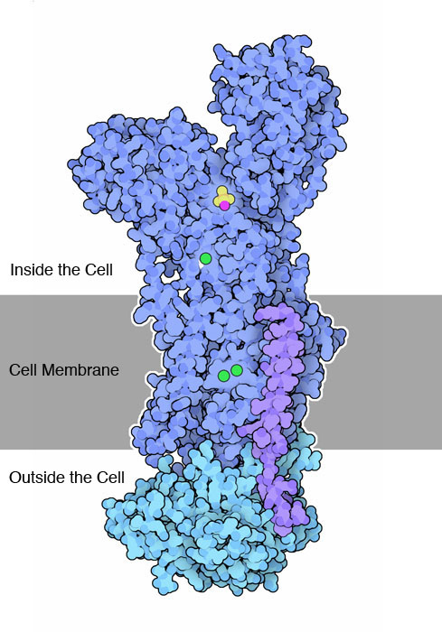

```{python}
#| include: false
import warnings

warnings.filterwarnings("ignore")

import matplotlib

matplotlib.rcParams["figure.figsize"] = (7, 4)
matplotlib.rcParams["figure.dpi"] = 110
matplotlib.rcParams["font.size"] = 8

import matplotlib.pyplot as plt
import numpy as np
import pandas as pd
```
## The central dogma {.scrollable}

:::{.callout-tip icon=false}
## Information flow

{height=400}

$$\text{DNA} \xrightarrow{\ \text{transcription}\ } \text{RNA} \xrightarrow{\ \text{translation}\ } \text{protein}$$

- **DNA** --- the archive. Four bases: adenine, cytosine, guanine, thymine.
- **RNA** --- the working copy. Thymine is replaced by uracil.
- **Protein** --- the machine. Manufactured by the ribosome per RNA instructions. Twenty amino acids, folded into a shape that does something. Works as molecular machines, structural support, etc.

Every step is a **transformation of a string**, which is why so much of bioinformatics is string algorithms.
:::

## Messages in bits {.scrollable}

:::{.callout-tip icon=false}
## Information representation

- humans use base 10
- computers use base 2 (why?)
- organisms use base 4

For a message $p$ bits long:
$$n_{\text{messages}} = n_{\text{symbols}}^{\,p}$$
:::

## Code {.scrollable}
:::{.callout-tip icon=false}
## Code
The bits mean nothing until sender and receiver agree on a **code**. ASCII is one such agreement --- 7 bits per keyboard character:


:::

## Code example

:::{.callout-tip icon=false}
## Example

```
1001000 1100101 1101100 1101100 1101111 0100001
```
is decoded to

```
Hello!
```

**Exercise**: try decoding the below message:
```
1010001 1001001 1001001 1001101 1000101 0100000 0110010 0100000 1101001 1110011 0100000 1100011 1101111 1101111 1101100 0100001
```
:::

## DNA is a base-4 code

:::{.callout-tip icon=false}
## Information content

- DNA has 4 bases: adenine (A), cytosine (C), guanine (G), and thymine (T).
- Protein uses 20 amino acids

A binary digit distinguishes 2 states and carries 1 bit. A DNA base distinguishes 4, so it carries

$$\log_2 4 = 2 \text{ bits}$$

```{python}
import math

for alphabet, size in [("binary", 2), ("DNA/RNA", 4), ("protein", 20)]:
    print(f"  {alphabet:9} {size:>2} symbols -> {math.log2(size):.2f} bits per position")
```

The human genome is about $3.2 \times 10^9$ bases --- roughly **800 MB** if packed at 2 bits per base. Uncompressed as ASCII it is 3.2 GB, which is why every genomics format has a 2-bit packing mode.
:::

## Protein is encoded in base 4 {.scrollable}

:::{.callout-note icon=false}
## Why codons are three bases long

Protein uses 20 amino acids. How many DNA bases must encode one?


| codon length | combinations | enough for 20? |
|---|---|---|
| 1 | $4^1 = 4$ | no |
| 2 | $4^2 = 16$ | **no** |
| 3 | $4^3 = 64$ | yes, with room to spare |

- **Codons** are the three base messages.
- mapping of codons to amino acids is the **genetic code**
- **stop codons** indicate end of the message

The 44 spare combinations are not wasted: the code is **redundant**, with several codons per amino acid, plus three stop codons.

That degeneracy is why a DNA substitution may leave the protein unchanged - a *synonymous* mutation.
:::

## Genetic code {.scrollable}


## Decoding protein messages {.scrollable}

:::{.callout-tip icon=false}
## Decoding
If `AUG` indicates the start of the protein coding region - but can also appear in the middle of the message. It encodes methionine.

Let's decode this message:
```
AUGUAUGAGGGUACUAAUUAA
```
Split in 3s:
```
AUGUAUGAGGGUACUAAUUAA
```

Use the table:
```
Met - Tyr - Glu - Gly - Thr - Asn
```
(UAA is stop codon, so it doesn't get translated to anything).
:::

## Decoding protein messages {.scrollable}

:::{.callout-tip icon=false}
## Slightly broken example
Let's decode this message:
```
CUUUUAUGCCUCGUCGUAGUGUGGAAUGAUGGCGUUC
```
Split in 3s, paying attention to start codon:
```
CUUUU AUG CCU CGU CGU AGU GUG GAA UGA UGG CGU UC
```

Use the table:
```
Met - Pro - Arg - Arg - Ser - Val - Glu
```
(UGA is stop codon, so it doesn't get translated to anything).

Therefore, the bases following the stop codon are not part of the protein message encoded by this DNA.
:::

## Decoding protein messages {.scrollable}

:::{.callout-tip icon=false}
## Decoding

Using BioPython:

```{python}
from Bio.Seq import Seq

rna = Seq("AUGUAUGAGGGUACUAAUUAA")
codons = [str(rna[i : i + 3]) for i in range(0, len(rna), 3)]
print("codons :", " ".join(codons))
print("protein:", rna.translate())
```

`M Y E G T N`, then `*` --- `UAA` is a stop codon, and translation ends there. A stop codon is the code's *end of message* marker.

N is defined to mean either A, C, G, or T, and is thus commonly encountered in readouts of DNA sequences at positions where the base couldn’t be determined
:::

## Decoding protein messages {.scrollable}

:::{.callout-tip icon=false}
## Translating in practice

```{python}
dna = Seq("ATGGCCATTGTAATGGGCCGCTGAAAGGGTGCCCGATAG")
print("DNA        :", dna)
print("transcribed:", dna.transcribe())
print("protein    :", dna.translate())
print("complement :", dna.reverse_complement())
```

The `*` marks a stop codon. Note `translate()` silently assumes reading frame 1 --- a DNA sequence has **six** reading frames (three forward, three reverse), and choosing the wrong one produces confident nonsense.
:::


## Decoding protein messages {.scrollable}

:::{.callout-tip icon=false}
## Decoding
Using scikit-bio:
```{python}
import skbio
# the following sequence is derived from NCBI reference sequence NM_005368.3
protein = skbio.RNA(
            "AUGAAACCCCAGCUGUUGGGGCCAGGACACCCAGUGAGCCCAUACUUGCUCUUUUUGUCUUCUUCAGACUGCGCCAUGGG"
            "GCUCAGCGACGGGGAAUGGCAGUUGGUGCUGAACGUCUGGGGGAAGGUGGAGGCUGACAUCCCAGGCCAUGGGCAGG"
            "AAGUCCUCAUCAGGCUCUUUAAGGGUCACCCAGAGACUCUGGAGAAGUUUGACAAGUUCAAGCACCUGAAGUCAGAG"
            "GACGAGAUGAAGGCGUCUGAGGACUUAAAGAAGCAUGGUGCCACCGUGCUCACCGCCCUGGGUGGCAUCCUUAAGAA"
            "GAAGGGGCAUCAUGAGGCAGAGAUUAAGCCCCUGGCACAGUCGCAUGCCACCAAGCACAAGAUCCCCGUGAAGUACC"
            "UGGAGUUCAUCUCGGAAUGCAUCAUCCAGGUUCUGCAGAGCAAGCAUCCCGGGGACUUUGGUGCUGAUGCCCAGGGG"
            "GCCAUGAACAAGGCCCUGGAGCUGUUCCGGAAGGACAUGGCCUCCAACUACAAGGAGCUGGGCUUCCAGGGCUAGGC"
            "CCCUGCCGCUCCCACCCCCACCCAUCUGGGCCCCGGGUUCAAGAGAGAGCGGGGUCUGAUCUCGUGUAGCCAUAUAG"
            "AGUUUGCUUCUGAGUGUCUGCUUUGUUUAGUAGAGGUGGGCAGGAGGAGCUGAGGGGCUGGGGCUGGGGUGUUGAAG"
            "UUGGCUUUGCAUGCCCAGCGAUGCGCCUCCCUGUGGGAUGUCAUCACCCUGGGAACCGGGAGUGGCCCUUGGCUCAC"
            "UGUGUUCUGCAUGGUUUGGAUCUGAAUUAAUUGUCCUUUCUUCUAAAUCCCAACCGAACUUCUUCCAACCUCCAAAC"
            "UGGCUGUAACCCCAAAUCCAAGCCAUUAACUACACCUGACAGUAGCAAUUGUCUGAUUAAUCACUGGCCCCUUGAAG"
            "ACAGCAGAAUGUCCCUUUGCAAUGAGGAGGAGAUCUGGGCUGGGCGGGCCAGCUGGGGAAGCAUUUGACUAUCUGGA"
            "ACUUGUGUGUGCCUCCUCAGGUAUGGCAGUGACUCACCUGGUUUUAAUAAAACAACCUGCAACAUCUCA"
        ).translate(stop='require')
protein
```
:::


## The genetic code is a molecule

:::{.callout-tip icon=false}
## Who actually reads the code

The codon table is not stored anywhere as a table. It is implemented by **transfer RNA** (tRNA): each tRNA carries one amino acid and has an **anticodon** loop that base-pairs with the matching codon on the mRNA. The ribosome brings them together and joins the amino acids in order.

A tRNA can be described at three levels:

- **primary structure**:  its sequence of bases
- **secondary structure**: which bases pair with which
- **tertiary structure**: the 3-D shape that pairing produces

Stop codons have no corresponding tRNA.
:::

## tRNA


## Limitations of the analogy

:::{.callout-warning icon=false}
## A genome is not just a list of protein messages

The bits-and-codons picture is useful and incomplete:

- most of a genome does **not** encode protein; much of it regulates *when* and *how much* other genes are expressed
- the **structure** of DNA and RNA carries information too, affecting expression
- **alternative splicing** lets one gene produce several different proteins
- real sequence data contains positions the instrument could not resolve - written `N` for "any base"
:::

## The alphabet is not four letters {.scrollable .extends}

:::{.callout-note icon=false}
## Ambiguity codes

Real sequence data contains positions the instrument could not resolve. IUPAC gives each possibility set a letter:

| code | means | | code | means |
|---|---|---|---|---|
| `N` | any base | | `R` | `A` or `G` (purine) |
| `W` | `A` or `T` | | `Y` | `C` or `T` (pyrimidine) |
| `S` | `C` or `G` | | `K` | `G` or `T` |

So the practical DNA alphabet has **15 letters plus a gap**, and protein sequences add `X` (unknown), `B`, `Z`, and `*` for a stop.

This is why a typed sequence class earns its keep: `DNA("ACGN")` is valid, `DNA("ACGU")` is an error, and code that assumes `set(seq) <= {"A","C","G","T"}` will fail on the first real FASTA file it meets --- usually silently, by dropping reads.
:::

<!-- ==========================================================================
     SOURCE: readIAB ch.3 "Pairwise sequence alignment"
             https://readiab.org/pairwise-alignment.html
             sections: "What is a sequence alignment?", "A first algorithm for
             aligning a pair of sequences", "Why this simple procedure is too
             simplistic"
     ========================================================================== -->

# What is an alignment?

## Sequence alignment
:::{.callout-tip icon=false}
## Definition
It's about determining how similar a pair of biological sequences are.
:::

<!-- source: readIAB ch.3, opening -- hemoglobin r1/r2/q1/q2 Hamming example,
     sequences and accessions exactly as in the book -->
## Example {.scrollable}

:::{.callout-tip icon=false}
## Example
Imagine you have three protein sequences

- `r1` and `r2`: reference
- `q1`: query

Question: is `q1` more similar to `r1` or `r2`?

Potential solution:
```{python}
from scipy.spatial.distance import hamming
import skbio

# NCBI Reference Sequence: NP_000508.1 (human hemoglobin subunit A)
r1 = skbio.Protein("MVLSPADKTNVKAAWGKVGAHAGEYGAEALERMFLSFPTTKTYFPHFDLSHGSAQVKGHGKKVADALTNAVAHVDDMPNALSALSDLHAHKLRVDPVNFKLLSHCLLVTLAAHLPAEFTPAVHASLDKFLASVSTVLTSKYR")

# NCBI Reference Sequence: NP_001004376.1 (chicken hemoglobin subunit A)
r2 = skbio.Protein("MVLSAADKNNVKGIFTKIAGHAEEYGAETLERMFTTYPPTKTYFPHFDLSHGSAQIKGHGKKVVAALIEAANHIDDIAGTLSKLSDLHAHKLRVDPVNFKLLGQCFLVVVAIHHPAALTPEVHASLDKFLCAVGTVLTAKYR")

# GenBank: QFF91579.1 (sei whale hemoglobin subunit A)
q1 = skbio.Protein("MVLFPADKSNVKATWAKIGNHGAEYGAEALERMFMNFPSTKTYFPHFDLGHDSAQVKGHGKKVADALTKAAGHMDNLLDALSDLSDLHAHKLRVDPVNFKLLSHCLLVTLALHLPAEFTPSVHASLDKFLASVSTVLTSKYR")

print(r1)
print(r2)
print(q1)
```
:::

## Example {.scrollable}

:::{.callout-tip icon=false}
## Hamming distance
Hamming distance is a metric on the set of the words of length $n$ and is the number of positions at which the corresponding symbols are different.


Compute distance:

```{python}
print(hamming(r1, q1))
print(hamming(r2, q1))
```
:::

## Example {.scrollable}

:::{.callout-tip icon=false}
## Broken example
```{python}
# NCBI Reference Sequence: XP_028905054.1 (platypus hemoglobin subunit A); 
# a "-" character was added to the end of this sequence to make it the same
# length as r1 and r2, enabling us to compute Hamming distances

q2 = skbio.Protein("MLTDAEKKEVTALWGKAAGHGEEYGAEALERLFQAFPTTKTYFSHFDLSHGSAQIKAHGKKVADALSTAAGHFDDMDSALSALSDLHAHKLRVDPVNFKLLAHCILVVLARHCPGEFTPSAHAAMDKFLSKVATVLTSKYR-")

print(hamming(r1, q2))
print(hamming(r2, q2))
```
What happened? The reason is that amino acid was deleted in the platypus sequence.
:::

## Example {.scrollable}

:::{.callout-tip icon=false}
## Fix
Move the `-`:
```{python}
# NCBI Reference Sequence: XP_028905054.1 (platypus hemoglobin subunit A); 

q2_aligned = skbio.Protein("M-LTDAEKKEVTALWGKAAGHGEEYGAEALERLFQAFPTTKTYFSHFDLSHGSAQIKAHGKKVADALSTAAGHFDDMDSALSALSDLHAHKLRVDPVNFKLLAHCILVVLARHCPGEFTPSAHAAMDKFLSKVATVLTSKYR")

print(hamming(r1, q2_aligned))
print(hamming(r2, q2_aligned))
```
:::

## Pairwise alignment {.scrollable}

:::{.callout-tip icon=false}
## Explanation

Before computing distances, we need to **align sequences**. The `-` character is called a **gap character**.

Compare side-by-side:

```{python}
print(r1)
print(q2_aligned)
```
:::

:::{.callout-important icon=false}
## Three kinds of mutation

Over evolutionary time a DNA sequence changes, mostly through errors in replication (**mutations**):

- **substitution**: one base replaced by another. Sometimes there is no change in resulting protein (**synonymous mutations**)
- **insertion**: one or more bases added
- **deletion**: one or more bases removed

Two sequences descended from a common ancestor are **homologs**.


:::

## Pairwise alignment {.scrollable}
:::{.callout-important}
## The goal
The goal of pairwise sequence alignment is, given two DNA, RNA, or protein sequences, to generate a hypothesis about which sequence positions derived from a common ancestral sequence position.
:::

:::{.callout-tip icon=false}
## Practice
In practice, we develop a pairwise alignment hypothesis by aligning the sequences to one another, inserting gap characters as necessary, in a way that maximizes their similarity. This is a maximum parsimony approach (an application of Occam’s razor), where we assume that the simplest explanation (the one involving the fewest or most common mutation events) is the most likely.
:::

:::{.callout-note icon=false}
## As a table

An alignment is a table: rows are sequences, columns are positions. All rows have the same length by construction, and **each column is a claim** that those positions share an ancestor.
:::

## A first algorithm {.scrollable}

:::{.callout-tip icon=false}
## Process

Define sequences:
```{python}
from skbio import DNA
seq1 = DNA("ACCGGTGGAACCGGTAACACCCAC")
seq2 = DNA("ACCGGTAACCGGTTAACACCCAC")
```

Create a blank matrix:
```{python}
import numpy as np

num_rows = len(seq2)
num_cols = len(seq1)
data = np.zeros(shape=(num_rows, num_cols), dtype=int)
```

Helper function to show the matrix:
```{python}
#| code-fold: true
import tabulate

def show_F(h_sequence, v_sequence, data, hide_zeros=False, nonzero_val=None):
    rows = []
    col_headers = [c.decode('UTF-8') for c in h_sequence.values]
    row_headers = [c.decode('UTF-8') for c in v_sequence.values]
    pad_headers = data.shape == (len(row_headers) + 1, len(col_headers) + 1)
    if pad_headers:
        row_headers = [" "] + row_headers
        col_headers = [" "] + col_headers
    for h, d in zip(row_headers, data):
        current_row = [h]
        for e in d:
            if e == 0:
                if hide_zeros:
                    current_row.append('')
                else:
                    current_row.append(0)
            else:
                if nonzero_val is not None:
                    current_row.append(nonzero_val)
                else:
                    current_row.append(e)
        rows.append(current_row)
    return tabulate.tabulate(rows, headers=col_headers, tablefmt='html')


def show_T(h_sequence, v_sequence, data):
    if data.dtype == int:
        data_ = T = np.full(shape=data.shape, fill_value=" ", dtype=str)
        translation_table = {0: "•", 1: "↖", 2: "↑", 3: "←"}
        for i, row in enumerate(data):
            for j, value in enumerate(row):
                data_[i, j] =  translation_table[value]
    else:
        data_ = data
    return show_F(h_sequence, v_sequence, data_)
```

Show the matrix:
```{python}
show_F(seq1, seq2, data)
```
:::

## A first algorithm {.scrollable}

:::{.callout-tip icon=false}
## Process
Add values:
```{python}
for row_number, row_character in enumerate(seq2):
    for col_number, col_character in enumerate(seq1):
        if row_character == col_character:
            data[row_number, col_number] = 1

show_F(seq1, seq2, data, hide_zeros=True)
```
:::

## A first algorithm {.scrollable}

:::{.callout-tip icon=false}
## Process
Identify diagonals:
```{python}
## Find the long diagonals
# create a copy of our data matrix to work with, so we
# leave the original untouched.
summed_data = data.copy()
# iterate over the cells in our data matrix, starting in
# the second row and second column
for i in range(1, summed_data.shape[0]):
    for j in range(1, summed_data.shape[1]):
        # if the value in the current cell is greater than zero
        # (i.e., the characters at the corresponding pair of
        # sequence positions are the same), add the value from the
        # cell that is diagonally up and to the left.
        if summed_data[i, j] > 0:
            summed_data[i, j] += summed_data[i-1][j-1]

show_F(seq1, seq2, summed_data, hide_zeros=True)
```
:::


## A first algorithm {.scrollable}

:::{.callout-tip icon=false}
## Process
Identify the longest diagonal:
```{python}
longest_diagonal_length = summed_data.max()
print("The longest diagonal is %d characters long." % longest_diagonal_length)
```
:::

## A first algorithm {.scrollable}

:::{.callout-tip icon=false}
## Process
Transcribe some of the possible alignments:

- start with the longest diagonal and trace it backwards to transcribe the alignment by writing down the characters from each of the two sequences at every row and column corresponding to the diagonal that you’re following
- when we encounter a break in the diagonal, we find the next longest diagonal that starts in a cell that is up and/or to the left of the cell when the previous diagonal you were following ends
- for every cell that you move straight upwards (non-diagonally), we insert a gap in the sequence on the horizontal axis of your matrix
- for every cell that you move straight leftwards, you’d insert a gap in the sequence on the vertical axis of your matrix.

We’d also generally compute a score for an alignment to help us figure out which alignments are better than others. For now, let’s add one for every match, and subtract one for every mismatch.

Here are two possible alignments:

Alignment 1 (score 19):
```
ACCGGTGGAACCGG-TAACACCCAC
ACCGGT--AACCGGTTAACACCCAC
```

Alignment 2 (score 8):
```
ACCGGTGGAACCGGTAACACCCAC
ACCGGT--------TAACACCCAC
```
:::

## Why that is too simplistic

:::{.callout-warning icon=false}
## Two bad assumptions

1. **All matches are equally good and all mismatches equally bad.** For proteins this is plainly false: replacing leucine with isoleucine (both hydrophobic, similar size) is far more tolerable than replacing it with aspartate.
2. **Every gap costs the same.** But a single 5-base indel is *one* mutational event, while five separate 1-base indels are five. Charging them equally misrepresents the biology.

> All scoring schemes have limitations, and you should remember that when you're working with software that generates alignments for you.

:::

<!-- SOURCE: readIAB ch.3, "Differential scoring of matches and mismatches"
     https://readiab.org/pairwise-alignment.html -->

## Scoring {.scrollable}
:::{.callout-tip icon=false}
## Scoring
Let's consider protein alignment.

- In a protein, each amino acid residue is contributing to the structure and/or function of the protein
- A given amino acid residue may contribute a charge to an enzyme that helps it to bind its substrate, it may introduce structural stability or instability in a protein, or provide spacing between different functional domains of the protein
- Substitutions between amino acids that have similar chemical or physical properties tend to be better tolerated (i.e., less detrimental to the function of the protein) than substitutions between amino acids with different chemical or physical properties. 
:::

## Scoring {.scrollable}
:::{.callout-tip icon=false}
## Scoring


- polar (charged) residues: positioning inside/outside of the cell
- non-polar residues: positioning within the membrane

Polar residues destabilize membrane-bound proteins when they are present within the membrane (a highly non-polar environment). Therefore, we probably want to score the alignment of a non-polar residue with a polar residue as less likely than with another non-polar residue.
:::

## Scoring {.scrollable}
:::{.callout-tip icon=false}
## Substitution matrix
A widely used one is BLOSUM 50.
```{python}
#| code-fold: true
def show_substitution_matrix(headers, data):
    rows = []
    for h, d in zip(headers, data):
        current_row = [h]
        for e in d:
            current_row.append(e)
        rows.append(current_row)
    return tabulate.tabulate(rows, headers=headers, tablefmt='html')

blosum50 = {'A': {'A': 5, 'C': -1, 'D': -2, 'E': -1, 'F': -3, 'G': 0, 'H': -2, 'I': -1, 'K': -1, 'L': -2, 'M': -1, 'N': -1, 'P': -1, 'Q': -1, 'R': -2, 'S': 1, 'T': 0, 'V': 0, 'W': -3, 'Y': -2},
'C': {'A': -1, 'C': 13, 'D': -4, 'E': -3, 'F': -2, 'G': -3, 'H': -3, 'I': -2, 'K': -3, 'L': -2, 'M': -2, 'N': -2, 'P': -4, 'Q': -3, 'R': -4, 'S': -1, 'T': -1, 'V': -1, 'W': -5, 'Y': -3},
'D': {'A': -2, 'C': -4, 'D': 8, 'E': 2, 'F': -5, 'G': -1, 'H': -1, 'I': -4, 'K': -1, 'L': -4, 'M': -4, 'N': 2, 'P': -1, 'Q': 0, 'R': -2, 'S': 0, 'T': -1, 'V': -4, 'W': -5, 'Y': -3},
'E': {'A': -1, 'C': -3, 'D': 2, 'E': 6, 'F': -3, 'G': -3, 'H': 0, 'I': -4, 'K': 1, 'L': -3, 'M': -2, 'N': 0, 'P': -1, 'Q': 2, 'R': 0, 'S': -1, 'T': -1, 'V': -3, 'W': -3, 'Y': -2},
'F': {'A': -3, 'C': -2, 'D': -5, 'E': -3, 'F': 8, 'G': -4, 'H': -1, 'I': 0, 'K': -4, 'L': 1, 'M': 0, 'N': -4, 'P': -4, 'Q': -4, 'R': -3, 'S': -3, 'T': -2, 'V': -1, 'W': 1, 'Y': 4},
'G': {'A': 0, 'C': -3, 'D': -1, 'E': -3, 'F': -4, 'G': 8, 'H': -2, 'I': -4, 'K': -2, 'L': -4, 'M': -3, 'N': 0, 'P': -2, 'Q': -2, 'R': -3, 'S': 0, 'T': -2, 'V': -4, 'W': -3, 'Y': -3},
'H': {'A': -2, 'C': -3, 'D': -1, 'E': 0, 'F': -1, 'G': -2, 'H': 10, 'I': -4, 'K': 0, 'L': -3, 'M': -1, 'N': 1, 'P': -2, 'Q': 1, 'R': 0, 'S': -1, 'T': -2, 'V': -4, 'W': -3, 'Y': 2},
'I': {'A': -1, 'C': -2, 'D': -4, 'E': -4, 'F': 0, 'G': -4, 'H': -4, 'I': 5, 'K': -3, 'L': 2, 'M': 2, 'N': -3, 'P': -3, 'Q': -3, 'R': -4, 'S': -3, 'T': -1, 'V': 4, 'W': -3, 'Y': -1},
'K': {'A': -1, 'C': -3, 'D': -1, 'E': 1, 'F': -4, 'G': -2, 'H': 0, 'I': -3, 'K': 6, 'L': -3, 'M': -2, 'N': 0, 'P': -1, 'Q': 2, 'R': 3, 'S': 0, 'T': -1, 'V': -3, 'W': -3, 'Y': -2},
'L': {'A': -2, 'C': -2, 'D': -4, 'E': -3, 'F': 1, 'G': -4, 'H': -3, 'I': 2, 'K': -3, 'L': 5, 'M': 3, 'N': -4, 'P': -4, 'Q': -2, 'R': -3, 'S': -3, 'T': -1, 'V': 1, 'W': -2, 'Y': -1},
'M': {'A': -1, 'C': -2, 'D': -4, 'E': -2, 'F': 0, 'G': -3, 'H': -1, 'I': 2, 'K': -2, 'L': 3, 'M': 7, 'N': -2, 'P': -3, 'Q': 0, 'R': -2, 'S': -2, 'T': -1, 'V': 1, 'W': -1, 'Y': 0},
'N': {'A': -1, 'C': -2, 'D': 2, 'E': 0, 'F': -4, 'G': 0, 'H': 1, 'I': -3, 'K': 0, 'L': -4, 'M': -2, 'N': 7, 'P': -2, 'Q': 0, 'R': -1, 'S': 1, 'T': 0, 'V': -3, 'W': -4, 'Y': -2},
'P': {'A': -1, 'C': -4, 'D': -1, 'E': -1, 'F': -4, 'G': -2, 'H': -2, 'I': -3, 'K': -1, 'L': -4, 'M': -3, 'N': -2, 'P': 10, 'Q': -1, 'R': -3, 'S': -1, 'T': -1, 'V': -3, 'W': -4, 'Y': -3},
'Q': {'A': -1, 'C': -3, 'D': 0, 'E': 2, 'F': -4, 'G': -2, 'H': 1, 'I': -3, 'K': 2, 'L': -2, 'M': 0, 'N': 0, 'P': -1, 'Q': 7, 'R': 1, 'S': 0, 'T': -1, 'V': -3, 'W': -1, 'Y': -1},
'R': {'A': -2, 'C': -4, 'D': -2, 'E': 0, 'F': -3, 'G': -3, 'H': 0, 'I': -4, 'K': 3, 'L': -3, 'M': -2, 'N': -1, 'P': -3, 'Q': 1, 'R': 7, 'S': -1, 'T': -1, 'V': -3, 'W': -3, 'Y': -1},
'S': {'A': 1, 'C': -1, 'D': 0, 'E': -1, 'F': -3, 'G': 0, 'H': -1, 'I': -3, 'K': 0, 'L': -3, 'M': -2, 'N': 1, 'P': -1, 'Q': 0, 'R': -1, 'S': 5, 'T': 2, 'V': -2, 'W': -4, 'Y': -2},
'T': {'A': 0, 'C': -1, 'D': -1, 'E': -1, 'F': -2, 'G': -2, 'H': -2, 'I': -1, 'K': -1, 'L': -1, 'M': -1, 'N': 0, 'P': -1, 'Q': -1, 'R': -1, 'S': 2, 'T': 5, 'V': 0, 'W': -3, 'Y': -2},
'V': {'A': 0, 'C': -1, 'D': -4, 'E': -3, 'F': -1, 'G': -4, 'H': -4, 'I': 4, 'K': -3, 'L': 1, 'M': 1, 'N': -3, 'P': -3, 'Q': -3, 'R': -3, 'S': -2, 'T': 0, 'V': 5, 'W': -3, 'Y': -1},
'W': {'A': -3, 'C': -5, 'D': -5, 'E': -3, 'F': 1, 'G': -3, 'H': -3, 'I': -3, 'K': -3, 'L': -2, 'M': -1, 'N': -4, 'P': -4, 'Q': -1, 'R': -3, 'S': -4, 'T': -3, 'V': -3, 'W': 15, 'Y': 2},
'Y': {'A': -2, 'C': -3, 'D': -3, 'E': -2, 'F': 4, 'G': -3, 'H': 2, 'I': -1, 'K': -2, 'L': -1, 'M': 0, 'N': -2, 'P': -3, 'Q': -1, 'R': -1, 'S': -2, 'T': -2, 'V': -1, 'W': 2, 'Y': 8}}

aas = list(blosum50.keys())
aas.sort()
data = []
for aa1 in aas:
    row = []
    for aa2 in aas:
        row.append(blosum50[aa1][aa2])
    data.append(row)

aa_labels = ''.join(aas)
```
Show it:
```{python}
show_substitution_matrix(aa_labels, data)
```
:::

## Needleman-Wunsch algorithm
:::{.callout-tip icon=false}
Originally published by Saul B. Needleman and Christian D. Wunsch in 1970 [NW70].

It performs what is known as global alignment, meaning that both sequences are aligned from their first amino acid residue (or base) through their last amino acid residue (or base).
:::

:::{.callout-tip icon=false}
## Define sequences

```{python}
from skbio import Protein
seq1 = Protein("HEAGAWGHEE")
seq2 = Protein("PAWHEAE")

print(seq1)
print(seq2)
```
:::

## Needleman-Wunsch algorithm {.scrollable}
:::{.callout-tip icon=false}
## New matrices

Here we’ll compute two new matrices that together allow us to determine the highest alignment score given the sequences and the substitution matrix, and to transcribe the aligned sequences. These matrices are

- the dynamic programming matrix, or $F$
- and the traceback matrix, or $T$
:::
:::{.callout-note icon=false}
## F
$F$ looks a lot like the matrix we defined above, but it has one extra row and column, corresponding to the start of each of the sequences (a state that is independent of the first residue of the sequences that is important for our algorithm).

$F$ keeps track of the best score of the alignment through the corresponding pair of positions, if the alignment were to terminate at that pair of positions.
:::

:::{.callout-important icon=false}
## T
Because there are multiple possible alignments that a score in $F$ can be derived from, we use the second matrix, $T$, to track which single alignment led to each score in $F$.

$T$ has the same shape (i.e., numbers of rows and columns) as $F$, and its values encode information about how the sequences were aligned to result in the score in the corresponding cell in $F$.
:::

## Needleman-Wunsch algorithm {.scrollable}
:::{.callout-tip icon=false}
## New matrices
Prior to initialization, $F$ and $T$ would look like the following.
```{python}
num_rows = len(seq2) + 1
num_cols = len(seq1) + 1
F = np.zeros(shape=(num_rows, num_cols), dtype=int)
show_F(seq1, seq2, F)
```
```{python}
T = np.full(shape=(num_rows, num_cols), fill_value=" ", dtype=str)
show_F(seq1, seq2, T)
```
:::

## Needleman-Wunsch algorithm {.scrollable}
:::{.callout-tip icon=false}
## Compute F and T

$d$ is the **gap penalty**. This is a constant value that is subtracted from the score of the alignment every time a gap character has to be introduced to align the sequences. We'll use a constant value of $d=8$ (it's positive because we subtract it).

$i$ is the row number in $F$, and $j$ is the column number in $F$.
$$
\begin{align}
& F(0, 0) = 0\\
& F(i, 0) = F(i-1, 0) - d\\
& F(0, j) = F(0, j-1) - d\\
\end{align}
$$

Initializing $F$ would result in the following.
```{python}
d = 8
F[0][0] = 0
for i in range(1, num_rows):
    F[i][0] = F[i-1][0] - d

for j in range(1, num_cols):
    F[0][j] = F[0][j-1] - d

show_F(seq1, seq2, F)
```

And $T$ (arrow indicate the cell the score depends on):
```{python}
T[0][0] = "•"
for i in range(1, num_rows):
    T[i][0] = "↑"

for j in range(1, num_cols):
    T[0][j] = "←"

show_F(seq1, seq2, T)
```
:::

## Needleman-Wunsch algorithm {.scrollable}
:::{.callout-tip icon=false}
## Compute F and T
Next, we'll compute the scores for all of the other cells in $F$, starting at position $(1, 1)$. In Needleman-Wunsch alignment, the score $F$ for cell $(i, j)$ (when $i > 0$ and $j > 0$) is computed as the maximum of three possible values. $s$ refers to the substitution matrix, and $c_i$ and $c_j$ refer to characters in `seq1` and `seq2`.

$$
F(i, j) = max \left(\begin{align}
& F(i-1, j-1) + s(c_i, c_j)\\
& F(i-1, j) - d\\
& F(i, j-1) - d
\end{align}\right)
$$

We score a cell with the maximum of three values:

- either the value of the cell up and to the left plus the score for the substitution taking place in the current cell (which you find by looking up the substitution in the substitution matrix);
- the value of the cell above minus the gap penalty;
- or the value of the cell to the left minus the gap penalty.

In this way, you're determining whether the best (highest) score is obtained by inserting a gap in sequence 1 (corresponding to $F(i-1, j) - d$), inserting a gap in sequence 2 (corresponding to $F(i, j-1) - d$), or aligning the characters in sequence 1 and sequence 2 (corresponding to $F(i-1, j-1) + s(c_i, c_j)$).
:::

## Needleman-Wunsch algorithm {.scrollable}
:::{.callout-tip icon=false}
## Compute F and T
```{python}
from skbio.alignment._pairwise import _compute_score_and_traceback_matrices
from skbio.sequence import Protein
from skbio.alignment import TabularMSA

seq1 = TabularMSA([seq1])
seq2 = TabularMSA([seq2])

nw_matrix, traceback_matrix = _compute_score_and_traceback_matrices(
    seq1, seq2, 8, 8, blosum50)

show_F(seq1[0], seq2[0], nw_matrix)
```
And $T$ --- scikit-bio stores it as integer codes (1 = diagonal, 2 = up, 3 = left, 0 = end), so `show_T` translates them to arrows:
```{python}
show_T(seq1[0], seq2[0], traceback_matrix)
```
:::

## Needleman-Wunsch algorithm {.scrollable}
:::{.callout-tip icon=false}
## Transcribe the alignment
We can now use $F$ and $T$ to transcribe and score the alignment of sequences 1 and 2. To do this, we start at the bottom-right of the matrices and follow the arrows to cell $(0, 0)$.

* Every time we encounter a vertical arrow, we consume a character from sequence 2 (the vertical sequence) and add a gap to sequence 1.
* Every time we encounter a horizontal arrow, we consume a character from sequence 1 (the horizontal sequence) and add a gap to sequence 2.
* Every time we encounter a diagonal arrow, we consume a character from sequence 1 and sequence 2.
* When we encounter a bullet, we've reached the end of the alignment so we're done.

As you transcribe the alignment, write sequence 1 on top of sequence 2, and work from right to left (since you are working backwards through the matrix).

The score in the cell that you started in (the bottom-right in this case) is the score for the alignment.
```{python}
from skbio.alignment._pairwise import _traceback
aln1, aln2, score, _, _ = _traceback(traceback_matrix,nw_matrix,seq1,seq2, nw_matrix.shape[0]-1, nw_matrix.shape[1]-1)

print(aln1[0])
print(aln2[0])
print(score)
```
:::

## Needleman-Wunsch algorithm {.scrollable}
:::{.callout-tip icon=false}
## API
We'd like to define a function that takes all of the necessary input and provides the aligned sequences and the score as output, without requiring the user to make several function calls. This requires API definition:

- inputs
- outputs
- name

scikit-bio implementation:
```{python}
from skbio.alignment import global_pairwise_align
%psource global_pairwise_align
```
Usage:
```{python}
aln, score, _ = global_pairwise_align(Protein("HEAGAWGHEE"), Protein("PAWHEAE"), 8, 8, blosum50, penalize_terminal_gaps=True)

print(aln)
print(score)
```
:::

## Local alignment

:::{.callout-tip icon=false}
## Global vs local
Global alignment: we align both sequences from their beginning through their end. 

Local alignment: we have a pair of sequences that we suspect may partially overlap each other, and we want to know what the best possible alignment of all or part of one sequence is with all or part of the other sequences.

Application: sequence database searching (e.g., the [BLAST web server](http://blast.ncbi.nlm.nih.gov/Blast.cgi)), where we have a query sequence and we want to find the closest match (or matches) in a reference database containing many different gene sequences. 
:::

## Local alignment

:::{.callout-tip icon=false}
## Smith-Waterman
Originally published by Temple F. Smith and Michael S. Waterman (1981).

Aligned sequences in Smith-Waterman can be a subsequence of one or both of the unaligned (input) sequences. In Needleman-Wunsch alignment, the aligned sequences will be full-length with respect to the unaligned sequences.
```{python}
from skbio import Protein
seq1 = Protein("HEAGAWGHEE")
seq2 = Protein("PAWHEAE")

print(seq1)
print(seq2)
```
:::

## Local alignment {.scrollable}

:::{.callout-tip icon=false}
## Smith-Waterman
Create blank matrices:

```{python}
num_rows = len(seq2) + 1
num_cols = len(seq1) + 1
F = np.zeros(shape=(num_rows, num_cols), dtype=int)
show_F(seq1, seq2, F)
```
```{python}
T = np.full(shape=(num_rows, num_cols), fill_value=" ", dtype=str)
show_T(seq1, seq2, T)
```
:::

## Local alignment {.scrollable}

:::{.callout-tip icon=false}
## Smith-Waterman
Compute $F$ and $T$:


$$
\begin{align}
& F(0, 0) = 0\\
& F(i, 0) = 0\\
& F(0, j) = 0
\end{align}
$$


```{python}
d = 8
F[0][0] = 0
for i in range(1, num_rows):
    F[i][0] = 0

for j in range(1, num_cols):
    F[0][j] = 0

show_F(seq1, seq2, F)
```

And $T$:
```{python}
T[0][0] = "•"
for i in range(1, num_rows):
    T[i][0] = "•"

for j in range(1, num_cols):
    T[0][j] = "•"

show_T(seq1, seq2, T)
```
:::
## Local alignment {.scrollable}

:::{.callout-tip icon=false}
## Smith-Waterman
Compute remaining cells:

$$
F(i, j) = max \left(\begin{align}
& 0\\
& F(i-1, j-1) + s(c_i, c_j)\\
& F(i-1, j) - d\\
& F(i, j-1) - d)
\end{align}\right)
$$

```{python}
from skbio.alignment._pairwise import _init_matrices_sw
seq1 = TabularMSA([seq1])
seq2 = TabularMSA([seq2])

sw_matrix, traceback_matrix = _compute_score_and_traceback_matrices(
    seq1, seq2, 8, 8, blosum50, new_alignment_score=0.0,
    init_matrices_f=_init_matrices_sw)

show_F(seq1[0], seq2[0], sw_matrix)
```
And $T$:
```{python}
show_T(seq1[0], seq2[0], traceback_matrix)
```
:::
## Local alignment {.scrollable}

:::{.callout-tip icon=false}
## Smith-Waterman
Transcribe: we should now begin tracing back from the cell with the highest value in $F$, rather than the bottom right cell of the matrix. As before, the alignment terminates when we hit a bullet (•) character, but in contrast to Needleman-Wunsch alignment, this can happen anywhere in the matrix, not only in $F(0, 0)$.

```{python}
max_value = 0.0
max_i = 0
max_j = 0
for i in range(sw_matrix.shape[0]):
    for j in range(sw_matrix.shape[1]):
        if sw_matrix[i, j] > max_value:
            max_i, max_j = i, j
            max_value = sw_matrix[i, j]

aln1, aln2, score, start_a1, start_a2 = _traceback(traceback_matrix, sw_matrix, seq1, seq2, max_i, max_j)
print(aln1[0])
print(aln2[0])
print(score)
```
:::
## Local alignment {.scrollable}

:::{.callout-tip icon=false}
## Smith-Waterman
Using Python API:
```{python}
from skbio.alignment import local_pairwise_align

%psource local_pairwise_align
```
Use a generic wrapper:
```{python}
def align(sequence1, sequence2, gap_penalty, substitution_matrix, local):
    if local:
        return local_pairwise_align(sequence1, sequence2, gap_penalty, gap_penalty, substitution_matrix)
    else:
        return global_pairwise_align(sequence1, sequence2, gap_penalty, gap_penalty, substitution_matrix)
```
Use for local:

```{python}
aln, score, _ = align(Protein('HEAGAWGHEE'), Protein('PAWHEAE'), 8, blosum50, True)

print(aln)
print(score)
```

Use for global:

```{python}
aln, score, _ = align(Protein('HEAGAWGHEE'), Protein('PAWHEAE'), 8, blosum50, False)

print(aln)
print(score)
```
:::

## Differential gap scoring {.scrollable}

:::{.callout-tip icon=false}
## Gap scoring

We might want to incur a large penalty for opening a gap, but a smaller penalty for extending an existing gap. This is referred to as *affine gap scoring*.

More info [here](http://www.ncbi.nlm.nih.gov/books/NBK21114/).

When we compute the score corresponding to a gap in our alignment (i.e., where we'd insert either a ↑ or a ← in $T$), we should incur a *gap extension penalty* if the value in $T$ that the new arrow will point to is the same type of arrow. Otherwise, we should incur the *gap open penalty*.
:::

## Differential gap scoring {.scrollable}

:::{.callout-tip icon=false}
## Gap scoring
If we represent our gap open penalty as $d^0$, and our gap extend penalty as $d^e$, our scoring scheme would look now like the following:

$$
F(i, j) = max \left(\begin{align}
& 0\\
& F(i-1, j-1) + s(c_i, c_j)\\
& \left\{\begin{array}{l l} F(i-1, j) - d^e \quad \text{if $T(i-1, j)$ is ↑}\\ F(i-1, j) - d^o \quad \text{if $T(i-1, j)$ is not ↑} \end{array}  \right\} \\
& \left\{\begin{array}{l l} F(i, j-1) - d^e \quad \text{if $T(i, j-1)$ is ←}\\ F(i, j-1) - d^o \quad \text{if $T(i, j-1)$ is not ←} \end{array}  \right\}
 \end{align}\right)
$$

Notice how we only use the gap extend penalty if the previous max score resulted from a gap in the same sequence because it represents the continuation of an existing gap in that sequence. We know which sequence a gap is being introduced in by the characters in the traceback matrix: ↑ always implies a gap in the sequence on the horizontal axis of $F$ and $T$, and ← always implies a gap in the sequence on the vertical axis of $F$ and $T$.
:::
## Differential gap scoring {.scrollable}

:::{.callout-tip icon=false}
## Gap scoring
Pass penalties as 3rd and 4th argument to `_compute_score_and_traceback_matrices`:
```{python}
seq1 = TabularMSA([Protein("HEAGAWGHEE")])
seq2 = TabularMSA([Protein("PAWHEAE")])

sw_matrix, traceback_matrix = _compute_score_and_traceback_matrices(seq1, seq2, 8, 1, blosum50)

show_F(seq1[0], seq2[0], sw_matrix)
```
And $T$:
```{python}
show_T(seq1[0], seq2[0], traceback_matrix)
```
:::

## Differential gap scoring {.scrollable}

:::{.callout-tip icon=false}
## Gap scoring
And for global alignment:

```{python}
seq1 = TabularMSA([Protein("HEAGAWGFHEE")])
seq2 = TabularMSA([Protein("PAWHEAE")])
```

```{python}
aln, score, _ = global_pairwise_align(seq1, seq2, 8, 8, blosum50)
print(aln)
print(score)
```
```{python}
aln, score, _ = global_pairwise_align(seq1, seq2, 8, 1, blosum50)
print(aln)
print(score)
```
:::

## Benchmarking
:::{.callout-tip icon=false}
## Comparing implementations
```{python}
from skbio.alignment import local_pairwise_align_nucleotide

seq1 = DNA("GGTCTTCGCTAGGCTTTCATCGGGTTCGGCATCTACTCTGAGTTACTACG")
seq2 = DNA("GGTCTTCAGGCTTTCATCGGGAACGGCATCTCTGAGTTACTACC")

%timeit local_pairwise_align_nucleotide(seq1, seq2, gap_open_penalty=8, gap_extend_penalty=1)
```

Faster implementation (compiled):

```{python}
from skbio.alignment import pair_align_nucl

%timeit pair_align_nucl(seq1, seq2, mode="local")
```

:::

## Benchmarking
:::{.callout-tip icon=false}
## Runtime as function of length

Helper function to generate random sequences:
```{python}
import numpy as np

def random_sequence(moltype, length):
    result = []
    # Our "alphabet" here will consist of the standard characters in a
    # molecules alphabet.
    alphabet = list(moltype.nondegenerate_chars)
    for e in range(length):
        result.append(np.random.choice(alphabet))
    return moltype(''.join(result))
```

Test:

```{python}
print(random_sequence(DNA, 10))
print(random_sequence(DNA, 10))
print(random_sequence(DNA, 25))
print(random_sequence(DNA, 50))
```

:::
## Benchmarking {.scrollable}
:::{.callout-tip icon=false}
## Different lengths
```{python}
import timeit

times = []
# the book goes to 105 000 bases with the SSW heuristic; an exact aligner needs the
# full m x n matrix, so we stop at 9 000 (a 105k x 105k matrix would not fit in RAM)
seq_lengths = range(1000, 10000, 2000)

def get_time_function(seq_length):
    def f():
        seq1 = random_sequence(DNA, seq_length)
        seq2 = random_sequence(DNA, seq_length)
        pair_align_nucl(seq1, seq2, mode="local", max_paths=1)
    return f

for seq_length in seq_lengths:
    times.append(min(timeit.Timer(get_time_function(seq_length)).repeat(repeat=3, number=1)))

print("Done!")
```

Show table:
```{python}
import pandas as pd
runtimes = pd.DataFrame(data=np.asarray([seq_lengths, times]).T, columns=["Sequence length", "Runtime (s)"] )
runtimes
```

Plot it:
```{python}
import seaborn as sns
ax = sns.regplot(x="Sequence length", y="Runtime (s)", data=runtimes, fit_reg=False)
ax.set_xlim(0)
ax.set_ylim(0)
ax
```
We have a **quadratic relationship**.
:::

## Benchmarking {.scrollable}

