## Homology searching

:::{.callout-tip icon=false}
## Goal
Use **pairwise alignment** to search databases of biological sequences to identify **sequence homology**.

- Homology: a pair of sequences derived from a **common ancestral sequence**.
- Homology searching is essential for inferring **where a sequence came from** and/or **what it does**.
- For an unannotated sequence it is very hard (really, impossible) to know what it is without more information.
:::

## Query and reference database

:::{.callout-tip icon=false}
## Query vs reference

A researcher searches their **query** against a **reference database** of annotated sequences to learn:

- what **function** the sequence performs (if the reference has functional annotation)
- what **organisms** likely encode it in their genome (if the reference has taxonomic annotation)
:::

## Exercise: mystery sequence {.scrollable}

:::{.callout-note icon=false}
## Exercise
Whose genome is this sequence encoded in? What is its function? Use [Protein BLAST](https://blast.ncbi.nlm.nih.gov/Blast.cgi?PROGRAM=blastp&PAGE_TYPE=BlastSearch&LINK_LOC=blasthome).

```{.text .font6}
>mystery-sequence1
MFVFLVLLPLVSSQCVNLTTRTQLPPAYTNSFTRGVYYPDKVFRSSVLHSTQDLFLPFFS
NVTWFHAIHVSGTNGTKRFDNPVLPFNDGVYFASTEKSNIIRGWIFGTTLDSKTQSLLIV
NNATNVVIKVCEFQFCNDPFLGVYYHKNNKSWMESEFRVYSSANNCTFEYVSQPFLMDLE
GKQGNFKNLREFVFKNIDGYFKIYSKHTPINLVRDLPQGFSALEPLVDLPIGINITRFQT
LLALHRSYLTPGDSSSGWTAGAAAYYVGYLQPRTFLLKYNENGTITDAVDCALDPLSETK
CTLKSFTVEKGIYQTSNFRVQPTESIVRFPNITNLCPFGEVFNATRFASVYAWNRKRISN
CVADYSVLYNSASFSTFKCYGVSPTKLNDLCFTNVYADSFVIRGDEVRQIAPGQTGKIAD
YNYKLPDDFTGCVIAWNSNNLDSKVGGNYNYLYRLFRKSNLKPFERDISTEIYQAGSTPC
NGVEGFNCYFPLQSYGFQPTNGVGYQPYRVVVLSFELLHAPATVCGPKKSTNLVKNKCVN
FNFNGLTGTGVLTESNKKFLPFQQFGRDIADTTDAVRDPQTLEILDITPCSFGGVSVITP
GTNTSNQVAVLYQDVNCTEVPVAIHADQLTPTWRVYSTGSNVFQTRAGCLIGAEHVNNSY
ECDIPIGAGICASYQTQTNSPRRARSVASQSIIAYTMSLGAENSVAYSNNSIAIPTNFTI
SVTTEILPVSMTKTSVDCTMYICGDSTECSNLLLQYGSFCTQLNRALTGIAVEQDKNTQE
VFAQVKQIYKTPPIKDFGGFNFSQILPDPSKPSKRSFIEDLLFNKVTLADAGFIKQYGDC
LGDIAARDLICAQKFNGLTVLPPLLTDEMIAQYTSALLAGTITSGWTFGAGAALQIPFAM
QMAYRFNGIGVTQNVLYENQKLIANQFNSAIGKIQDSLSSTASALGKLQDVVNQNAQALN
TLVKQLSSNFGAISSVLNDILSRLDKVEAEVQIDRLITGRLQSLQTYVTQQLIRAAEIRA
SANLAATKMSECVLGQSKRVDFCGKGYHLMSFPQSAPHGVVFLHVTYVPAQEKNFTTAPA
ICHDGKAHFPREGVFVSNGTHWFVTQRNFYEPQIITTDNTFVSGNCDVVIGIVNNTVYDP
LQPELDSFKEELDKYFKNHTSPDVDLGDISGINASVVNIQKEIDRLNEVAKNLNESLIDL
QELGKYEQYIKWPWYIWLGFIAGLIAIVMVTIMLCCMTSCCSCLKGCCSCGSCCKFDEDD
SEPVLKGVKLHYT
```
:::

## Homology vs similarity

:::{.callout-tip icon=false}
## Discrete vs continuous

- Query and homologous reference can be **identical**, or differ due to **mutation events**.
- **Homology** is a *discrete* variable: sequences either *are* or *are not* derived from a common ancestor.
- **Similarity** is a *continuous* variable: sequences can be more or less similar.
- "80% homologous" doesn't make sense - what people mean is *80% similar*, and therefore they hypothesize homology.
:::

## Similarity

:::{.callout-tip icon=false}
## Definition used here

$$\text{Similarity} = 1 - \text{Hamming distance}$$

- **Hamming distance**: the fraction of positions that **differ** between aligned sequences.
- **Similarity**: the fraction of positions that **do not differ** between aligned sequences.
:::

## Defining the problem {.scrollable}

:::{.callout-tip icon=false}
## Approach
- One or more **query sequences**; for each we want to know which reference sequence(s) it is most similar to.
- Use accelerated local alignment function, `local_pairwise_align_ssw`.
- Run it **many times**: one query vs many references; inspect the highest-scoring alignment(s).
:::

```{python}
import skbio
from skbio.alignment import pair_align_nucl, TabularMSA                                         
                                                                                                
def local_pairwise_align_ssw(seq1, seq2):                                                       
    res = pair_align_nucl(seq1, seq2, mode='local')                                             
    path = res.paths[0]                                                                         
    a1, a2 = path.to_aligned((seq1, seq2))                                                      
    msa = TabularMSA([type(seq1)(a1), type(seq1)(a2)])                                          
    return msa, res.score, path.ranges
```

## Runtime matters

:::{.callout-tip icon=false}
## Size of reference databases

- **Greengenes** 97% OTUs (SSU rRNA): hundreds of millions of bases
- **Human genome**: billions of bases
- **NCBI non-redundant nucleotide database**: trillions of bases

**Heuristic algorithms** apply rules to approximate the correct solution in a fraction of the runtime needed to be *guaranteed* the correct solution. Very common in bioinformatics.

We align nucleotide sequences here, but the same concepts apply to protein homology searching.
:::

## Loading annotated sequences

:::{.callout-tip icon=false}
## Greengenes

- A database of **16S rRNA gene** sequences - a component of the archaeal and bacterial **ribosome**.
- One of about **200 genes** encoded in the genomes of *all* known cellular organisms.
- Sequences are **taxonomically annotated**: gene sequence + taxonomy of the organism.
- Searching an unannotated 16S query against it lets us infer which organism it's from.
:::

:::{.callout-note}
Accessed via the QIIME default reference project - convenient for experiments, but outdated; don't use in practice.
:::

## Loading the reference database {.scrollable}

```{python}
import qiime_default_reference as qdr
import skbio

def load_taxonomy_reference_database(verbose=True):
    # Load the taxonomic data
    reference_taxonomy = {}
    for e in open(qdr.get_reference_taxonomy()):
        seq_id, seq_tax = e.strip().split('\t')
        reference_taxonomy[seq_id] = seq_tax

    # Load the reference sequences, and associate the taxonomic annotation with
    # each as metadata
    reference_db = []
    for e in skbio.io.read(qdr.get_reference_sequences(), format='fasta', constructor=skbio.DNA):
        if e.has_degenerates():
            # ignore sequences that contain degenerate characters (other than A, C, G, T)
            continue
        seq_tax = reference_taxonomy[e.metadata['id']]
        e.metadata['taxonomy'] = seq_tax
        reference_db.append(e)

    if verbose:
        print("%s sequences were loaded from the reference database." % len(reference_db))

    return reference_taxonomy, reference_db

reference_taxonomy, reference_db = load_taxonomy_reference_database()
```

## Inspecting reference sequences {.scrollable}

:::{.callout-tip icon=false}
## Inspection
Specificity of taxonomic annotations differs between sequences:

```{python}
reference_db[0]
```

```{python}
reference_db[-1]
```
:::

## Subsampling and query sequences

:::{.callout-tip icon=false}
## Setup
- For runtime, work with a **random sample** of 5000 reference sequences.
- Extract query sequences from Greengenes, **unannotated** (simulate not knowing the organism).
- **Trim** queries (200 bases) - simulates a partial gene sequence, typical of current sequencing technologies; also faster.
- Some queries may also be in the subsampled reference database, some won't - realistic.
:::

```{python}
import random
reference_db = random.sample(reference_db, k=5000)
len(reference_db)
```

## Loading query sequences {.scrollable}

```{python}
def load_taxonomy_query_sequences(start_position=100, length=200):
    queries = []
    for e in skbio.io.read(qdr.get_reference_sequences(), format='fasta', constructor=skbio.DNA):
        if e.has_degenerates():
            continue
        e = e[start_position:start_position + length]
        queries.append(e)

    return queries

queries = load_taxonomy_query_sequences()
queries = random.sample(queries, k=50)
queries[0]
```

## Problem definition

:::{.callout-tip icon=false}
## Taxonomic assignment
- Query sequence $q_i$, **not** taxonomically annotated.
- Reference database $R$ of annotated sequences $r_1, r_2, r_3, \ldots, r_n$.
- Infer taxonomy for $q_i$ by identifying the most similar sequence(s) in $R$ and associating their taxonomy with $q_i$.
- We actually *do* know the taxonomy of $q_i$, so we can **evaluate** the approach.
:::

## Realistic features of the setup

:::{.callout-tip icon=false}
## Be aware

1. All query and reference sequences are **homologous** (all 16S rRNA). Sometimes you'll use gene-specific databases (Greengenes), sometimes non-specific ones (NCBI nr) - the search process is similar.
2. Distance between a query and its closest references **varies widely**: from an exact match to as little as 50% similarity.

Ultimate goal: scale up to search **millions** of sequences - e.g., 16S rRNA sequences collected from the environment with high-throughput sequencing.
:::

## A complete homology search function

:::{.callout-tip icon=false}
## `local_alignment_search`
- Aligns each query $q_i$ with **each** reference sequence $r_1, \ldots, r_n$.
- Top scoring alignments for each $q_i$ are the **best hits**; we request `n` of them.
- Output: summary of the `n` best hits per query - alignment info + reference taxonomy.
- From the best hits' taxonomy, we infer the taxonomy of $q_i$.
:::

## `local_alignment_search` {.scrollable}

```{python}
import pandas as pd

def local_alignment_search(queries, reference_db, n=5,
                           aligner=local_pairwise_align_ssw):
    results = []
    indices = []
    for q in queries:
        # first we'll compute all of the alignments and their associated scores
        hits = []
        for r in reference_db:
            aln, score, _ = aligner(q, r)
            hits.append([r.metadata['id'], score, aln,
                         r.metadata['taxonomy']])
        # then we reverse-sort them by score, and return the n highest
        # scoring alignments
        best_hits = sorted(hits, key=lambda e: e[1], reverse=True)[:n]
        if len(best_hits) == 0:
            # if there are no hits, log that information
            indices.append((q.metadata['id'], "no matches"))
            results.append(("n/a", np.nan, np.nan, np.nan))
        else:
            # otherwise compile and track some information about the n
            # best hits
            for r_id, score, aln, r_tax in best_hits:
                percent_similarity = (100 * (1. - aln[0].distance(aln[1])))
                aln_length = aln.shape[1]
                indices.append((q.metadata['id'], r_id))
                results.append((r_tax, percent_similarity,
                                aln_length, score))
    index = pd.MultiIndex.from_tuples(indices, names=['query', 'reference'])
    columns = ['reference taxonomy', 'percent similarity',
               'alignment length', 'score']
    results = pd.DataFrame(results, index=index, columns=columns)
    return results
```

## Running the search {.scrollable}

```{python}
import time

start_time = time.time()
current_queries = random.sample(queries, k=4)
results = local_alignment_search(current_queries, reference_db)
stop_time = time.time()
print("Runtime: %1.4f sec per query" % ((stop_time - start_time) / len(current_queries)))
```

:::{.callout-note icon=false}
## Question
How many queries against how many references? Does this scale to **millions** of sequences? Estimate the runtime for one million queries.
:::

## Search results {.scrollable}
<!-- TODO -->
::: {.font6}
| query | reference | reference taxonomy | % similarity | aln length | score |
|----|----|----|----|----|----|
| 354971 | 211339 | k\_\_Bacteria; p\_\_Firmicutes; c\_\_Clostridia; o\_\_... | 95.92 | 196 | 352 |
|  | 543173 | k\_\_Bacteria; p\_\_Firmicutes; c\_\_Bacilli; o\_\_Lac... | 90.82 | 196 | 302 |
|  | 354905 | k\_\_Bacteria; p\_\_Firmicutes; c\_\_Bacilli; o\_\_Lac... | 86.67 | 195 | 258 |
|  | 744387 | k\_\_Bacteria; p\_\_Firmicutes; c\_\_Bacilli; o\_\_Lac... | 86.08 | 194 | 251 |
|  | 297314 | k\_\_Bacteria; p\_\_Firmicutes; c\_\_Bacilli; o\_\_Lac... | 85.20 | 196 | 247 |
| 326869 | 4445752 | k\_\_Bacteria; p\_\_Proteobacteria; c\_\_Alphaproteo... | 95.00 | 200 | 350 |
|  | 349639 | k\_\_Bacteria; p\_\_Proteobacteria; c\_\_Alphaproteo... | 92.50 | 200 | 325 |
|  | 616682 | k\_\_Bacteria; p\_\_Proteobacteria; c\_\_Alphaproteo... | 92.50 | 200 | 325 |
|  | 766020 | k\_\_Bacteria; p\_\_Proteobacteria; c\_\_Alphaproteo... | 92.00 | 200 | 320 |
|  | 4714 | k\_\_Bacteria; p\_\_Proteobacteria; c\_\_Alphaproteo... | 92.00 | 200 | 320 |
| 1111024 | 4438586 | k\_\_Bacteria; p\_\_Gemmatimonadetes; c\_\_Gemmatimo... | 88.61 | 202 | 284 |
|  | 4452903 | k\_\_Bacteria; p\_\_Gemmatimonadetes; c\_\_Gemmatimo... | 86.12 | 209 | 276 |
|  | 212819 | k\_\_Bacteria; p\_\_Gemmatimonadetes; c\_\_Gemmatimo... | 87.25 | 204 | 269 |
|  | 1148064 | k\_\_Bacteria; p\_\_Gemmatimonadetes; c\_\_Gemmatimo... | 86.89 | 206 | 266 |
|  | 1813677 | k\_\_Bacteria; p\_\_Gemmatimonadetes; c\_\_Gemmatimo... | 86.27 | 204 | 264 |
| 1726426 | 1726426 | k\_\_Bacteria; p\_\_Proteobacteria; c\_\_Gammaproteo... | 100.00 | 200 | 400 |
|  | 197286 | k\_\_Bacteria; p\_\_Proteobacteria; c\_\_Gammaproteo... | 97.50 | 200 | 375 |
|  | 540402 | k\_\_Bacteria; p\_\_Proteobacteria; c\_\_Gammaproteo... | 97.00 | 200 | 370 |
|  | 4217232 | k\_\_Bacteria; p\_\_Proteobacteria; c\_\_Gammaproteo... | 97.00 | 200 | 370 |
|  | 736735 | k\_\_Bacteria; p\_\_Proteobacteria; c\_\_Gammaproteo... | 96.50 | 200 | 365 |
:::

## Assigning taxonomy: hints

:::{.callout-tip icon=false}
## What is the most likely taxonomy of each query?

- `k`, `p`, `c`, `o`, `f`, `g`, `s` = *kingdom*, *phylum*, *class*, *order*, *family*, *genus*, *species*. `g__` means the genus is unknown.
- Your annotations don't have to go down to species. Not assigning at a level implies **uncertainty** — better than a bad guess. Unsure of species → `s__`; unsure of genus → `g__`, ...
- Use **percent similarity**, alignment length and score to decide how **confident** to be.
:::

## Closest vs known taxonomies {.scrollable}

:::{.callout-tip icon=false}
## Comparison
```{python}
for q in current_queries:
    q_id = q.metadata['id']
    print('Closest taxonomies for query %s (in order):' % q_id)
    for e in results['reference taxonomy'][q_id]:
        print(' ', e)
    print()
```

```{python}
for q in current_queries:
    q_id = q.metadata['id']
    print('Known taxonomy for query %s:\n %s' % (q_id, reference_taxonomy[q_id]))
    print()
```
:::

## Reducing the runtime for DB searches

:::{.callout-tip icon=false}
## Why is it slow?
- On the order of **5–15 seconds** per query against 5000 references.
- For **every** reference sequence: compute the $F$ and $T$ matrices, then trace back.
- Doesn't scale to real-world applications: **performing all pairwise alignments is prohibitively expensive**.
- Pairwise alignment runtime scales **quadratically** with sequence length - but here lengths don't change; we perform an expensive step **many times**.
- Database is fixed; queries all have the same length. How does runtime scale depending on query count?
:::

## Measuring runtime {.scrollable}

```{python}
import itertools

def tabulate_local_alignment_search_runtime(queries, reference_db, n_query_sequences,
                                            n_reference_sequences, search_function):
    data = []
    # iterate over pairs of (number of queries, number of references),
    # computing the runtime three times for each pair
    for nq, nr in itertools.product(n_query_sequences, n_reference_sequences):
        for i in range(3):
            current_queries = random.sample(queries, k=nq)
            temp_reference_db = random.sample(reference_db, k=nr)
            start_time = time.time()
            _ = search_function(current_queries, temp_reference_db)
            stop_time = time.time()
            median_query_sequence_len = np.median([len(q) for q in current_queries])
            median_reference_sequence_len = np.median([len(r) for r in temp_reference_db])
            data.append((nq, nr, median_query_sequence_len, median_reference_sequence_len,
                         stop_time - start_time))
    runtimes = pd.DataFrame(data=np.asarray(data),
                            columns=["Number of query seqs", "Number of reference seqs",
                                     "Median query seq length", "Median reference seq length",
                                     "Runtime (s)"] )
    return runtimes

n_reference_sequences = [100]
n_query_sequences = [1, 5, 10, 15]

local_alignment_search_runtimes = tabulate_local_alignment_search_runtime(queries, reference_db,
    n_query_sequences, n_reference_sequences, local_alignment_search)

local_alignment_search_runtimes
```

## Runtime table {.scrollable}

<!-- TODO -->
::: {.font8}
| | query seqs | reference seqs | median query len | median ref len | Runtime (s) |
|----|----|----|----|----|----|
| 0 | 1 | 100 | 200 | 1434.0 | 0.061 |
| 1 | 1 | 100 | 200 | 1425.0 | 0.064 |
| 2 | 1 | 100 | 200 | 1422.0 | 0.055 |
| 3 | 5 | 100 | 200 | 1420.0 | 0.289 |
| 4 | 5 | 100 | 200 | 1431.0 | 0.299 |
| 5 | 5 | 100 | 200 | 1430.5 | 0.298 |
| 6 | 10 | 100 | 200 | 1412.0 | 0.571 |
| 7 | 10 | 100 | 200 | 1446.0 | 0.649 |
| 8 | 10 | 100 | 200 | 1423.5 | 0.578 |
| 9 | 15 | 100 | 200 | 1449.0 | 0.865 |
| 10 | 15 | 100 | 200 | 1424.0 | 0.864 |
| 11 | 15 | 100 | 200 | 1425.5 | 0.914 |
:::

- No variance in query length, small variance in reference length, little variance in runtime.
- Runtime increases with the number of queries — but **how**?

## Runtime vs number of queries

```{python}
import seaborn as sns
ax = sns.regplot(x="Number of query seqs", y="Runtime (s)", data=local_alignment_search_runtimes)
```

<!-- TODO -->
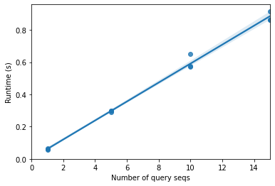{height=300}

$$\text{runtime} \approx \text{constant} \times \text{number of query sequences}$$

5 queries × 10 references = 50 alignments; 10 × 100 = 1000 alignments.

## Ways to reduce runtime

:::{.callout-tip icon=false}
## 1. Perform fewer alignments
- Fewer queries? Researchers want to know what *all* their sequences are.
- Fewer references? We'd risk excluding useful references.
- Don't search **all** queries against **all** references: a procedure, **faster than alignment**, that approximates which alignments are likely to be good (high scoring) — align only those.
:::

:::{.callout-tip icon=false}
## 2. Do the same work faster
Faster implementation, faster computer, or run in **parallel**: $\text{new runtime} \approx \frac{\text{runtime}}{f}$

Production tools like **BLAST** combine these approaches.
:::

## Heuristic algorithms

:::{.callout-tip icon=false}
## The problem isn't going away
- Computers are getting faster/cheaper — but sequencing is getting cheaper, so collections grow.
- Many think DNA sequencing is getting cheaper **faster** than computers are.
- More query sequences for the same money, and ever larger reference databases.
- Book figures (log scale): *Genome sequencing costs* and *Size of GenBank*.
:::

## Heuristics for database searching

:::{.callout-tip icon=false}
## Idea
- Most alignments in a database search are unlikely to be good.
- Define a **heuristic** (rule) to decide which references are likely to give good alignments, and align only those.
- Deciding must be **much faster** than aligning.
- It must make **good** choices: excluded references can't be results. A good heuristic is very unlikely to exclude the best alignment(s).
:::

:::{.callout-note icon=false}
## Key questions
1. How often does the heuristic fail to get the right answer?
2. How much faster is it — and is that worth not being guaranteed the best answer?
:::

## Random reference sequence selection

:::{.callout-tip icon=false}
## A straw man baseline
Select a random $p\%$ of the reference sequences to align against: from $R_s$ alignments (database size) to $p \times R_s$ per query $q_i$.
:::

```python
import random

def heuristic_local_alignment_search_random(
        queries, reference_db, p, n=5, aligner=local_pairwise_align_ssw):
    k = int(p * len(reference_db))
    database_subset = random.sample(reference_db, k)
    return local_alignment_search(queries, database_subset, n=n, aligner=aligner)

current_queries = random.sample(queries, k=10)
results = heuristic_local_alignment_search_random(current_queries, reference_db, p=0.10)
```

## Random selection: sample output {.scrollable}

```{.text .font6}
Closest taxonomies for query 1111024 (in order):
  k__Bacteria; p__Gemmatimonadetes; c__Gemmatimonadetes; o__Gemmatimonadales; f__Ellin5301; g__; s__
  k__Bacteria; p__Gemmatimonadetes; c__Gemmatimonadetes; o__C114; f__; g__; s__
  k__Bacteria; p__Gemmatimonadetes; c__Gemmatimonadetes; o__Gemmatimonadales; f__; g__; s__
  k__Bacteria; p__Gemmatimonadetes; c__Gemmatimonadetes; o__Gemmatimonadales; f__Gemmatimonadaceae; g__Gemmatimonas; s__
  k__Bacteria; p__Verrucomicrobia; c__Opitutae; o__; f__; g__; s__

Closest taxonomies for query 4336536 (in order):
  k__Bacteria; p__OD1; c__SM2F11; o__; f__; g__; s__
  k__Bacteria; p__Acidobacteria; c__Acidobacteria-6; o__iii1-15; f__; g__; s__
  k__Bacteria; p__Acidobacteria; c__Acidobacteria-6; o__iii1-15; f__; g__; s__
  k__Bacteria; p__Acidobacteria; c__Acidobacteria-6; o__iii1-15; f__; g__; s__
  k__Bacteria; p__Acidobacteria; c__Acidobacteria-6; o__iii1-15; f__; g__; s__

Known taxonomy for query 1111024:
 k__Bacteria; p__Gemmatimonadetes; c__Gemmatimonadetes; o__Gemmatimonadales; f__; g__; s__
Known taxonomy for query 4336536:
 k__Bacteria; p__Acidobacteria; c__Acidobacteria-6; o__iii1-15; f__RB40; g__; s__
```

## Defining the "right answer"

:::{.callout-tip icon=false}
## Evaluation criterion
If the **most common taxonomy** among the search results, at `taxonomy_levels` levels (how deep/specific), **matches the known taxonomy**, the algorithm got the right answer.

Vary `taxonomy_levels` to see how heuristics perform at different levels.
:::

## `evaluate_search` {.scrollable}

```python
import collections

def evaluate_search(queries, reference_db, reference_taxonomy, search_function,
                    taxonomy_levels, n=5, aligner=local_pairwise_align_ssw):
    start_time = time.time()
    search_results = search_function(current_queries, reference_db, n=n, aligner=aligner)
    stop_time = time.time()
    runtime = stop_time - start_time
    per_query_runtime = runtime/len(queries)
    data = []
    indices = []
    for q in queries:
        q_id = q.metadata['id']
        indices.append(q_id)
        q_known_taxonomy = tuple(reference_taxonomy[q_id].split('; ')[:taxonomy_levels])
        q_observed_taxonomies = collections.Counter()
        for e in search_results['reference taxonomy'][q_id]:
            q_observed_taxonomies[tuple(e.split('; ')[:taxonomy_levels])] += 1
        q_observed_taxonomy = q_observed_taxonomies.most_common()[0][0]
        data.append((q_known_taxonomy, q_observed_taxonomy))
    index = pd.Index(indices, name='Query ID')
    data = pd.DataFrame(data, index=index, columns=['Known taxonomy', 'Observed taxonomy'])
    number_correct = np.sum(data['Known taxonomy'] == data['Observed taxonomy'])
    fraction_correct = number_correct / data.shape[0]
    return per_query_runtime, fraction_correct, data
```

## Full search vs random heuristic {.scrollable}

Five taxonomy levels (family level). Full database search — **takes a couple of minutes**:

```python
taxonomy_levels = 5
runtime, fraction_correct, data = evaluate_search(current_queries, reference_db, reference_taxonomy,
                                                  local_alignment_search, taxonomy_levels=taxonomy_levels)
```

```
2.97 seconds per query sequence
70.00% correct answers
```

Random 10% of the database:

```python
import functools
heuristic_local_alignment_search_random_10 = functools.partial(heuristic_local_alignment_search_random, p=0.10)
runtime, fraction_correct, data = evaluate_search(current_queries, reference_db, reference_taxonomy,
                                                  heuristic_local_alignment_search_random_10,
                                                  taxonomy_levels=taxonomy_levels)
```

```
0.30 seconds per query sequence
30.00% correct answers
```

## Is random selection a good heuristic?

:::{.callout-tip icon=false}
## Observations
- Across many trials: the correct genus-level assignment about **half as often** as the full search.
- Results vary due to random selection of query and reference sequences.
:::

:::{.callout-note icon=false}
## Exercise
Re-run with **fewer** taxonomy levels (e.g., phylum) and **more** (e.g., species). How does this affect how often we get the right answer?
:::

## Composition-based reference selection

:::{.callout-tip icon=false}
## A smarter heuristic
If the overall **nucleotide composition** of a query is very different from that of a reference, the best alignment is unlikely to come from that pair — so don't align them.

How do we define "overall nucleotide composition" usefully?
:::

## GC content {.scrollable}

:::{.callout-tip icon=false}
## Heuristic
GC content is **fast to compute**. Align only against the `database_subset_size` references with GC content most similar to the query.
:::

```python
database_subset_size = 500

def heuristic_local_alignment_search_gc(
        queries, reference_db, database_subset_size, n=5,
        reference_db_gc_contents=None,
        aligner=local_pairwise_align_ssw):
    results = []
    if reference_db_gc_contents is None:
        reference_db_gc_contents = \
         {r.metadata['id'] : r.gc_content() for r in reference_db}
    for q in queries:
        query_gc_content = q.gc_content()
        database_subset = []
        for r in reference_db:
            ref_gc_content = reference_db_gc_contents[r.metadata['id']]
            # difference in GC content between reference and query;
            # we'll sort and select reference sequences by this value
            database_subset.append((abs(ref_gc_content - query_gc_content), r))
        database_subset.sort(key=lambda x: x[0])
        database_subset = [e[1] for e in database_subset[:database_subset_size]]
        results.append(local_alignment_search(
            [q], database_subset, n=n, aligner=aligner))
    return pd.concat(results)
```

## GC content: results

```python
heuristic_local_alignment_search_gc_2 = functools.partial(heuristic_local_alignment_search_gc,
                                                          database_subset_size=database_subset_size)
runtime, fraction_correct, data = evaluate_search(current_queries, reference_db, reference_taxonomy,
                                                  heuristic_local_alignment_search_gc_2,
                                                  taxonomy_levels=taxonomy_levels)
```

```
0.32 seconds per query sequence
10.00% correct answers
```

:::{.callout-note icon=false}
## Exercise
Increase and decrease `database_subset_size`. How does this affect runtime and the fraction of correct answers?
:::

## kmer content

:::{.callout-tip icon=false}
## kmers
A **kmer** is a word (list of adjacent characters) of length *k* found within a sequence. `overlap=True`: kmers can overlap.
:::

```python
skbio.DNA('ACCGTGACCAGTTACCAGTTTGACCAA').kmer_frequencies(k=5, overlap=True)
```

```{.text .font6}
{'ACCGT': 1, 'CCGTG': 1, 'CGTGA': 1, 'GTGAC': 1, 'TGACC': 2, 'GACCA': 2,
 'ACCAG': 2, 'CCAGT': 2, 'CAGTT': 2, 'AGTTA': 1, 'GTTAC': 1, 'TTACC': 1,
 'TACCA': 1, 'AGTTT': 1, 'GTTTG': 1, 'TTTGA': 1, 'TTGAC': 1, 'ACCAA': 1}
```

## kmer heuristic

:::{.callout-tip icon=false}
## Shared kmers
Align the query only to the references containing the **largest fraction of the kmers observed in the query**.

This makes sense: we only align sequences when it looks like they share multiple length-`k` stretches **not interrupted** by substitutions or insertion/deletion mutations.
:::

```python
def fraction_shared_kmers(kmer_freqs1, kmer_freqs2):
    """Compute the fraction of kmers in kmer_freqs1 that are also in kmer_freqs2
    k-mer counts are not incorporated in this distance metric.
    """
    sequence1_kmers = set(kmer_freqs1)
    num_sequence1_kmers = len(sequence1_kmers)
    sequence2_kmers = set(kmer_freqs2)
    shared_kmers = sequence1_kmers & sequence2_kmers
    return len(shared_kmers) / num_sequence1_kmers
```

## kmer-based search {.scrollable}

```python
def heuristic_local_alignment_search_kmers(
        queries, reference_db, database_subset_size, k, n=5,
        reference_db_kmer_frequencies=None,
        aligner=local_pairwise_align_ssw):
    results = []
    if reference_db_kmer_frequencies is None:
        reference_db_kmer_frequencies = \
         {r.metadata['id'] : r.kmer_frequencies(k=k, overlap=True) for r in reference_db}
    for q in queries:
        query_kmer_frequency = q.kmer_frequencies(k=k, overlap=True)
        database_subset = []
        for r in reference_db:
            ref_kmer_frequency = reference_db_kmer_frequencies[r.metadata['id']]
            s = fraction_shared_kmers(query_kmer_frequency, ref_kmer_frequency)
            database_subset.append((s, r))
        database_subset.sort(key=lambda x: x[0], reverse=True)
        database_subset = [e[1] for e in database_subset[:database_subset_size]]
        results.append(local_alignment_search(
            [q], database_subset, n=n, aligner=aligner))
    return pd.concat(results)

k = 7
heuristic_local_alignment_search_kmers_50 = \
    functools.partial(heuristic_local_alignment_search_kmers, k=k,
                      database_subset_size=database_subset_size)
```

```
5.18 seconds per query sequence
70.00% correct answers
```

How do runtime and accuracy compare to GC content and the full search?

## Pre-computing reference database information

:::{.callout-tip icon=false}
## Reuse what doesn't change
- The reference database **rarely changes** → pre-compute features of reference sequences once and reuse them.
- Computing all reference kmer frequencies is a lot of work (~a minute) — saved on **every** search.
:::

```python
reference_db_kmer_frequencies = {r.metadata['id']: r.kmer_frequencies(k=k, overlap=True)
                                 for r in reference_db}

heuristic_local_alignment_search_kmers_50 = \
 functools.partial(heuristic_local_alignment_search_kmers,
                   reference_db_kmer_frequencies=reference_db_kmer_frequencies,
                   k=k, database_subset_size=database_subset_size)
```

```
0.60 seconds per query sequence
70.00% correct answers
```

This last search is **very similar to how BLAST works**.

# Statistical significance of a pairwise alignment

## How good is an alignment?

:::{.callout-tip icon=false}
## Scores are hard to interpret
- An alignment score depends on query and reference **lengths**.
- Possibly also on their **composition**, depending on the substitution matrix.
- How do we determine *how good* a given alignment is? → a **statistical** approach.
:::

## Metrics of alignment quality

:::{.callout-tip icon=false}
## Candidate metrics
- alignment length (relevant for local, not global, alignment)
- pairwise similarity
- score
- number of substitutions (reported e.g. by BLAST)
- number of insertion/deletion (gap) positions

**None of these are useful on their own.**
:::

## Example: substitutions vs gaps

Align:
```
GAAGCAGCAC
GAACAGAAC
```

Fewest substitutions (zero!) — but many homologous-looking bases unaligned:
```
GAAGCAGCAC-----
GAA------CAGAAC
```

Fewest gaps — but many substitutions and misaligned regions (e.g., `CAG`):
```
GAAGCAGCAC
GAACAGA-AC
```

The **alignment score** balances these features (and the scoring scheme can be adjusted) — but scores are hard to interpret, especially when we have only one or a few.

## p-values and $\alpha$

:::{.callout-tip icon=false}
## p-value
An alignment represents a **hypothesis about homology**. Ask:

*What fraction of the time would I obtain a score at least this good if my sequences are **not** homologous?*

- High p-value (e.g., 25%) → probably not a good alignment.
- Low p-value (e.g., 0.001%) → probably good: such scores are achieved infrequently.
:::

:::{.callout-tip icon=false}
## $\alpha$
Threshold set by how often we're willing to be wrong. If $p < \alpha$ → **statistically significant**; otherwise not.
:::

## False positives and false negatives

:::{.callout-tip icon=false}
## Two ways to be wrong
- Call sequences homologous when they're not → **false positive** (type 1 error).
- Call sequences not homologous when they are → **false negative** (type 2 error).
:::

:::{.callout-tip icon=false}
## $\alpha$ is a dial
- $\alpha = 0.05$: accept a false positive ~1 in 20 times → err on the side of **false positives**.
- $\alpha = 1 \times 10^{-50}$: err on the side of **false negatives**.
- Turn up → more FPs, fewer FNs. Turn down → fewer FPs, more FNs.
:::

## Choosing $\alpha$

:::{.callout-tip icon=false}
## Application specific
- No hard-and-fast rule whether false positives or false negatives are better.
- Understand the biological question and the ramifications of each.
:::

:::{.callout-note icon=false}
## Question
When might you prefer false positives? When might you prefer false negatives?
:::

## Interpreting alignment scores in context

:::{.callout-tip icon=false}
## Empirical approach
1. Align the pair of sequences and compute the score.
2. Align **many** pairs of sequences similar to the query and reference, but **known not to be homologous**.
3. Get these by **shuffling** (randomizing the order of bases in) the query.
4. Compare the actual score to this distribution.
:::

## Random and shuffled sequences {.scrollable}

```python
def random_sequence(moltype, length):
    result = []
    alphabet = list(moltype.nondegenerate_chars)
    for e in range(length):
        result.append(random.choice(alphabet))
    return moltype(''.join(result))

def shuffle_sequence(sequence):
    # generate a list of the position indices (numbers) in sequence
    randomized_order = list(range(len(sequence)))
    # randomly rearrange the order of that list
    random.shuffle(randomized_order)
    # return a new sequence, where the positions are shuffled
    return sequence[randomized_order]
```

```{.text .font6}
seq = random_sequence(skbio.DNA, 50)       # GC-content: 54.00%
0 GATAAGAAAT TAACCGCGTG GTGGGGAGAC GGCCCTTGTG TGGCTCAATC
shuffle_sequence(seq)                      # GC-content: 54.00%
0 AGGACGGACA GAGTGCTCGG GTCGTTAGAC CACGAGTGAT TCCGATTTGA
```

Shuffling changes the **order** but not the **composition** — exactly like shuffling a deck of cards.

## Distribution of random scores {.scrollable}

```python
query_seq = random_sequence(skbio.DNA, 50)
_, actual_score, _ = local_pairwise_align_ssw(query_seq, query_seq)
print("Score: %1.2f" % actual_score)    # Score: 100.00

def generate_random_score_distribution(sequence1, sequence2, n=99,
                                       aligner=local_pairwise_align_ssw):
    scores = []
    for i in range(n):
        # generate a randomized version of the first sequence
        random_sequence = shuffle_sequence(sequence1)
        # align it against the second sequence and save its score
        _, score, _ = aligner(random_sequence, sequence2)
        scores.append(score)
    return scores

random_scores = generate_random_score_distribution(query_seq, query_seq, 99)
```

```{.text .font6}
[10, 11, 10, 10, 13, 8, 13, 10, 10, 11, 12, 12, 14, 12, 9, 9, 11, 11, 11, 13, 12, 11, 12, 11, 12, 11, 15, 9, 12, 14, 16, 8, 13, ...]
```

## Actual vs random scores

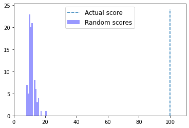{height=380}

What does this tell us about our alignment score — is it good or bad?

## Empirical p-value

:::{.callout-tip icon=false}
## Data-driven p-value
- Count how many random scores are **at least as high** as the actual score; divide by the number of scores.
- Define $\alpha$ **before** computing the p-value, so the p-value doesn't influence the choice of $\alpha$.
- Here $\alpha = 0.05$: if $p < 0.05$, the alignment is significant → accept the homology hypothesis.
:::

## `fraction_better_or_equivalent_alignments`

```python
def fraction_better_or_equivalent_alignments(sequence1, sequence2, n=99,
                                             aligner=local_pairwise_align_ssw):
    # align sequence1 and sequence2 and store the score of the alignment
    _, actual_score, _ = aligner(sequence1, sequence2)
    # compute the distribution of randomized scores
    random_scores = generate_random_score_distribution(sequence1, sequence2, n,
                                                       aligner=aligner)
    # count the number of random scores at least as good as our actual score
    count_better = 0
    for s in random_scores:
        if s >= actual_score:
            count_better += 1
    # add one to numerator and denominator to account for actual_score
    return (count_better + 1) / (n + 1)

fraction_better_or_equivalent_alignments(query_seq, query_seq, 99)   # 0.01
```

$0.01 < \alpha$ → accept the hypothesis that the sequences are homologous.

## Notes on empirical p-values

$$p = \frac{\#\text{ computed alignment scores} \geq \text{actual score}}{\#\text{ alignment scores computed}}$$

- Numerator and denominator both include the actual score → the lowest achievable p-value is $\frac{1}{99 + 1}$.
- More permutations (e.g., 999) → more precision: `0.001`.
- At the lowest possible value, report the p-value as **less than** that value:

> *The alignment of our query and reference sequence was statistically significant, as determined by comparing our actual alignment score to random variants ($p < 0.001$).*

## Harder cases: non-homologous sequences

Two independently generated random sequences — we **know** they're not homologous:

```python
sequence1 = random_sequence(skbio.DNA, 250)
sequence2 = random_sequence(skbio.DNA, 250)
fraction_better_or_equivalent_alignments(sequence1, sequence2)   # 0.93
```

Now the interesting region in between — introduce mutations at only some positions:

```python
def partially_randomize_sequence(percent_id, sequence):
    result = []
    for c in sequence:
        if random.random() < percent_id:
            result.append(str(c))
        else:
            # choose a base at random that is not the current base
            # i.e., simulate a substitution event
            result.append(choice([r for r in sequence.nondegenerate_chars if r != c]))
    return sequence.__class__(''.join(result))
```

## 95% vs 25% identity {.scrollable}

```{.text .font6}
sequence1
0   GTGCCTACTG AGGGAGCTCA TCGTGCGCAG CATCATACGC ATAACCGAAT TCTATTAGCC
sequence1_95
0   GTGCCTACTG AGGGAGCTCA TCGTTCGCAG CTTCATACGG GTAACCGAAT TCTATTAGCC
sequence1_25
0   GTGGATAATA CGTGATAGCA TGGTGAGGAT GAGTTCACCA ATTGACGCTT TTTCTCAGCG
```

```python
sequence1_95 = partially_randomize_sequence(0.95, sequence1)
fraction_better_or_equivalent_alignments(sequence1, sequence1_95)   # 0.01

sequence1_25 = partially_randomize_sequence(0.25, sequence1)
fraction_better_or_equivalent_alignments(sequence1, sequence1_25)   # 0.26
```

- 95%: significant → homologous.
- 25%: not significant, even though `sequence1_25` *is* derived from `sequence1`.

## Limit of detection

:::{.callout-tip icon=false}
## A real-world problem
- Homology detected for very closely related sequences (`sequence1_95`), not for distant ones (`sequence1_25`).
- As sequences diverge, **detecting homology becomes increasingly difficult**.
- Simulation: vary `percent_id` and find where the approach **stops** identifying pairs as homologous.
- Tells us the pairwise similarity below which we can no longer identify homology with this approach.
:::

## Simulation {.scrollable}

```python
# the range of percent identities that we'll test
percent_ids = np.arange(0.0, 1.0, 0.05)
# the number of random sequences we'll test at each percent identity
num_trials = 20
sequence_length = 150
random_sequences = [random_sequence(skbio.DNA, sequence_length) for i in range(num_trials)]

results = []
for percent_id in percent_ids:
    # at each percent_id, track the p-values for each trial (random sequence)
    p_values = []
    for sequence in random_sequences:
        # partially randomize the sequence, compute its p-value, and record it
        sequence_at_percent_id = partially_randomize_sequence(percent_id, sequence)
        p = fraction_better_or_equivalent_alignments(sequence, sequence_at_percent_id)
        p_values.append(p)
    results.append((percent_id, np.median(p_values), np.mean(p_values)))
pd.DataFrame(results, columns=["Percent id between query and subject",
                               "Median p-value", "Mean p-value"])
```

## Simulation results {.scrollable}

::: {.columns}
::: {.column width="55%"}
::: {.font6}
| Percent id | Median p | Mean p |
|----|----|----|
| 0.00 | 0.545 | 0.5495 |
| 0.05 | 0.750 | 0.6420 |
| 0.10 | 0.670 | 0.6015 |
| 0.15 | 0.665 | 0.6225 |
| 0.20 | 0.425 | 0.5160 |
| 0.25 | 0.390 | 0.4450 |
| 0.30 | 0.280 | 0.3005 |
| 0.35 | 0.160 | 0.3180 |
| 0.40 | 0.010 | 0.1065 |
| 0.45 | 0.010 | 0.0815 |
| 0.50 | 0.010 | 0.0225 |
| 0.55 | 0.010 | 0.0100 |
| 0.60–0.95 | 0.010 | 0.0100 |
:::
:::
::: {.column width="45%"}
:::{.callout-note icon=false}
## Questions
- How similar must a pair of sequences be for us to reliably identify homology? Higher or lower than you expected?
- Shortcuts were taken to keep runtime low. What could make this simulation more robust?
:::
:::
:::

# Machine learning in bioinformatics

## Machine learning

:::{.callout-tip icon=false}
## Why
- Used for tasks where an algorithm should help **identify patterns in a complex dataset**.
- Implementations here are for learning, not for practice.
- [scikit-learn](http://scikit-learn.org/): popular, well-documented Python ML library — a great place to start.
:::

:::{.callout-warning}
ML algorithms can easily be misused — intentionally or not — to give **misleading results**. This is only a primer. See scikit-learn's [Common pitfalls and recommended practices](https://scikit-learn.org/stable/common_pitfalls.html).
:::

## The feature table

:::{.callout-tip icon=false}
## Samples × features
- ML algorithms get a table of **samples** and user-defined **features** of those samples.
- A matrix: samples are **rows**, features are **columns** → the **feature table**.
- Central to ML and many subfields of bioinformatics.
- Terms are purposefully general: samples = any unit of study; features = attributes of samples.
- **Labels** / **response variables** may be associated with samples → a different class of methods applies.
:::

## The Iris dataset

:::{.callout-tip icon=false}
## A classic
- Originally published by **RA Fisher** (1936).
- Four features of **150 specimens** of *Iris* (a genus of flowering plant), **three species**.
:::

```python
import sklearn.datasets
import pandas as pd

iris_dataset = sklearn.datasets.load_iris(as_frame=True)
iris_feature_table = iris_dataset.frame.drop('target', axis=1)
iris_feature_table.index.name = 'sample-id'
# map target integers onto species names
iris_labels = pd.Series(iris_dataset.target_names[iris_dataset.target],
                        index=iris_dataset.target.index, name='species').to_frame()
iris_labels.index.name = 'sample-id'
```

## Iris feature table

::: {.columns}
::: {.column width="60%"}
::: {.font8}
| sample-id | sepal length (cm) | sepal width (cm) | petal length (cm) | petal width (cm) |
|----|----|----|----|----|
| 0 | 5.1 | 3.5 | 1.4 | 0.2 |
| 1 | 4.9 | 3.0 | 1.4 | 0.2 |
| 2 | 4.7 | 3.2 | 1.3 | 0.2 |
| ... | ... | ... | ... | ... |
| 148 | 6.2 | 3.4 | 5.4 | 2.3 |
| 149 | 5.9 | 3.0 | 5.1 | 1.8 |

150 rows × 4 columns
:::
:::
::: {.column width="40%"}
- **Sample vector** (row): sample id + value of each feature.
- **Feature vector** (column): feature id + values measured in each sample.
- Feature ids can be simple descriptions — or integers.
:::
:::

## Labels

::: {.columns}
::: {.column width="40%"}
::: {.font8}
| sample-id | species |
|---|---|
| 0 | setosa |
| 1 | setosa |
| ... | ... |
| 148 | virginica |
| 149 | virginica |
:::
:::
::: {.column width="60%"}
- The feature table alone → input for **unsupervised** learning (e.g., are there groups of similar samples?).
- Sample ids in labels must match the feature table.
- Features + labels → input for **supervised** learning (e.g., a classifier that reports species from sepal/petal measurements).
- Three classes: `setosa`, `versicolor`, `virginica`.
:::
:::

## Unsupervised vs supervised learning

:::{.callout-tip icon=false}
## Unsupervised learning
- Labels are **not available or not used**; operates on the feature table alone.
- Goal: discover **structure** — which samples are most similar based on feature values.
- Example: **ordination** — very widely used in biology (PCoA, NMDS plots).
:::

:::{.callout-tip icon=false}
## Supervised learning
- Sample **labels** are used in addition to the feature table.
- Discrete labels → **classification**; continuous labels → **regression**.
- Goal: a model that accurately predicts an unlabeled sample's label from its features.
:::

## ML applied to microbial sequence data

:::{.callout-tip icon=false}
## Setup
- 16S rRNA sequences from **Greengenes** → build a feature table.
- Labels: used in the supervised task, and to aid interpretation in the unsupervised task.
- Goal: explore **species-level taxonomy** of a few microbial species.
  - Unsupervised: are sequences from the same species more similar to each other than to other species?
  - Supervised: can we build a classifier predicting species from an unlabeled sequence?
:::

## Loading annotated sequences {.scrollable}

```python
def load_annotated_sequences(taxa_of_interest, class_size=None, sequence_length=500,
                             verbose=True, ids_to_exclude=None):
    result = {}
    SequenceRecord = collections.namedtuple(typename='SequenceRecord',
                                            field_names=['identifier', 'split_taxonomy', 'taxonomy', 'sequence'])
    taxon_to_sequence_records = {t: list() for t in taxa_of_interest}

    id_to_taxonomy_record = {}
    for line in open(qdr.get_reference_taxonomy()):
        identifier, taxonomy = line.strip().split('\t')
        id_to_taxonomy_record[identifier] = taxonomy

    for seq in skbio.io.read(qdr.get_reference_sequences(), format='fasta',
                             constructor=skbio.DNA):
        identifier = seq.metadata['id']
        if ids_to_exclude is not None and identifier in ids_to_exclude:
            continue
        tax = id_to_taxonomy_record[identifier]
        split_taxonomy = [e.strip() for e in tax.split(';')]
        taxonomy = ';'.join(split_taxonomy)
        if taxonomy not in taxon_to_sequence_records:
            continue
        if seq.has_degenerates():
            continue
        if sequence_length is not None:
            sequence = seq[:sequence_length]
        else:
            sequence = seq
        sr = SequenceRecord(identifier=identifier, split_taxonomy=split_taxonomy,
                            taxonomy=taxonomy, sequence=sequence)
        taxon_to_sequence_records[taxonomy].append(sr)

    if class_size is None:
        result = {sr.identifier: sr for srs in taxon_to_sequence_records.values() for sr in srs}
    else:
        result = {}
        for taxon, srs in taxon_to_sequence_records.items():
            sampled_sequence_records = random.sample(srs, k=class_size)
            result.update({sr.identifier: sr for sr in sampled_sequence_records})
    return result
```

## Taxa of interest {.scrollable}

Five sequences from each of seven species:

```{.python .font6}
taxa_of_interest = {
    'k__Bacteria;p__Bacteroidetes;c__Bacteroidia;o__Bacteroidales;f__Prevotellaceae;g__Prevotella;s__stercorea',
    'k__Bacteria;p__Bacteroidetes;c__Bacteroidia;o__Bacteroidales;f__Prevotellaceae;g__Prevotella;s__copri',
    'k__Bacteria;p__Bacteroidetes;c__Bacteroidia;o__Bacteroidales;f__Prevotellaceae;g__Prevotella;s__melaninogenica',
    'k__Bacteria;p__Bacteroidetes;c__Flavobacteriia;o__Flavobacteriales;f__Flavobacteriaceae;g__Flavobacterium;s__succinicans',
    'k__Bacteria;p__Actinobacteria;c__Actinobacteria;o__Actinomycetales;f__Propionibacteriaceae;g__Propionibacterium;s__acnes',
    'k__Bacteria;p__Proteobacteria;c__Gammaproteobacteria;o__Pseudomonadales;f__Pseudomonadaceae;g__Pseudomonas;s__veronii',
    'k__Bacteria;p__Proteobacteria;c__Gammaproteobacteria;o__Pseudomonadales;f__Pseudomonadaceae;g__Pseudomonas;s__viridiflava'
}
sequences_per_taxon = 5
seq_data = load_annotated_sequences(taxa_of_interest, class_size=sequences_per_taxon)
```

```{.text .font6}
15 sequences were identified for taxon ...;g__Flavobacterium;s__succinicans.
127 sequences were identified for taxon ...;g__Propionibacterium;s__acnes.
26 sequences were identified for taxon ...;g__Prevotella;s__melaninogenica.
35 sequences were identified for taxon ...;g__Prevotella;s__stercorea.
17 sequences were identified for taxon ...;g__Pseudomonas;s__viridiflava.
24 sequences were identified for taxon ...;g__Pseudomonas;s__veronii.
121 sequences were identified for taxon ...;g__Prevotella;s__copri.
```

Each record: unique identifier, source species, and a 16S rRNA sequence.

## Choosing features: k-mers

:::{.callout-tip icon=false}
## What should the features be?
- k-mers helped find relevant sequences in database searching — may be useful here too.
- **Longer** k-mers are more likely to be **specific** to certain taxa — helpful.
- **Too long**: less likely to be observed in other sequences (more variation across closely related organisms) — we need features **shared** among related samples.
- Here $k = 4$, chosen by experimenting with multiple Greengenes subsamples. Other values of $k$, or other sequence features, are possible.
:::

## Building the feature table

```python
k = 4

def feature_table_from_sequence_records(sequence_records, k):
    kmer_frequencies = {id_ : sr.sequence.kmer_frequencies(k=k) for id_, sr in sequence_records.items()}
    result = pd.DataFrame(kmer_frequencies).fillna(0).astype(int).T
    result.index.name = 'id'
    return result

sequence_feature_table = feature_table_from_sequence_records(seq_data, k)
```

::: {.font6}
| id | GATG | ATGA | TGAA | GAAC | AACG | ACGC | ... | TTCC | GTTC | ATTC |
|----|----|----|----|----|----|----|----|----|----|----|
| 1020921 | 4 | 3 | 2 | 2 | 4 | 2 | ... | 0 | 0 | 0 |
| 1111241 | 5 | 2 | 2 | 1 | 3 | 1 | ... | 0 | 0 | 0 |
| 4226754 | 3 | 1 | 1 | 3 | 4 | 2 | ... | 0 | 0 | 0 |
| 535359 | 4 | 2 | 2 | 2 | 3 | 1 | ... | 2 | 1 | 1 |

Rows: sequences; columns: unique k-mers (256 columns); values: counts.
:::

## Sample labels {.scrollable}

```python
def feature_labels_from_sequence_records(sequence_records):
    result = pd.DataFrame({id_:sr.split_taxonomy for id_, sr in sequence_records.items()}).T
    result.columns = ['domain', 'phylum', 'class', 'order', 'family', 'genus', 'species']
    result.index.name = 'id'
    legend_entries = []
    for _, (g, s, p) in result[['genus', 'species', 'phylum']].iterrows():
        legend_entries.append('%s %s (%s)' % (g[3:], s[3:], p[3:]))
    result['legend entry'] = legend_entries
    return result

sequence_labels = feature_labels_from_sequence_records(seq_data)
```

::: {.font6}
| id | phylum | genus | species | legend entry |
|----|----|----|----|----|
| 1020921 | p\_\_Bacteroidetes | g\_\_Flavobacterium | s\_\_succinicans | Flavobacterium succinicans (Bacteroidetes) |
| 1111241 | p\_\_Bacteroidetes | g\_\_Flavobacterium | s\_\_succinicans | Flavobacterium succinicans (Bacteroidetes) |
| 4226754 | p\_\_Actinobacteria | g\_\_Propionibacterium | s\_\_acnes | Propionibacterium acnes (Actinobacteria) |
| 403853 | p\_\_Actinobacteria | g\_\_Propionibacterium | s\_\_acnes | Propionibacterium acnes (Actinobacteria) |
| 535359 | p\_\_Bacteroidetes | g\_\_Prevotella | s\_\_melaninogenica | Prevotella melaninogenica (Bacteroidetes) |
:::

# Unsupervised learning

## Ordination

:::{.callout-tip icon=false}
## Two strokes
1. **Polar Ordination** — simple math, not widely used in practice (more informative techniques exist). Shows how ordination **reduces dimensionality** and how to interpret results.
2. **Principal Coordinates Analysis (PCoA)** — more complicated math; applied using scikit-bio.
:::

## Computing distances between samples

:::{.callout-tip icon=false}
## Jaccard
Most ordination techniques start by computing **distances** between all pairs of samples. Here: the fraction of k-mers unique to either sample — the **Jaccard distance**.

$$\text{Jaccard Index}_{(A,B)} = \frac{|A \cap B|}{|A \cup B|}$$

- $|A \cap B|$: number of features observed (value ≥ 1) in **both** samples — size of the intersection.
- $|A \cup B|$: number of features observed in **either or both** — size of the union.

$$\text{Jaccard Distance}_{(A,B)} = 1 - \text{Jaccard Index}_{(A,B)}$$
:::

## Distance matrix

Applying this to all pairs of samples gives a **distance matrix**:

```python
import skbio.diversity

sequence_distance_matrix = skbio.diversity.beta_diversity('jaccard', sequence_feature_table,
                                                          ids=sequence_feature_table.index)
```

:::{.callout-tip icon=false}
## Properties
- Diagonal is zero: $\text{Jaccard Distance}_{(A,A)} = 0$.
- Symmetric: $\text{Jaccard Distance}_{(A,B)} = \text{Jaccard Distance}_{(B,A)}$.
:::

```python
d = sequence_distance_matrix[sample_id1, sample_id2]
# The Jaccard Distance between samples 1020921 and 1111241 is 0.150.
```

## Distance matrix heatmap

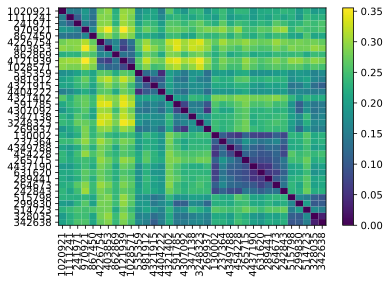{height=420}

**Exercise**: compare to the sample labels (`sequence_labels`) — do you notice any patterns?

## Polar ordination

:::{.callout-tip icon=false}
## Building a scatterplot from a distance matrix
Ordination results are typically viewed in a 2D or 3D scatterplot.

**Step 1**: find the **largest distance** $D$ in the distance matrix and its two samples.
:::

```python
sorted_indices = np.argsort(sequence_distance_matrix.data, axis=None)[::-1]
sorted_indices = np.unravel_index(sorted_indices, shape=sequence_distance_matrix.shape)
sample_id1 = sequence_distance_matrix.ids[sorted_indices[0][0]]
sample_id2 = sequence_distance_matrix.ids[sorted_indices[0][1]]
D = sequence_distance_matrix[sample_id1, sample_id2]
```

```
The largest distance in the distance matrix is 0.355, between samples 970921 and 4121939.
```

## The first axis

:::{.callout-tip icon=false}
## Placing samples
- These two samples define the **first axis**, of length $D$: one at $0$, the other at $D$ (which goes where doesn't matter).
- Every other sample $s$ is placed at:

$$A_s = \frac{D^2 + D1^2 - D2^2}{2 \times D}$$

- $D1$: distance between $s$ and the sample at $0$; $D2$: distance between $s$ and the sample at $D$ (both from the distance matrix).
:::

```python
def compute_axis(dm, endpoint1, endpoint2):
    d = dm[endpoint1, endpoint2]
    result = {endpoint1: 0, endpoint2: d}
    non_endpoints = set(dm.ids) - set([endpoint1, endpoint2])
    for e in non_endpoints:
        d1 = dm[endpoint1, e]
        d2 = dm[endpoint2, e]
        result[e] = (d**2 + d1**2 - d2**2) / (2 * d)
    return pd.Series(result)
```

## First axis values {.scrollable}

```python
axis1_values = compute_axis(sequence_distance_matrix, sample_id1, sample_id2)
axis1_values.sort_values()
```

```{.text .font6}
970921     0.000000
241971     0.080489
867450     0.084018
1111241    0.093832
1020921    0.101953
3248323    0.110663
347138     0.115381
...
242843     0.206698
862869     0.257691
1028571    0.301334
4226754    0.305866
403853     0.345773
4121939    0.355372
```

**Exercise**: compare with `sequence_labels` — any patterns in the ordered samples?

## Strip plot of the first axis

```python
import seaborn as sns
_ = sns.stripplot(x=axis1_values)
```

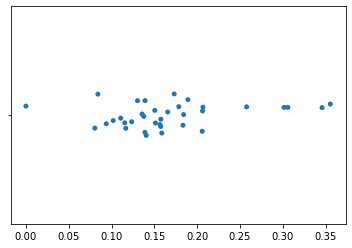{height=300}

- Only placement on the **horizontal** axis is meaningful; vertical jitter aids visualization.
- Each point is a sample; closer samples are more similar in k-mer composition.

## More axes

:::{.callout-tip icon=false}
## Selecting further axes
- Additional axes **uncorrelated** with the first provide more information.
- Selecting them is more complicated: compute **all** axes (one for every pair of samples), then pick those representing large distances but **uncorrelated** with previously selected axes.
:::

```python
def polar_ordination(dm):
    result = {}
    for i, id1 in enumerate(dm.ids):
        for id2 in dm.ids[:i]:
            axis_label = '%s to %s' % (id1, id2)
            result[axis_label] = compute_axis(dm, id1, id2)
    result = pd.DataFrame(result)
    return result

sequence_polar_ordination = polar_ordination(sequence_distance_matrix)
# 35 rows × 595 columns
```

## Scoring axes

:::{.callout-tip icon=false}
## An objective criterion
- 595 axes aren't more interpretable than the distance matrix.
- Axis 1: the largest distance. Axis 2: a large distance **and** uncorrelated with axis 1.
- "Uncorrelated" is subjective → define a **score**:

$$\text{Score}_{A} = \frac{\text{max distance on } A}{|\text{Spearman}(\text{Axis 1}, A)|}$$
:::

## `select_polar_ordination_axes`

```python
def select_polar_ordination_axes(polar_ordination):
    distance_sorted_ord_axes = polar_ordination.max().sort_values(ascending=False)
    first_axis_idx = distance_sorted_ord_axes.index[0]
    corrs = polar_ordination.corrwith(polar_ordination[first_axis_idx],
                                      method='spearman').abs().sort_values(ascending=False)
    scores = distance_sorted_ord_axes / corrs
    result = pd.concat([distance_sorted_ord_axes, corrs, scores], axis=1)
    result.columns = ['maximum distance', 'corr with first axis', 'score']
    result.sort_values(by='score', ascending=False, inplace=True)
    second_axis_idx = result.index[0]
    return first_axis_idx, second_axis_idx, result
```

```
Axis 1 is defined by the distance from sample 4121939 to 970921
Axis 2 is defined by the distance from sample 289441 to 862869
```

## Axis summaries

::: {.font8}
|                    | maximum distance | corr with first axis | score      |
|--------------------|------------------|----------------------|------------|
| 289441 to 862869   | 0.231469         | 0.000560             | 413.171897 |
| 3248323 to 4321402 | 0.229508         | 0.001821             | 126.044136 |
| 631620 to 4226754  | 0.272340         | 0.002241             | 121.531915 |
| 299830 to 241971   | 0.230453         | 0.002801             | 82.265843  |
| 264673 to 4226754  | 0.300847         | 0.007003             | 42.961017  |
| ...                | ...              | ...                  | ...        |
| 4307092 to 591785  | 0.076598         | 0.544258             | 0.140739   |
| 4404222 to 535359  | 0.090750         | 0.666480             | 0.136163   |

595 rows × 3 columns
:::

## Two-dimensional polar ordination

```python
_ = sns.scatterplot(x=sequence_polar_ordination[first_axis_idx],
                    y=sequence_polar_ordination[second_axis_idx])
```

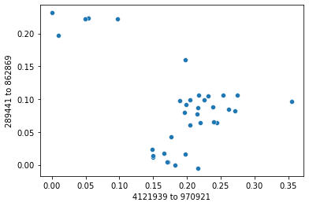{height=330}

Grouping should be more distinct than in the strip plot: samples can separate along **two** axes.

## What has been "learned"

:::{.callout-tip icon=false}
## Structure in the data
- Samples close in the scatterplot have, on average, **smaller distances** than samples far apart.
- This structure is what the polar ordination algorithm has "learned".
- Labels were **not used** — yet samples that cluster together are from the **same species**.
:::

## Coloring by label

```python
_ = sns.scatterplot(x=sequence_polar_ordination[first_axis_idx],
                    y=sequence_polar_ordination[second_axis_idx],
                    hue=sequence_labels['legend entry'])
```

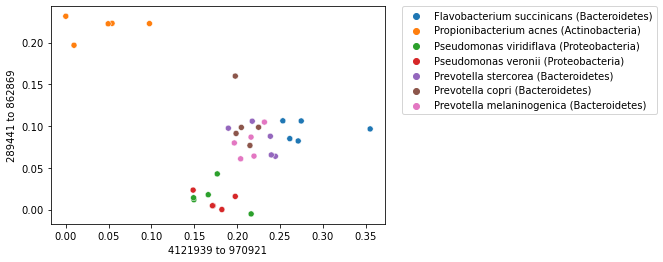{height=330}

:::{.callout-note}
Labels help **interpret** the plot but were not used to **compute** it — this is what makes the ordination **unsupervised**.
:::

## Interpreting ordination plots: axis order

:::{.callout-tip icon=false}
## Axis order matters
- The **first** axis typically represents the **largest** differences in the dataset.
- The **second**: the next largest differences, uncorrelated with the first.
- Without axes representing the largest distances, we'd be less likely to see patterns.
:::

```python
distance_sorted_axis_summary = axis_summaries.sort_values(by='maximum distance', ascending=True)
largest_distance_axis_idx = distance_sorted_axis_summary.index[-1]
smallest_distance_axis_idx = distance_sorted_axis_summary.index[0]
```

## Largest-distance axis

```python
_ = sns.stripplot(x=sequence_polar_ordination[largest_distance_axis_idx],
                  y=sequence_labels['legend entry'])
```

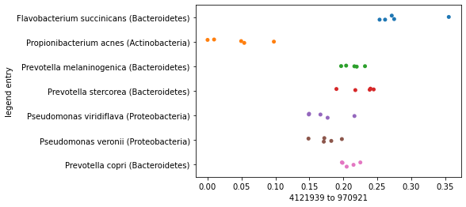{height=360}

Samples within each species roughly group together; maybe even some separation of species.

## Smallest-distance axis

```python
_ = sns.stripplot(x=sequence_polar_ordination[smallest_distance_axis_idx],
                  y=sequence_labels['legend entry'])
```

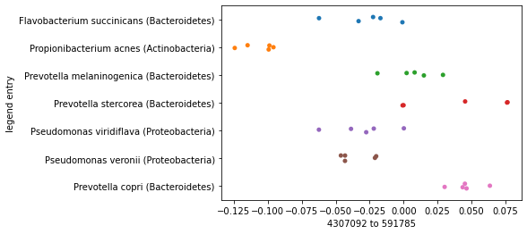{height=360}

Clustering by species is much less apparent. Later axes represent smaller differences — focus on the **first few** axes.

## Uncorrelated axes

:::{.callout-tip icon=false}
## Why uncorrelated
Correlated axes, by definition, present **similar information**. Plot a second axis highly correlated with the first:
:::

```python
# the axis most correlated with first_axis_idx is first_axis_idx itself, so select the second
correlated_axis_idx = axis_summaries.sort_values(by='corr with first axis', ascending=False).index[1]
```

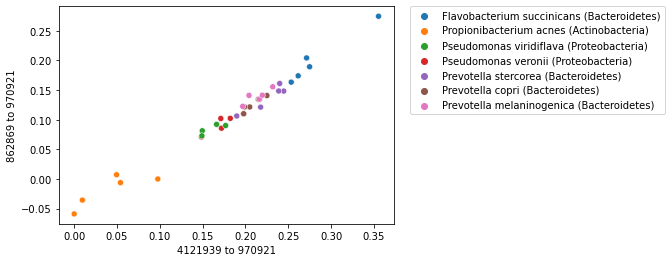{height=300}

## Correlated axes add little

:::{.callout-tip icon=false}
## Observations
- We don't get much more information from the second axis than from the first.
- Draw a line along the diagonal: placement of points along it ≈ the strip plot of the first axis.
- The correlated axis adds little to our understanding of clustering — we might as well not have it.
:::

## Directionality of the axes

:::{.callout-tip icon=false}
## End points are arbitrary
Which sample is placed at $0$ and which at $D$ was an arbitrary choice.
:::

::: {.columns}
::: {.column width="50%"}
```python
axis1_values_a = compute_axis(
    sequence_distance_matrix,
    sample_id1, sample_id2)
```
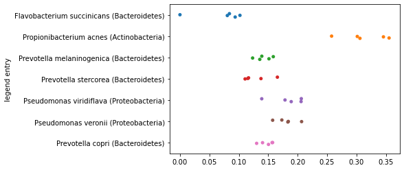
:::
::: {.column width="50%"}
```python
axis1_values_b = compute_axis(
    sequence_distance_matrix,
    sample_id2, sample_id1)
```
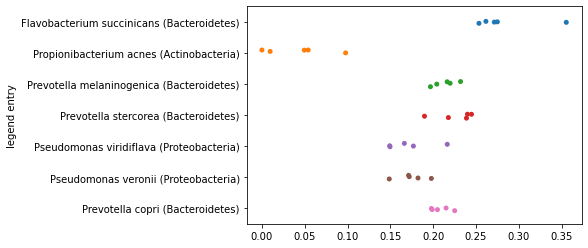
:::
:::

## Mirror images

:::{.callout-tip icon=false}
## Direction is not meaningful
- The two plots are **mirror images**: perfectly anti-correlated, identical information about grouping.
- True for **any** axis in an ordination: you can always flip an axis and have the same result.
- Running the same ordination multiple times may flip axes — an implementation detail that doesn't affect results.
:::

## Principal Coordinates Analysis (PCoA)

:::{.callout-tip icon=false}
## PCoA
- Math more complex than polar ordination, but it **works better** and should be preferred in practice.
- scikit-bio includes an implementation.
:::

```python
import skbio.stats.ordination
sequence_pcoa_ordination = skbio.stats.ordination.pcoa(sequence_distance_matrix)

_ = sns.scatterplot(x=sequence_pcoa_ordination.samples['PC1'],
                    y=sequence_pcoa_ordination.samples['PC2'])
```

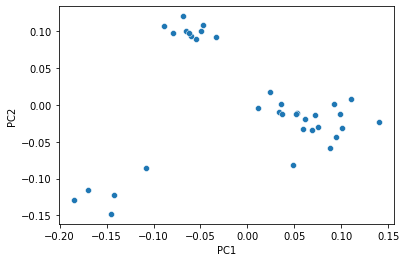{height=250}

## PCoA with labels

```python
_ = sns.scatterplot(x=sequence_pcoa_ordination.samples['PC1'],
                    y=sequence_pcoa_ordination.samples['PC2'],
                    hue=sequence_labels['legend entry'])
```

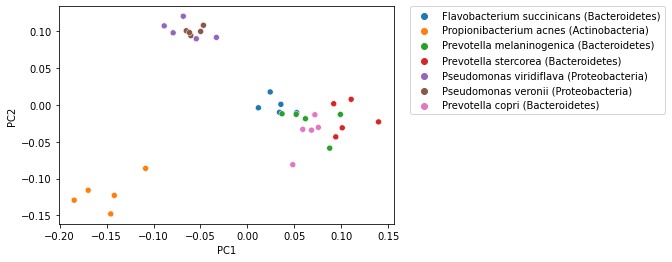{height=360}

As with polar ordination, labels were **not used** in the PCoA computation.

## Exploratory analysis: coloring by phylum

```python
_ = sns.scatterplot(x=sequence_pcoa_ordination.samples['PC1'],
                    y=sequence_pcoa_ordination.samples['PC2'],
                    hue=sequence_labels['phylum'])
```

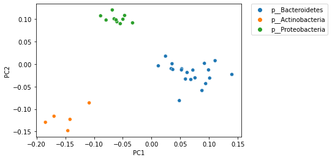{height=320}

Ordination plots are used to see if sample similarity is associated with metadata. Samples cluster **more distinctly by phylum** than by species.

## Further axes: PC1 vs PC3

:::{.callout-tip icon=false}
## Many axes
- Ordination generates many axes (number depends on method; generally a function of the number of samples).
- Axes are ordered by **variation explained**: axis 1 > axis 2 > axis 3 ...
- Visualizations focus on the first two or three; later axes may be misleading.
:::

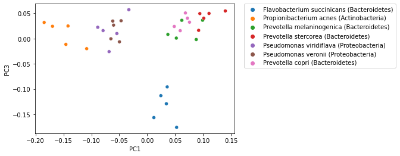{height=300}

## Exploratory analysis ≠ hypothesis testing

:::{.callout-warning}
- Exploratory analysis of ordination doesn't replace **statistical comparisons** of sample composition.
- Finding a pattern then testing it ≠ having an *a priori* hypothesis and testing it.
- Many metadata categories + few samples → **spurious patterns** likely.
- **Treat observations from exploratory analysis as hypotheses to be tested with different data.**
- Hypothesis generation and hypothesis testing cannot be performed on the same data.
:::

:::{.callout-tip icon=false}
## Emperor
Widely used tool for **interactive** ordination plots: color by metadata, compare axes, invert axes — a few mouse clicks.
:::

**Exercise**: how does the clustering of samples compare between polar ordination and PCoA?

# Supervised classification

## Naive Bayes

:::{.callout-tip icon=false}
## Supervised classification
- Algorithm: **Naive Bayes** — relatively straight-forward math, widely used and powerful.
- Familiar topic: **taxonomic classification of 16S rRNA sequences**.
- Same problem as before: query $q_i$ (unannotated), reference $R$ of annotated sequences $r_1, \ldots, r_n$; infer taxonomy for $q_i$.
- Previously solved with pairwise alignment; now: build a Naive Bayes classifier from the feature table + labels, apply it to unlabeled data.
:::

## Defining a classification task

:::{.callout-tip icon=false}
## Classes
- Two or more **pre-defined classes**; goal: assign observations to them.
- Humans do this every day: books you want to read vs everything else; phone apps into folders ("school", "entertainment", "social media").
:::

:::{.callout-tip icon=false}
## Spam filter
- Every email: spam or not spam → spam folder or inbox.
- Too permissive → inbox filled with junk; too restrictive → relevant messages go to spam.
:::

Here: classes are **microbial species**. Input: an unannotated sequence; output: the species it most likely came from.

## Training data

:::{.callout-tip icon=false}
## Training the classifier
- Classifiers need data to develop a **model** → **training** the classifier.
- **Training data**: observations with defined classes — the "supervision" in supervised learning.
- Spam filter: emails annotated as spam / not spam. Species assignment: 16S sequences annotated at species level.
- Training data should typically be **balanced**: roughly the same number of examples of each class.
:::

## Test data and real-world data

:::{.callout-tip icon=false}
## Test data
- An **independent** collection of labeled observations, **not** used for training.
- Evaluates performance on previously unseen data → predicts performance on **real world** data (class unknown: new emails; environmental DNA sequences).
- Don't use test data for **optimization**: train → test → change → re-test risks **over-fitting** to that test set; performance would no longer predict real-world performance.
:::

## k-fold cross validation

::: {.columns}
::: {.column width="45%"}
- Training/test sets can be **costly** to develop (hours of human annotation).
- Split training data into `k` sets (usually 5 or 10).
- In each, $1/k$ of entries are test data, the rest training data.
- Train and test `k` times; **average** performance.
- Allows developing and optimizing without dedicated test data.
:::
::: {.column width="55%"}
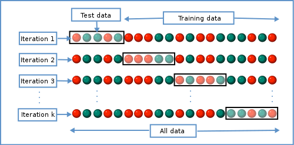

::: {.font6}
Colors indicate class (e.g., red = spam, green = not spam). Image: Gufosowa, CC BY-SA 4.0, via Wikimedia Commons.
:::
:::
:::

## Evaluating a binary classifier

:::{.callout-tip icon=false}
## Disease X
- **Binary classifier**: exactly two classes — easiest to understand.
- Predict whether an individual is **healthy** or has **Disease X**, from features extracted from medical data.
- A function: features of a sample → "healthy" or "diseased".
- Positive result: the patient has Disease X; negative: healthy.
:::

## Outcomes on test data

:::{.callout-tip icon=false}
## Four possibilities
| | Known: Disease X | Known: healthy |
|---|---|---|
| **Predicted positive** | **True positive (TP)** | **False positive (FP)** — type 1 error |
| **Predicted negative** | **False negative (FN)** — type 2 error | **True negative (TN)** |
:::

Tallies of TP, FP, FN, TN over many samples are presented in a **confusion matrix**, from which many performance values can be computed.

## Accuracy

$$\text{accuracy} = \frac{TP + TN}{TP + FP + FN + TN}$$

:::{.callout-tip icon=false}
## Fraction classified correctly — but it hides information
- Doesn't tell whether poor performance comes from type 1 errors, type 2 errors, or both.
- A low-accuracy classifier that often gives FPs but almost never FNs can still be **clinically useful**:
  - negative result → the person doesn't have the disease;
  - positive result → indicator that additional testing is needed.
- Useful as a cheap first screening if additional tests are more expensive.
:::

## Precision and recall

:::{.callout-tip icon=false}
## Computed as a pair
More informative than accuracy: they indicate whether a classifier suffers more from FPs or FNs.

$$\text{precision} = \frac{TP}{TP + FP} \qquad \text{recall} = \frac{TP}{TP + FN}$$

- **Precision**: fraction of reported positives that are actually positive → how often we get **false positives**.
- **Recall**: fraction of actual positives reported as positive → how often we get **false negatives**.
- We want both high, but depending on the application we may prefer one over the other.
:::

## Naive Bayes classifiers

:::{.callout-tip icon=false}
## Plan
- Instead of alignment, train Naive Bayes classifiers by building **kmer-based models** of the 16S sequences of taxa in the training data.
- Run test sequences through the models to find the most likely taxonomic origin.
- Test sequences have known taxonomy → evaluate accuracy.
- Well-designed training/testing → test performance tells us what to expect on data of unknown origin.
:::

## Training: the set of all features $W$

:::{.callout-tip icon=false}
## Inputs
- Model of what each class looks like, from labeled training data: **feature table + class labels**.
- k-mers as features (same `k`).
- First, the set of **all possible** words of length `k` given the alphabet → $W$.
:::

```python
alphabet = skbio.DNA.nondegenerate_chars

def compute_W(alphabet, k):
    return set(map(''.join, itertools.product(alphabet, repeat=k)))

W = compute_W(alphabet, k)
```

```
Alphabet contains the characters: G, A, T, C
For an alphabet size of 4, W contains 256 length-4 kmers.
```

## Exercise and taxonomic level

:::{.callout-note icon=false}
## Exercise
With the DNA alphabet (A, C, G, T): how many different 3-mers are there? How many 5-mers? How many 5-mers with a twenty-character alphabet (protein sequences)?
:::

:::{.callout-tip icon=false}
## Taxonomic specificity
- Less specific levels (phylum, class) → higher accuracy expected, but less biologically informative.
- More specific levels (genus, species) → more informative.
- Here: a **species** classifier (mirroring the unsupervised task).
:::

## The k-mer probability table

:::{.callout-tip icon=false}
## Estimating probabilities from frequencies
Goal: the probability of observing each k-mer in $W$ in a sequence from a given species.

- $N$: total number of sequences in the training data
- $W$: set of all possible kmers, given $k$ and an alphabet
- $w_i$: an individual k-mer in $W$
- $n(w_i)$: number of training sequences containing $w_i$
:::

## Pseudocounts

:::{.callout-tip icon=false}
## $P_i$
Probability of observing $w_i$ in a relevant real-world sequence from **any** species.

- Naively $n(w_i)/N$ — but a k-mer in a real-world sequence might be absent from training data ($n(w_i) = 0$).
- So: $P_i = \dfrac{n(w_i) + 0.5}{N + 1}$ — the added values are **pseudocounts**.
:::

:::{.callout-tip icon=false}
## $P(w_i \mid species)$
Probability of observing $w_i$ in a sequence from a **given** species.

- Proportion of the species' sequences containing $w_i$, plus pseudocounts.
- Numerator pseudocount scaled by how frequent $w_i$ is overall: $P_i$. Denominator pseudocount: 1.
:::

## Computing the table {.scrollable}

```python
def compute_kmer_probability_table(feature_table, sequence_labels, W):
    N = feature_table.shape[0] # number of training sequences

    # number of sequences containing kmer wi
    n_wi = pd.Series(0, index=W)
    n_wi = n_wi + feature_table.astype(bool).sum(axis=0)
    n_wi = n_wi.fillna(0)
    n_wi.name = 'n(w_i)'

    # probabilities of observing each kmer
    Pi = (n_wi + 0.5) / (N + 1)
    Pi.name = 'P_i'

    # number of times each taxon appears in training set
    taxon_counts = collections.Counter(sequence_labels)
    taxon_table = pd.DataFrame(0, index=taxon_counts.keys(), columns=W)
    taxon_table = taxon_table + feature_table.astype(bool).groupby(by=sequence_labels, axis=0).sum()
    taxon_table = taxon_table.fillna(0)

    # probabilities of observing each kmer in each taxon
    p_wi_t = []
    for taxon, count in taxon_counts.items():
        p_wi_t.append(pd.Series((taxon_table.loc[taxon] + Pi) / (count + 1), name=taxon))

    return pd.DataFrame(p_wi_t).T

kmer_probability_table = compute_kmer_probability_table(sequence_feature_table,
                                                        sequence_labels['legend entry'], W)
```

## The k-mer probability table {.scrollable}

::: {.font6}
| | F. succinicans | P. acnes | P. melaninogenica | P. stercorea | Ps. viridiflava | Ps. veronii | P. copri |
|----|----|----|----|----|----|----|----|
| AAAA | 0.368 | 0.201 | 0.535 | 0.201 | 0.035 | 0.035 | 0.035 |
| AAAC | 0.975 | 0.975 | 0.975 | 0.975 | 0.308 | 0.808 | 0.975 |
| AAAG | 0.998 | 0.998 | 0.998 | 0.998 | 0.998 | 0.998 | 0.998 |
| AAAT | 0.891 | 0.225 | 0.058 | 0.725 | 0.058 | 0.225 | 0.225 |
| AACA | 0.975 | 0.975 | 0.641 | 0.975 | 0.641 | 0.808 | 0.975 |
| AACC | 0.785 | 0.951 | 0.951 | 0.951 | 0.118 | 0.285 | 0.951 |
| AAGA | 0.965 | 0.965 | 0.965 | 0.132 | 0.965 | 0.799 | 0.799 |
| AAGC | 0.789 | 0.956 | 0.123 | 0.456 | 0.956 | 0.956 | 0.956 |
| AATC | 0.938 | 0.271 | 0.771 | 0.271 | 0.938 | 0.938 | 0.271 |
| AATT | 0.933 | 0.266 | 0.766 | 0.933 | 0.433 | 0.600 | 0.266 |
| ACAA | 0.947 | 0.947 | 0.447 | 0.280 | 0.947 | 0.947 | 0.280 |
| ACAG | 0.975 | 0.475 | 0.641 | 0.975 | 0.975 | 0.975 | 0.975 |
| ACCC | 0.567 | 0.067 | 0.400 | 0.900 | 0.067 | 0.067 | 0.734 |
:::

Our k-mer-based models of the species: used to compute probabilities of real-world sequences belonging to each species.

## Applying a Naive Bayes classifier

Test data: sequences for our species of interest, **excluding** those used in training:

```python
test_seq_data = load_annotated_sequences(taxa_of_interest, class_size=sequences_per_taxon,
                                          verbose=False, ids_to_exclude=sequence_labels.index)
test_labels = feature_labels_from_sequence_records(test_seq_data)
```

:::{.callout-tip icon=false}
## Classifying a query sequence
1. Extract the set of all k-mers from the query → $V$.
2. For each species: $P(query \mid species)$ = **product** of its k-mer probabilities for that species.
3. Return the species with the **highest** probability.

Without pseudocounts, a single zero k-mer probability would make the whole product zero.
:::

## Classification code

```python
# Classifies a sequence that has already been split into a list of kmers.
def classify_V(V, kmer_probability_table):
    P_S_t = [] # probability of the sequence given the taxon
    for taxon in kmer_probability_table:
        kmer_probabilities = kmer_probability_table[taxon]
        # Multiplying many probabilities often hits the lower limit of the
        # computer's precision (less than machine epsilon). We therefore take
        # the log of each observed probability and sum those logs.
        query_log_probability = sum(list(map(np.log, kmer_probabilities[V])))
        P_S_t.append((query_log_probability, taxon))
    return max(P_S_t)[1], V

# Classifies a sequence directly, first computing V, then calling classify_V.
def classify_sequence(query_sequence, kmer_probability_table, k):
    V = list(map(str, query_sequence.iter_kmers(k=k)))
    return classify_V(V, kmer_probability_table)
```

## Classifying a test sequence

```python
def random_sequence_record_choice(sequence_records):
    return random.sample(list(sequence_records.values()), 1)[0]

query_sr = random_sequence_record_choice(test_seq_data)
taxon_assignment, V = classify_sequence(query_sr.sequence, kmer_probability_table, k)
```

```
Sequence 4465561 is predicted to be from the species Prevotella melaninogenica (Bacteroidetes).
Sequence 4465561 is known to be from the species Prevotella melaninogenica (Bacteroidetes).
```

Test data has known labels — unlike real-world queries — so we can estimate real-world performance.

:::{.callout-note icon=false}
## Exercise
Was it the correct species? Genus? Phylum? Classify a few more — does the classifier seem to work well?
:::

## Confidence in the results

:::{.callout-tip icon=false}
## How confident should we be?
- Training/test sequences are random → results differ each run; some assignments will be wrong.
- How dependent is the assignment on the **specific** query? With slight differences (a different strain, sequencing errors), would we get the same answer?
  - Yes → higher confidence. No → lower confidence.
- Important: the classifier as implemented will **always** return one of the classes, even if the query is very different from all references.
:::

## Bootstrapping

:::{.callout-tip icon=false}
## Procedure
1. Assign taxonomy using $V$, as before.
2. For a user-specified number of iterations: create a random subset of $V$ **sampled with replacement**, and assign taxonomy to it.
3. Count how often the subset assignment equals the assignment for the full $V$.
4. Confidence = count / iterations.

Always the same → confidence 1; never the same → confidence 0.
:::

## `classify_sequence_with_confidence`

```python
def classify_sequence_with_confidence(query_sequence, kmer_probability_table, k,
                                      confidence_iterations=100):
    # classify the query sequence, as we did above
    taxon, V = classify_sequence(query_sequence, kmer_probability_table, k)

    count_same_taxon = 0
    # Size of each subsample: 10% of the actual number of kmers in the query.
    subsample_size = int(len(V) * 0.1)
    # Classify random subsets of the query's kmers; count how often the
    # result is the same as for the full query.
    for i in range(confidence_iterations):
        subsample_V = np.random.choice(V, subsample_size, replace=True)
        subsample_taxon, _ = classify_V(subsample_V, kmer_probability_table)
        if taxon == subsample_taxon:
            count_same_taxon += 1
    confidence = count_same_taxon / confidence_iterations

    return (taxon, confidence)
```

```
Sequence 326403 is predicted to be from the species Prevotella stercorea (Bacteroidetes).
Confidence in this assignment is: 0.75.
Sequence 326403 is known to be from the species Prevotella stercorea (Bacteroidetes).
```

## Choosing a confidence threshold

:::{.callout-tip icon=false}
## What is a good confidence score?
- Use the test data to find out.
- Then define a **threshold**: accept assignments above it; label sequences below it as "**unclassified**".
- Compute assignments and confidence for **all** test sequences; compare distributions for correct vs incorrect assignments.
:::

```python
for query_id, query_sr in test_seq_data.items():
    predicted_taxonomy, confidence = classify_sequence_with_confidence(query_sr.sequence,
                                                                       kmer_probability_table, k)
    known_taxonomy = test_labels['legend entry'][query_sr.identifier]
    correct_assignment = known_taxonomy == predicted_taxonomy
    ...
```

## Summary of test results {.scrollable}

::: {.font6}
| | Predicted taxonomy | Known taxonomy | Confidence | Correct |
|----|----|----|----|----|
| 0 | Flavobacterium succinicans | Flavobacterium succinicans | 0.91 | True |
| 6 | Propionibacterium acnes | Propionibacterium acnes | 0.36 | True |
| 12 | Prevotella melaninogenica | Prevotella melaninogenica | 0.39 | True |
| 15 | Prevotella stercorea | Prevotella stercorea | 0.70 | True |
| 16 | Prevotella copri | Prevotella stercorea | 0.46 | False |
| 17 | Prevotella copri | Prevotella stercorea | 0.48 | False |
| 18 | Prevotella copri | Prevotella stercorea | 0.63 | False |
| 19 | Prevotella copri | Prevotella stercorea | 0.92 | False |
| 20 | Pseudomonas veronii | Pseudomonas viridiflava | 0.46 | False |
| 21 | Pseudomonas viridiflava | Pseudomonas viridiflava | 0.59 | True |
| 24 | Pseudomonas veronii | Pseudomonas viridiflava | 0.55 | False |
| 25 | Pseudomonas veronii | Pseudomonas veronii | 0.71 | True |
| 27 | Pseudomonas viridiflava | Pseudomonas veronii | 0.43 | False |
| 31 | Prevotella copri | Prevotella copri | 0.90 | True |
| ... | ... | ... | ... | ... |
:::

## Confidence: correct vs incorrect

```python
ax = sns.boxplot(data=[correct_assignment_confidences, incorrect_assignment_confidences])
ax = sns.swarmplot(data=[correct_assignment_confidences, incorrect_assignment_confidences], color="black")
```

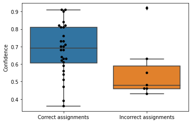{height=300}

:::{.callout-note icon=false}
## Questions
How well is a confidence threshold likely to work? If you never wanted to reject a correct assignment, how often would you accept an incorrect one? And vice versa?
:::

## Accuracy and the confusion matrix

```python
accuracy = n_correct_assignments / (n_correct_assignments + n_incorrect_assignments)
# The accuracy of the classifier was 0.800.
```

:::{.callout-tip icon=false}
## Confusion matrix
- Two axes: **actual** assignments and **predicted** assignments (same class order on both).
- Values: how each instance of each known class was classified.
- A good classifier has high values along the **diagonal**.
- Off-diagonal values show where the classifier got **confused**.
:::

```python
confusion_matrix = summary.groupby('Predicted taxonomy')['Known taxonomy'].value_counts().to_frame()
confusion_matrix.columns = ['count']
confusion_matrix = pd.pivot_table(confusion_matrix, index=['Predicted taxonomy'],
                                  columns=['Known taxonomy'], fill_value=0)
```

## Confusion matrix

::: {.font6}
| Predicted \\ Known | F. succinicans | P. copri | P. melaninogenica | P. stercorea | P. acnes | Ps. veronii | Ps. viridiflava |
|----|----|----|----|----|----|----|----|
| **F. succinicans** | 5 | 0 | 0 | 0 | 0 | 0 | 0 |
| **P. copri** | 0 | 5 | 0 | 4 | 0 | 0 | 0 |
| **P. melaninogenica** | 0 | 0 | 5 | 0 | 0 | 0 | 0 |
| **P. stercorea** | 0 | 0 | 0 | 1 | 0 | 0 | 0 |
| **P. acnes** | 0 | 0 | 0 | 0 | 5 | 0 | 0 |
| **Ps. veronii** | 0 | 0 | 0 | 0 | 0 | 4 | 2 |
| **Ps. viridiflava** | 0 | 0 | 0 | 0 | 0 | 1 | 3 |
:::

:::{.callout-note icon=false}
## Exercises
- Where classifications were wrong, was the **phylum** at least correct?
- Change `k` and the taxonomic level. How does accuracy change when increasing/decreasing `k` with the level fixed? And the level with `k` fixed?
:::

## Variations on the input

:::{.callout-tip icon=false}
## Labels and features
- Labels here are **discrete** (categorical/qualitative). With **continuous** labels (e.g., abundance of an organism in an environment) → supervised **regression** instead of classification.
- Features here were continuous; they could also be **discrete** (e.g., sex of a subject, species of a specimen). Algorithms may change, but ML still applies.
:::

## Takeaway

:::{.callout-tip icon=false}
## If you can build a feature table...
- scikit-learn has other example datasets: **diabetes**, **housing market**, **hand-writing** — other types of data for ML tasks.
- If you can wrangle your data into a **feature table**, potentially with **sample labels**, you can likely apply ML techniques.
- This barely scratches the surface. With accessible software, it's easy to know **enough to get into trouble** — continue learning before applying ML in research ([scikit-learn documentation](https://scikit-learn.org/)).
:::

## Works cited

- R A Fisher. The use of multiple measurements in taxonomic problems. *Ann. Eugen.*, 7(2):179–188, 1936.
- Y Vázquez-Baeza, M Pirrung, A Gonzalez, R Knight. EMPeror: a tool for visualizing high-throughput microbial community data. *Gigascience*, 2(1):16, 2013.
- J Gregory Caporaso. *Applied Bioinformatics*. [readiab.org](https://readiab.org)
