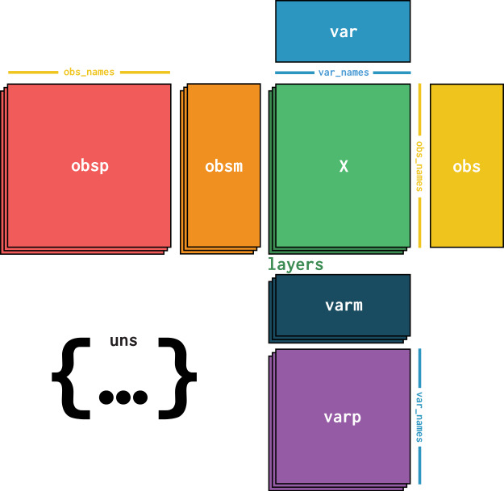
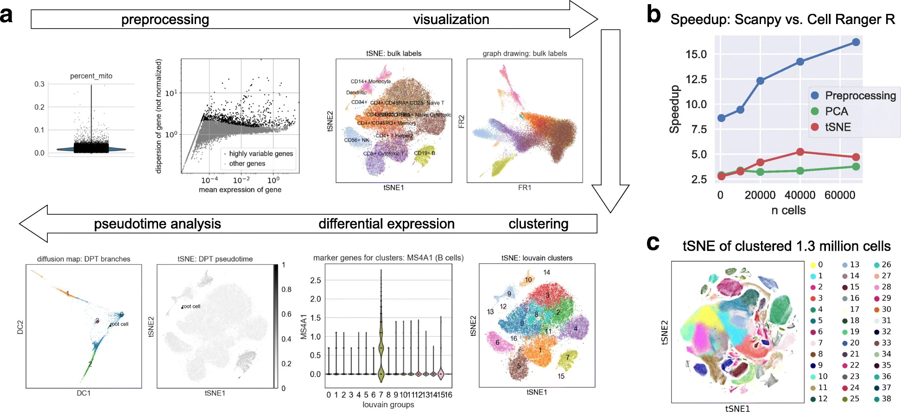
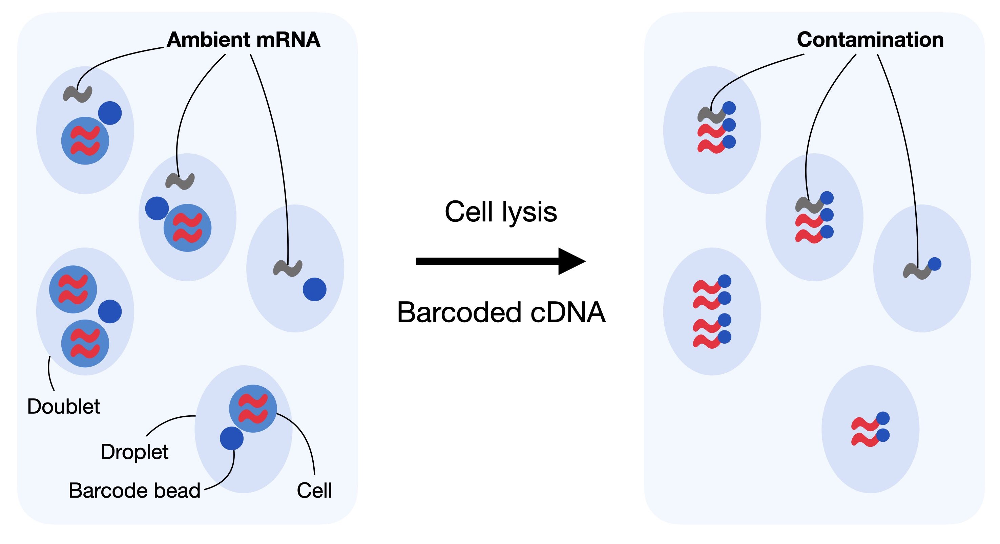
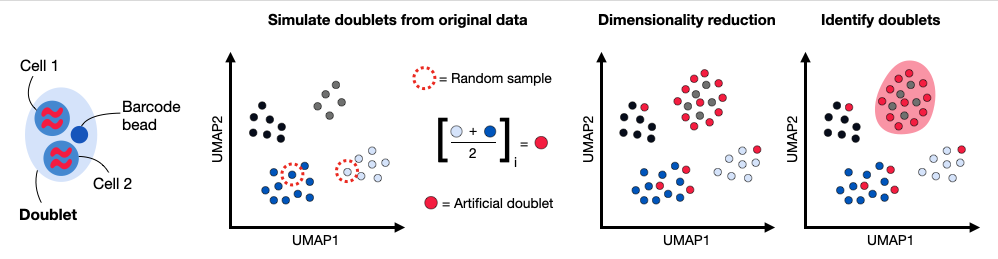
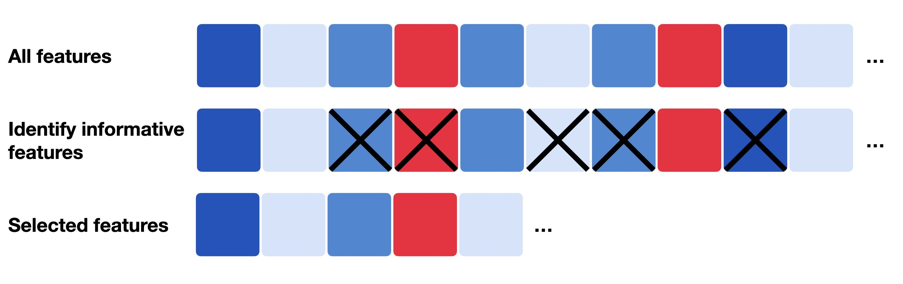
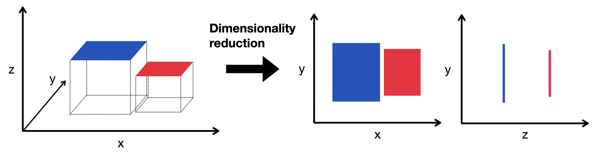
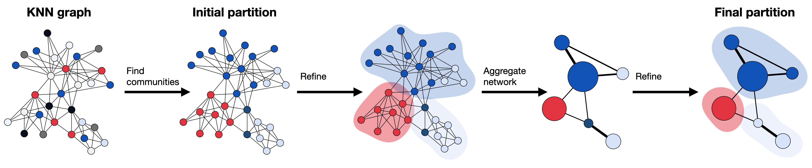

## Sequencing history
:::{.callout-tip icon=false}
## History

- 1869: DNA first isolated (Friedrich Miescher)
- 1953: DNA structure discovered (Watson, Crick, Franklin)
- 1965: first sequencing of tRNA (Robert Holley)
- 1977: Sanger sequencing (electrophoresis) (**1st gen**)
- 1987: ABI 370 (automation of Sanger sequencing)
- 1996: pyrosequencing (luminescence) (**2nd gen**)
- 2010s: long-read sequencing (**3rd gen**)
:::

## Sequencing history


## Sequencing history {.font6}

| Name                                 | Max read length (kb) | Accuracy (%)  | Cost ($/Gb)     | Throughput (Mb/year) | Generation |
| ------------------------------------ | -------------------- | ------------- | --------------- | -------------------- | ---------- |
| Illumina NextSeq 550                 | 0.15                 | >99.9         | >47,782         | 50-63                | 2          |
| Illumina NovaSeq 6000                | 0.25                 | >99.9         | 10-35           | >1,194,545           | 2          |
| Sanger sequencing (e.g. ThermoFisher) | 1            | 99.99 | 500,000 | 0.73         | 1          |
| PacBio (Sequel II, HiFi)             | >20                  | >99           | 43–86           | 10,220               | 3          |
| PacBio (Sequel II, CLR)              | >200                 | 87–92         | 13-26           | 93,440               | 3          |
| Nanopore (PromethION)                | >1,000               | 87–98         | 21-42           | 3,153,600            | 3          |
| Nanopore (MinION/GridION)            | >1,500               | 87–98         | 50-2,000        | 913-109,500          | 3          |


## Sequencing
:::{.callout-tip icon=false}
## DNA-Seq Procedure

1. **Sample and library preparation**: a so-called library is prepared by fragmenting the DNA samples and ligating them with adapter molecules. These adapters participate in the hybridization of the library fragments to the matrix and form a priming site.

2. **Amplification and sequencing**: the library gets converted into single-strand molecules. During an amplification step (such as a polymerase chain reaction), clusters of DNA molecules are created. All of the clusters perform individual reactions during a single sequencing run.

3. **Data output and analysis**: The output of a sequencing experiment depends on the sequencing technology and chemistry. Some sequencers generate fluorescence signals, others may generate electric signals. 
:::

## Sequencing
:::{.callout-tip icon=false}
## RNA-Seq Procedure
Same as DNA-seq, with the addition:

4. Reverse transcription step where complementary DNA (cDNA) is synthesized from the RNA template.
:::

## Why single-cell? {.scrollable}
```{python}
#| include: false
import warnings

warnings.filterwarnings("ignore")

import matplotlib

matplotlib.rcParams["figure.figsize"] = (7, 4)
matplotlib.rcParams["figure.dpi"] = 110
matplotlib.rcParams["font.size"] = 8

import matplotlib.pyplot as plt
import numpy as np
import pandas as pd
```


<!-- refs: [Mortazavi08, Tang09, Macosko15, Zheng17, Regev17]; sc-best-practices.org/introduction/scrna-seq -->

:::{.callout-warning icon=false}
## The problem
<!-- refs: Li et al. 2009, Bioinformatics 25:2078-2079 | [Mortazavi08, Tang09, Macosko15, Zheng17, Regev17]; sc-best-practices.org/introduction/scrna-seq -->
Bulk RNA-seq measures the **average expression** over millions of cells. 

- a tissue is a **mixture of cell types** (and cell states)
- averaging hides: rare cell types, developmental trajectories, tumor subclones, immune responses
- differential expression between two bulk samples may just reflect a **change in cell-type composition**, not a change in expression
:::

## Single-cell RNA-seq {.scrollable}
<!-- refs: [Mortazavi08, Tang09, Macosko15, Zheng17, Regev17]; sc-best-practices.org/introduction/scrna-seq -->

:::{.callout-tip icon=false}
## The idea
<!-- refs: Li et al. 2009, Bioinformatics 25:2078-2079 | [Mortazavi08, Tang09, Macosko15, Zheng17, Regev17]; sc-best-practices.org/introduction/scrna-seq -->
- Profile the transcriptome of **individual cells** - typically $10^2-10^5$ cells per experiment.

- Output: a **count matrix** - genes $\times$ cells, entry = number of UMI-tagged transcripts of gene $g$ in cell $c$.

- This turns biology into a data-science problem: ~20 000 features (genes) per sample (cell), thousands of samples.
:::

:::{.callout-note}
## What's UMI?
UMI $\equiv$ Unique Molecular Identifier
:::

## What questions can it answer? {.scrollable}
<!-- refs: [Mortazavi08, Tang09, Macosko15, Zheng17, Regev17]; sc-best-practices.org/introduction/scrna-seq -->

:::{.callout-note icon=false}
## Applications
<!-- refs: [Lun16]; [Regev17] | [Mortazavi08, Tang09, Macosko15, Zheng17, Regev17]; sc-best-practices.org/introduction/scrna-seq -->
- **Cell atlases**: catalog all cell types of an organ/organism (Human Cell Atlas)
- **Development**: order cells along differentiation paths (pseudotime)
- **Disease**: find the cell types and states that change in disease (e.g. COVID-19 lung atlases)
- **Immunology**: T-cell receptor repertoires, clonal expansion
- **Cancer**: tumor microenvironment, subclones, resistance mechanisms

:::

## The challenges of scRNA-seq data {.scrollable}
<!-- refs: [Mortazavi08, Tang09, Macosko15, Zheng17, Regev17]; sc-best-practices.org/introduction/scrna-seq -->

:::{.callout-warning icon=false}
## Why it is hard
<!-- refs: [Wolock19]; [Young20]; Li et al. 2009, Bioinformatics 25:2078-2079 | [Mortazavi08, Tang09, Macosko15, Zheng17, Regev17]; sc-best-practices.org/introduction/scrna-seq -->
- **sparsity / dropouts**: most gene–cell entries are zero (gene not captured in that cell) - technical zeros, not biological zeros
- **noise**: amplification bias, sampling noise
- **batch effects**: different chips, days, labs
- **doublets**: two cells in one droplet
- **ambient RNA**: background transcripts from lysed cells contaminate all droplets

:::

## The standard workflow {.scrollable}
<!-- refs: [Mortazavi08, Tang09, Macosko15, Zheng17, Regev17]; sc-best-practices.org/introduction/scrna-seq -->

:::{.callout-tip icon=false}
## Pipeline
<!-- refs: [Zheng17]; [Bray16]; [Melsted19]; [Wolock19]; [Young20]; [Blondel08]; [Traag19]; [McInnes18]; [vanDerMaaten08]; [Wolf18]; Li et al. 2009, Bioinformatics 25:2078-2079 | [Mortazavi08, Tang09, Macosko15, Zheng17, Regev17]; sc-best-practices.org/introduction/scrna-seq -->
1. raw reads → **count matrix** 
2. **quality control** (cells, genes, doublets, ambient RNA)
3. **normalization**
4. **feature selection** (highly variable genes)
5. **dimensionality reduction** (PCA/UMAP/t-SNE)
6. **clustering** (Leiden/Louvain)
7. **cell-type annotation**

:::

# Data structures and frameworks

## The count matrix {.scrollable}
<!-- refs: [Zheng17, Bray16, Melsted19]; sc-best-practices.org/introduction/raw-data-processing -->

:::{.callout-tip icon=false}
## AnnData's X
<!-- refs: [Zheng17, Bray16, Melsted19]; sc-best-practices.org/introduction/raw-data-processing -->
- rows = genes (~20 000–60 000), columns = cells
- entry $X_{gc}$ = UMI count of gene $g$ in cell $c$
- typically **> 90% zeros** (dropout + genuinely unexpressed genes)

```{python}
import anndata as ad
import numpy as np
import pandas as pd
from scipy.sparse import csr_matrix

counts = csr_matrix(
    np.random.default_rng().poisson(1, size=(100, 2000)), dtype=np.float32
)
adata = ad.AnnData(counts)
adata
```
:::

## AnnData
:::{.callout-tip icon=false}
## Description
- `X`: main matrix with dimensions of `obs_names x var_names`
- `obs` (=observations) correspond to the cells’ barcodes
- `var` (=variables) correspond to the gene identifiers
- `X` is surrounded by Pandas DataFrames `obs` and `var`, which save annotations of cells and genes, respectively
- `obsm` and `varm`: whole matrices of calculations for the observations and variables respectively
- `obsp` and `varp`: graph-like structures that associate cells with cells or genes with genes
- `uns`: other unstructured data
:::

## AnnData


## AnnData
:::{.callout-tip icon=false}
## X field

```{python}
adata.X
```
```{python}
adata.obs_names = [f"Cell_{i:d}" for i in range(adata.n_obs)]
adata.var_names = [f"Gene_{i:d}" for i in range(adata.n_vars)]
print(adata.obs_names[:10])
```
:::

## AnnData
:::{.callout-tip icon=false}
## Add metadata
```{python}
ct = np.random.default_rng().choice(["B", "T", "Monocyte"], size=(adata.n_obs,))
adata.obs["cell_type"] = pd.Categorical(ct)  # Categoricals are preferred for efficiency
adata.obs
```
Examine again:
```{python}
adata
```
:::

## AnnData
:::{.callout-tip icon=false}
## Observation/variable-level matrices

```{python}
adata.obsm["X_umap"] = np.random.default_rng().normal(0, 1, size=(adata.n_obs, 2))
adata.varm["gene_stuff"] = np.random.default_rng().normal(0, 1, size=(adata.n_vars, 5))
adata.obsm
```
Examine:
```{python}
adata
```
:::

## AnnData
:::{.callout-tip icon=false}
## Layers
We may have different forms of our original core data, perhaps one that is normalized and one that is not. These can be stored in different layers in AnnData.
```{python}
adata.layers["log_transformed"] = np.log1p(adata.X)
adata
```
:::


## AnnData
:::{.callout-tip icon=false}
## Convert to Pandas DataFrame
```{python}
with pd.option_context("display.max_columns", 10):
    display(adata.to_df(layer="log_transformed"))
```
:::

## AnnData
:::{.callout-tip icon=false}
## Read/write
Save:
```{python}
adata.write("my_results.h5ad", compression="gzip")
```

Read:
```{python}
adata_new = ad.read_h5ad("my_results.h5ad")
adata_new
```
:::

## AnnData {.scrollable}

:::{.callout-tip icon=false}
## Another metadata example
Imagine that the observations come from instruments characterizing 10 readouts in a multi-year study with samples taken from different subjects at different sites. We would typically get that information in some format and then store it in a DataFrame:

```{python}
obs_meta = pd.DataFrame(
    {
        "time_yr": np.random.default_rng().choice([0, 2, 4, 8], adata.n_obs),
        "subject_id": np.random.default_rng().choice(
            ["subject 1", "subject 2", "subject 4", "subject 8"], adata.n_obs
        ),
        "instrument_type": np.random.default_rng().choice(
            ["type a", "type b"], adata.n_obs
        ),
        "site": np.random.default_rng().choice(["site x", "site y"], adata.n_obs),
    },
    index=adata.obs.index,  # these are the same IDs of observations as above!
)
```
Check:
```{python}
adata = ad.AnnData(adata.X, obs=obs_meta, var=adata.var)
adata
```
:::


## AnnData
:::{.callout-tip icon=false}
## Partial reading of large data
If a single h5ad file is very large, you can partially read it into memory by using backed mode.
```{python}
adata = ad.read_h5ad("my_results.h5ad", backed="r")
adata.isbacked
```

If you do this, you will need to remember that the AnnData object has an open connection to the file used for reading.

```{python}
adata.filename
```
As we are using it in read-only mode, we cannot damage anything. To proceed with this tutorial, we still need to explicitly close it.

```{python}
adata.file.close()
```
:::

## scanpy


## scanpy
:::{.callout-tip icon=false}
## Structure
Link: <https://scanpy.scverse.org/en/stable/>

- functions belonging to the same step are grouped into corresponding modules
- `scanpy.preprocessing` all preprocessing functions (abbreviation: `scanpy.pp`)
- `scanpy.tools`: all transformations of a data matrix that are not preprocessing (abbreviation: `scanpy.tl`)
- `scanpy.plot`: all visualizations (abbreviation: `scanpy.pl`)
- `scanpy.datasets`: module for datasets
:::

## scanpy {.scrollable}
:::{.callout-tip icon=false}
## API


:::


## scanpy {.scrollable}
:::{.callout-tip icon=false}
## Setup
```{python}
import scanpy as sc

sc.settings.set_figure_params(dpi=80, facecolor="white")
sc.logging.print_header()
```
:::


## Loading PBMC 3k with scanpy {.scrollable}
<!-- refs: [Zheng17, Bray16, Melsted19]; sc-best-practices.org/introduction/raw-data-processing -->

:::{.callout-note icon=false}
## The dataset we will use
<!-- refs: [Zheng17]; [Wolf18] | [Zheng17, Bray16, Melsted19]; sc-best-practices.org/introduction/raw-data-processing -->
10x Genomics **PBMC 3k** (peripheral blood mononuclear cells, healthy donor) — the "hello world" of scRNA-seq; publicly downloadable.

Link: <https://cf.10xgenomics.com/samples/cell/pbmc3k/pbmc3k_filtered_gene_bc_matrices.tar.gz>

```{python}
import scanpy as sc

sc.settings.verbosity = 1
# download once from 10x, then load the filtered matrix:
# https://cf.10xgenomics.com/samples/cell-exp/1.2.0/pbmc_3k/pbmc_3k_filtered_gene_bc_matrices.tar.gz
adata = sc.read_10x_mtx(
    "../_data/filtered_gene_bc_matrices/hg19/",
    var_names="gene_symbols",
    cache=True,
    compressed=False,
)
adata.var_names_make_unique()
print(adata)
```

(If offline: `sc.datasets.pbmc3k()` ships a preprocessed version with scanpy.)
:::


## First look at the data {.scrollable}
<!-- refs: [Zheng17, Bray16, Melsted19]; sc-best-practices.org/introduction/raw-data-processing -->

:::{.callout-tip icon=false}
## Dimensions and content
<!-- refs: [Zheng17, Bray16, Melsted19]; sc-best-practices.org/introduction/raw-data-processing -->
Dimensions:
```{python}
print("cells x genes:", adata.shape)
```
Gene names:

```{python}
adata.var
```
Names:
```{python}
print("genes:", list(adata.var_names[:10]))
print("cells:", list(adata.obs_names[:5]))
```

`adata.obs` represents per-cell metadata and is currently empty.
:::


## scanpy {.scrollable}
:::{.callout-tip icon=false}
## Highest expr genes
Show genes that yield the highest fraction of counts in each single cell, across all cells:
```{python}
sc.pl.highest_expr_genes(adata, n_top=20)
```
:::

# Quality control

## Quality control

:::{.callout-tip icon=false}
## Background
scRNA-seq data is noisy by construction:

- each cell is captured with only thousands of reads, so most genes are zero
- bad cells (empty droplets, dying cells, doublets) systematically distort normalization and clustering
- they are recognizable precisely because of the known failure modes of the chemistry (mitochondrial leakage, doublets, ambient RNA).
:::

## Why QC first? {.scrollable}

:::{.callout-warning icon=false}
## Garbage in, clusters out
QC removes these before normalization:

- empty droplets (no cell)
- dying cells (mitochondrial RNA leaks)
- doublets (two cells)

:::

## The standard QC metrics {.scrollable}
<!-- refs: [Luecken19, Wolock19, Young20]; sc-best-practices.org/preprocessing-visualization/quality-control -->

:::{.callout-tip icon=false}
## Per-cell metrics
<!-- refs: Li et al. 2009, Bioinformatics 25:2078-2079 | [Luecken19, Wolock19, Young20]; sc-best-practices.org/preprocessing-visualization/quality-control -->
- **total counts** (`n_counts`): library size of the cell
- **number of genes detected** (`n_genes`): how many genes have ≥ 1 UMI
- **mitochondrial fraction** (`pct_counts_mt`): % of UMIs from mitochondrial genes — high = dying cell (cytoplasmic RNA lost, mito RNA remains)
- **ribosomal fraction** (`pct_counts_ribo`), **hemoglobin fraction** (`pct_counts_hb`) — blood samples: high Hb = red blood cell contamination

```{python}
adata.var["mt"] = adata.var_names.str.startswith("MT-")
adata.var["ribo"] = adata.var_names.str.startswith(("RPS", "RPL"))
adata.var["hb"] = adata.var_names.str.contains("^HB[^(P)]")

sc.pp.calculate_qc_metrics(
    adata, qc_vars=["mt", "ribo", "hb"], inplace=True, percent_top=[20], log1p=True
)
adata
print(adata.obs.columns)
```
:::

## Visualizing QC metrics {.scrollable}
<!-- refs: [Luecken19, Wolock19, Young20]; sc-best-practices.org/preprocessing-visualization/quality-control -->

:::{.callout-note icon=false}
## Look at distributions, not single cells
<!-- refs: [Luecken19, Wolock19, Young20]; sc-best-practices.org/preprocessing-visualization/quality-control -->
```{python}
sc.pl.violin(adata, ["n_genes_by_counts", "total_counts", "pct_counts_mt"], multi_panel=True, jitter=0.2)
sc.pl.scatter(adata, x="total_counts", y="pct_counts_mt")
sc.pl.scatter(adata, x="total_counts", y="n_genes_by_counts")
```
:::

## Filtering cells and genes {.scrollable}
<!-- refs: [Luecken19, Wolock19, Young20]; sc-best-practices.org/preprocessing-visualization/quality-control -->

:::{.callout-tip icon=false}
## Typical filters
<!-- refs: [Wolock19] | [Luecken19, Wolock19, Young20]; sc-best-practices.org/preprocessing-visualization/quality-control -->
```{python}
sc.pp.filter_cells(adata, min_genes=200)
sc.pp.filter_cells(adata, max_genes=6000)
adata = adata[adata.obs.pct_counts_mt < 10, :].copy()
sc.pp.filter_genes(adata, min_cells=3)   # genes seen in >= 3 cells
print(adata.shape)
```

- `min_genes` low: empty droplets; `max_genes` high: doublets
- high mito: stressed/dying cells
- genes in very few cells: noise, rarely informative
:::

## QC: Ambient RNA


## QC: Ambient RNA
:::{.callout-tip icon=false}
## Overview
Every droplet-based single-cell library is contaminated with ambient RNA — cell-free transcripts that leak out of stressed or lysed cells into the suspension and get co-encapsulated with real cells. This “soup” is captured and sequenced alongside each cell’s native transcriptome.

Several approaches can be used:

- CellBender (<https://cellbender.readthedocs.io/>)
- SoupX (<https://github.com/NiRuff/soupx-python>)
:::

## QC: Doublet Detection


# Normalization

## Normalization
<!-- refs: [Lun16]; [Hafemeister19]; [Luecken19] | [Lun16, Hafemeister19]; sc-best-practices.org/preprocessing-visualization/normalization -->

<!-- SOURCE: sc-best-practices.org/preprocessing-visualization/normalization;
     primary sources: Lun et al. 2016 (scran pooling) [Lun16],
     Hafemeister & Satija 2019 (sctransform) [Hafemeister19] -->

:::{.callout-tip icon=false}
## Description

- Normalization aims to adjust the raw counts in the dataset for variable sampling effects by scaling the observable variance to a specified range
- Several normalization techniques are used in practice varying in complexity.
:::
:::{.callout-important icon=false}
## Background
<!-- refs: [Lun16]; [Hafemeister19]; Li et al. 2009, Bioinformatics 25:2078-2079 | [Lun16, Hafemeister19]; sc-best-practices.org/preprocessing-visualization/normalization -->
Normalization in scRNA-seq is harder than in bulk:

- counts per cell vary over orders of magnitude for technical reasons (capture efficiency, sequencing depth) 
- a few highly expressed genes dominate the total
:::

## Normalization {.scrollable}
<!-- refs: [Lun16, Hafemeister19]; sc-best-practices.org/preprocessing-visualization/normalization -->

:::{.callout-warning icon=false}
## Why raw counts are not comparable?
<!-- refs: [Zheng17] | [Lun16, Hafemeister19]; sc-best-practices.org/preprocessing-visualization/normalization -->
- Cell A has 10 000 UMIs, cell B has 1 000
- Gene X has 50 counts in A, 5 in B

Is X 10x higher in A? Not necessarily: maybe A was simply sequenced deeper.

Normalization removes this **sequencing-depth** effect so counts are comparable across cells.
:::

## Normalization
:::{.callout-tip icon=false}
## Raw counts distribution

```{python}
import seaborn as sns

p1 = sns.histplot(adata.obs["total_counts"], bins=100, kde=False)
```
:::

## Normalization {.scrollable}
:::{.callout-tip icon=false}
## Shifted logarithm

The first normalization technique we will use is the **shifted logarithm** which is based on the **delta method**. The delta method applies a nonlinear function 
$$
f(y) = \log \left(\frac{y}{s}+y_0\right)
$$
where $y$ are raw counts, $s$ is *size factor*, and $y_0$ is pseudocount.

Size factors can be calculated by:
$$
s_c = \frac{\sum_g y_{gc}}{L}
$$
where $L$ describes target sum.

Scanpy default for $L$ is median raw count depth in the dataset.
:::

## Normalization {.scrollable}
:::{.callout-tip icon=false}
## Shifted logarithm

```{python}
scales_counts = sc.pp.normalize_total(adata, target_sum=None, inplace=False)
# log1p transform
adata.layers["log1p_norm"] = sc.pp.log1p(scales_counts["X"], copy=True)
```

Inspect:
```{python}
fig, axes = plt.subplots(1, 2, figsize=(10, 5))
p1 = sns.histplot(adata.obs["total_counts"], bins=100, kde=False, ax=axes[0])
axes[0].set_title("Total counts")
p2 = sns.histplot(adata.layers["log1p_norm"].sum(1), bins=100, kde=False, ax=axes[1])
axes[1].set_title("Shifted logarithm")
plt.show()
```
:::


## Normalization {.scrollable}
:::{.callout-tip icon=false}
## Pearson residuals

This normalization technique was motivated by the observation that cell-to-cell variation in scRNA-seq data might be confounded by biological heterogeneity with technical effects.

$$
r_i = \frac{y_i - \hat{\mu_i}}{\sqrt{V(\hat{\mu_i})}},
$$
where $y_i$ is the observed value, $\hat{\mu_i}$ is the fitted mean, and $V$ is the variance function.

The method utilizes Pearson residuals from ‘regularized negative binomial regression’ to calculate a model of technical noise in the data.

$$
z_{ij} = \frac{x_{ij}-\hat{\mu_i}}{\sqrt{\hat{\mu_i} + \hat{\mu_i}^2/\hat{\theta_i}}},
$$
where $V(\mu) = \mu + \mu^2/\theta$, and $\hat{\mu_{ij}} = \exp(\beta_{0i} + \beta_{1i}\log_{10}m_j)$.

It explicitly adds the count depth as a covariate in a generalized linear model.

This method removed the impact of sampling effects while preserving cell heterogeneity in the dataset. 
:::

## Normalization {.scrollable}
:::{.callout-tip icon=false}
## Pearson residuals
```{python}
analytic_pearson = sc.experimental.pp.normalize_pearson_residuals(adata, inplace=False)
adata.layers["analytic_pearson_residuals"] = csr_matrix(analytic_pearson["X"])

fig, axes = plt.subplots(1, 2, figsize=(10, 5))
p1 = sns.histplot(adata.obs["total_counts"], bins=100, kde=False, ax=axes[0])
axes[0].set_title("Total counts")
p2 = sns.histplot(
    adata.layers["analytic_pearson_residuals"].sum(1), bins=100, kde=False, ax=axes[1]
)
axes[1].set_title("Analytic Pearson residuals")
plt.show()
```
:::


# Feature selection

## Feature selection {.scrollable}
:::{.callout-tip icon=false}
## Overview
Most genes are noise (lowly expressed, or constant across cells). PCA/clustering on all genes is dominated by the noisiest, most highly expressed ones.

Solution: select **highly variable genes (HVGs)** - genes whose variance exceeds what mean expression predicts - and use only those (~1 000-3 000) downstream.



:::

## Highly variable genes {.scrollable}
<!-- refs: [Stuart19]; sc-best-practices.org/.../feature-selection + /dimensionality-reduction -->

:::{.callout-tip icon=false}
## scanpy implementation
<!-- refs: [Stuart19] | [Stuart19]; sc-best-practices.org/.../feature-selection + /dimensionality-reduction -->
```
uv add scikit-misc
```

```{python}
sc.pp.highly_variable_genes(adata, n_top_genes=2000, flavor="seurat_v3", subset=False)
# or flavor="cell_ranger" / "pearson_residuals"
#sc.pl.highly_variable_genes(adata)
adata_hvg = adata[:, adata.var.highly_variable].copy()
adata_hvg[:5]
```

Flavors:

- `seurat_v3`: bins genes by mean, computes dispersion within bins, picks top by standardized dispersion
- `pearson_residuals`: analytic residuals of a Poisson model - fast, robust
:::

# Dimensionality reduction

## Dimensionality reduction {.scrollable}
:::{.callout-tip icon=false}
## Description
Not all genes are informative and therefore not all genes are essential for tasks such as clustering. We already aimed to reduce the dimensionality of the data with feature selection. As a next step, we will further reduce the dimensions of single-cell RNA-seq data with dimensionality reduction algorithms. These algorithms are an important step during preprocessing to reduce the data complexity and for visualization.



:::
## scanpy
:::{.callout-tip icon=false}
## Dimensionality reduction
We can usePCA to unveil the main axes of variation. This also denoises the data. Scanpy offers PCA as a preprocessing or tools function. 


```{python}
sc.tl.pca(adata, svd_solver="arpack")
sc.pl.pca(adata, color="CST3")
```
:::


## PCA {.scrollable}
<!-- refs: [Stuart19]; sc-best-practices.org/.../feature-selection + /dimensionality-reduction -->

:::{.callout-tip icon=false}
## Linear dimensionality reduction
<!-- refs: [Stuart19]; sc-best-practices.org/.../feature-selection + /dimensionality-reduction -->
PCA finds orthogonal axes of maximal variance in the (scaled) HVG matrix:

$$X \approx U \Sigma V^T$$

- cells become points in PC space (typically 10–50 PCs)
- PCs capture biological signal (cell type, state) plus residual technical noise

```{python}
sc.tl.pca(adata_hvg, n_comps=50, svd_solver="arpack")
sc.pl.pca_variance_ratio(adata_hvg, n_pcs=50, log=True)
```
:::

## How many PCs? {.scrollable}
<!-- refs: [Stuart19]; sc-best-practices.org/.../feature-selection + /dimensionality-reduction -->

:::{.callout-warning icon=false}
## The elbow
<!-- refs: [Stuart19]; sc-best-practices.org/.../feature-selection + /dimensionality-reduction -->
Plot explained variance ratio per PC: a sharp **elbow** separates signal PCs from noise PCs. Take PCs before the elbow (or use JackStraw / `sc.tl.rank_genes_groups`-style heuristics).

```{python}
#| eval: false
sc.pl.pca_variance_ratio(adata_hvg, n_pcs=50, log=True)
# typical choice: n_pcs = 30 for PBMC-like data
sc.pp.neighbors(adata_hvg, n_pcs=30)
```
:::

:::{.callout-note}
## Rule of thumb

- more cells $\rightarrow$ more PCs needed
- inspect the elbow every time
:::

## Dimensionality reduction {.scrollable}
:::{.callout-tip icon=false}
## t-SNE
t-SNE is a graph based, non-linear dimensionality reduction technique which projects the high dimensional data onto 2D or 3D components.

The method defines a Gaussian probability distribution based on the high-dimensional Euclidean distances between data points. Subsequently, a Student t-distribution is used to recreate the probability distribution in a low dimensional space where the embeddings are optimized using gradient descent.

```{python}
sc.tl.tsne(adata, use_rep="X_pca")

sc.pl.tsne(adata, color="total_counts")
```
:::

## Dimensionality reduction {.scrollable}
:::{.callout-tip icon=false}
## UMAP
A fundamental step for any advanced embedding and downstream calculations is the calculating of the neighborhood graph using the PCA representation of the data matrix. It is automatically used for other tools that require it such as the calculation of a UMAP.

```{python}
sc.pp.neighbors(adata, n_neighbors=10, n_pcs=40)
```

We now use the calculating neighborhood graph to embed the cells with a UMAP.

```{python}
sc.tl.umap(adata)
sc.pl.umap(adata, color=["CST3", "NKG7", "PPBP"])
```
:::

## Dimensionality reduction {.scrollable}
:::{.callout-tip icon=false}
## UMAP interpretation
t-SNE and UMAP preserve which cells are **neighbors**, not the **distances** between cells that are far apart, so cluster sizes and distances between clusters carry little meaning. To see the effect of the initialization, we also compute UMAP from a random starting point.

```{python}
sc.tl.umap(adata, init_pos="random", key_added="X_umap_random")
sc.pl.umap(adata, color="total_counts")
```

:::

# Clustering

## Clustering
<!-- refs: [Blondel08]; [Traag19]; [Luecken19] | [Blondel08, Traag19]; sc-best-practices.org/cellular-structure/clustering -->

<!-- SOURCE: sc-best-practices.org/cellular-structure/clustering;
     primary sources: Blondel et al. 2008 (Louvain) [Blondel08],
     Traag et al. 2019 (Leiden) [Traag19] -->

:::{.callout-tip icon=false}
## Background
<!-- refs: [Blondel08]; [Traag19] | [Blondel08, Traag19]; sc-best-practices.org/cellular-structure/clustering -->

- graph-based methods win here because scRNA-seq data lies on a **manifold** (continuum of cell states), not in Gaussian blobs
- community detection on the KNN graph (Louvain, Leiden) follows the data's shape instead of forcing spherical clusters.
:::

## Clustering


## Why cluster cells? {.scrollable}
<!-- refs: [Blondel08, Traag19]; sc-best-practices.org/cellular-structure/clustering -->

:::{.callout-tip icon=false}
## From 10k points to groups
<!-- refs: Li et al. 2009, Bioinformatics 25:2078-2079 | [Blondel08, Traag19]; sc-best-practices.org/cellular-structure/clustering -->
Cells of the same type have similar expression → close in PC space. Clustering groups them so we can:

- count cell types and their proportions
- find markers per cluster (next sections)
- compare conditions (composition changes!)
:::

## The KNN graph {.scrollable}
<!-- refs: [Blondel08, Traag19]; sc-best-practices.org/cellular-structure/clustering -->

:::{.callout-note icon=false}
## Step 1: build a neighborhood graph
<!-- refs: [McInnes18] | [Blondel08, Traag19]; sc-best-practices.org/cellular-structure/clustering -->
```{python}
sc.pp.neighbors(adata, n_neighbors=15, n_pcs=30)   # KNN graph in PC space
```

- nodes = cells, edges = K-nearest neighbors (weighted by distance)
- this graph is the substrate for both clustering and UMAP
:::

## Louvain and Leiden {.scrollable}
<!-- refs: [Blondel08, Traag19]; sc-best-practices.org/cellular-structure/clustering -->

:::{.callout-tip icon=false}
## Community detection on the graph
<!-- refs: [Blondel08]; [Traag19]; [Wolf18] | [Blondel08, Traag19]; sc-best-practices.org/cellular-structure/clustering -->
- **Louvain** [Blondel08]: greedily optimize **modularity** - partition the graph so communities have more internal than expected edges
- **Leiden** [Traag19]: fixes Louvain's problem of disconnected/well-connected communities; scanpy uses Leiden by default

```{python}
sc.tl.leiden(
    adata, key_added="leiden_res0_25", resolution=0.25, flavor="igraph", n_iterations=2
)
sc.tl.leiden(
    adata, key_added="leiden_res0_5", resolution=0.5, flavor="igraph", n_iterations=2
)
sc.tl.leiden(
    adata, key_added="leiden_res1", resolution=1.0, flavor="igraph", n_iterations=2
)
```
:::

## Clustering {.scrollable}
<!-- refs: [Blondel08, Traag19]; sc-best-practices.org/cellular-structure/clustering -->

:::{.callout-warning icon=false}
## Resolution parameter
<!-- refs: Li et al. 2009, Bioinformatics 25:2078-2079 | [Blondel08, Traag19]; sc-best-practices.org/cellular-structure/clustering -->
- higher `resolution` → more, smaller clusters
- choose by: stability (do clusters survive downsampling / different resolutions?), marker gene coherence, and biological interpretability
- always report the resolution; cluster count is an analysis choice
:::

## Clustering
:::{.callout-tip icon=false}
## Visualization
```{python}
sc.pl.umap(
    adata,
    color=["leiden_res0_25", "leiden_res0_5", "leiden_res1"],
    legend_loc="on data",
)
```
:::

# Annotation

## Annotation {.scrollable}
:::{.callout-tip icon=false}
## Description

- we need to figure out the “cellular identity” of each of the cells in your data
- we will focus  on the annotation of “cell types”.
:::


:::{.callout-note icon=false}
## Cell type
A cell type is a cellular phenotype that is robust across datasets, identifiable by specific marker genes or proteins, and tied to a distinct biological function. A classic example is the plasma B cell — a white blood cell that secretes antibodies and can be identified by characteristic markers.
:::

## Annotation {.scrollable}
:::{.callout-tip icon=false}
## Manual annotation

- this method is based on a single or small set of marker genes known to be associated with a particular cell type. 

- the data is usually clustered before annotation

- either start from a table of marker genes, or check which genes are highly expressed in the clusters you defined 
:::

## Annotation {.scrollable}
:::{.callout-tip icon=false}
## Marker genes

```{python}
# keys: cell types or populations, values: lists of marker genes
marker_genes = {
    "CD14+ Mono": ["FCN1", "CD14"],
    "CD16+ Mono": ["TCF7L2", "FCGR3A", "LYN"],
    "ID2-hi myeloid prog": [
        "CD14",
        "ID2",
        "VCAN",
        "S100A9",
        "CLEC12A",
        "KLF4",
        "PLAUR",
    ],
    "cDC1": ["CLEC9A", "CADM1"],
    "cDC2": [
        "CST3",
        "COTL1",
        "LYZ",
        "DMXL2",
        "CLEC10A",
        "FCER1A",
    ],  # Note: DMXL2 should be negative
    "Normoblast": ["SLC4A1", "SLC25A37", "HBB", "HBA2", "HBA1", "TFRC"],
    "Erythroblast": ["MKI67", "HBA1", "HBB"],
    "Proerythroblast": [
        "CDK6",
        "SYNGR1",
        "HBM",
        "GYPA",
    ],  # Note HBM and GYPA are negative markers
    "NK": ["GNLY", "NKG7", "CD247", "GRIK4", "FCER1G", "TYROBP", "KLRG1", "FCGR3A"],
    "ILC": ["ID2", "PLCG2", "GNLY", "SYNE1"],
    "Lymph prog": [
        "VPREB1",
        "MME",
        "EBF1",
        "SSBP2",
        "BACH2",
        "CD79B",
        "IGHM",
        "PAX5",
        "PRKCE",
        "DNTT",
        "IGLL1",
    ],
    "Naive CD20+ B": ["MS4A1", "IL4R", "IGHD", "FCRL1", "IGHM"],
    "B1 B": [
        "MS4A1",
        "SSPN",
        "ITGB1",
        "EPHA4",
        "COL4A4",
        "PRDM1",
        "IRF4",
        "CD38",
        "XBP1",
        "PAX5",
        "BCL11A",
        "BLK",
        "IGHD",
        "IGHM",
        "ZNF215",
    ],  # Note IGHD and IGHM are negative markers
    "Transitional B": ["MME", "CD38", "CD24", "ACSM3", "MSI2"],
    "Plasma cells": ["MZB1", "HSP90B1", "FNDC3B", "PRDM1", "IGKC", "JCHAIN"],
    "Plasmablast": ["XBP1", "RF4", "PRDM1", "PAX5"],  # Note PAX5 is a negative marker
    "CD4+ T activated": ["CD4", "IL7R", "TRBC2", "ITGB1"],
    "CD4+ T naive": ["CD4", "IL7R", "TRBC2", "CCR7"],
    "CD8+ T": ["CD8A", "CD8B", "GZMK", "GZMA", "CCL5", "GZMB", "GZMH", "GZMA"],
    "T activation": ["CD69", "CD38"],  # CD69 much better marker!
    "T naive": ["LEF1", "CCR7", "TCF7"],
    "pDC": ["GZMB", "IL3RA", "COBLL1", "TCF4"],
    "G/M prog": ["MPO", "BCL2", "KCNQ5", "CSF3R"],
    "HSC": ["NRIP1", "MECOM", "PROM1", "NKAIN2", "CD34"],
    "MK/E prog": [
        "ZNF385D",
        "ITGA2B",
        "RYR3",
        "PLCB1",
    ],  # Note PLCB1 is a negative marker
}
```
:::


## Annotation {.scrollable}
:::{.callout-tip icon=false}
## Subset to our data


```{python}
marker_genes_in_data = {}
for ct, markers in marker_genes.items():
    markers_found = []
    for marker in markers:
        if marker in adata.var.index:
            markers_found.append(marker)
    marker_genes_in_data[ct] = markers_found
marker_genes_in_data
```
:::

## Annotation {.scrollable}
:::{.callout-tip icon=false}
## Example for B cells
```{python}
sc.tl.pca(adata, n_comps=50, mask_var="highly_variable")
sc.pp.neighbors(adata)
sc.tl.umap(adata)
```
```{python}
B_plasma_cts = [
    "Naive CD20+ B",
    "B1 B",
    "Transitional B",
    "Plasma cells",
    "Plasmablast",
]

for ct in B_plasma_cts:
    print(f"{ct.upper()}:")  # print cell subtype name
    sc.pl.umap(
        adata,
        color=marker_genes_in_data[ct],
        vmin=0,
        vmax="p99",  # set vmax to the 99th percentile of the gene count instead of the maximum, to prevent outliers from making expression in other cells invisible. Note that this can cause problems for extremely lowly expressed genes.
        sort_order=False,  # do not plot highest expression on top, to not get a biased view of the mean expression among cells
        frameon=False,
        cmap="Reds",  # or choose another color map e.g. from here: https://matplotlib.org/stable/tutorials/colors/colormaps.html
    )
    print("\n\n\n")  # print white space for legibility
```
:::

## Annotation {.scrollable}
:::{.callout-tip icon=false}
## Visualization using dotplot
```{python}
B_plasma_markers = {
    ct: [m for m in ct_markers if m in adata.var.index]
    for ct, ct_markers in marker_genes.items()
    if ct in B_plasma_cts
}

sc.pl.dotplot(
    adata,
    groupby="leiden_res1",
    var_names=B_plasma_markers,
    standard_scale="var",  # standard scale: normalize each gene to range from 0 to 1
)
```
:::
